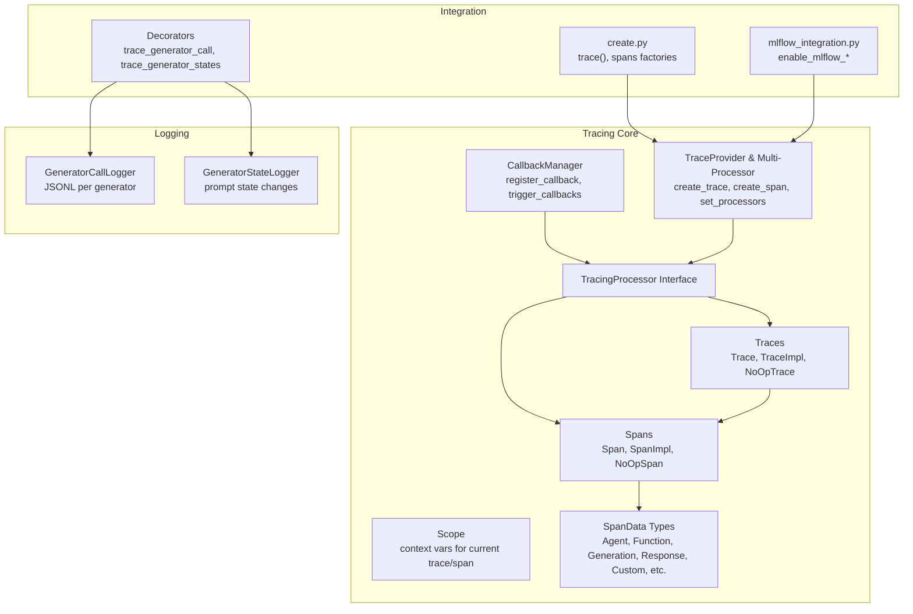
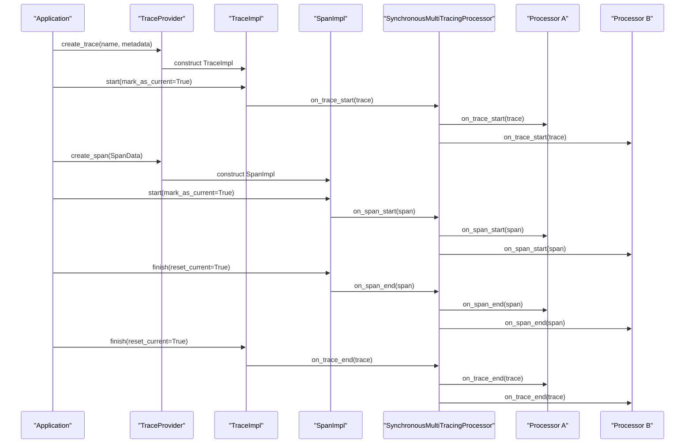
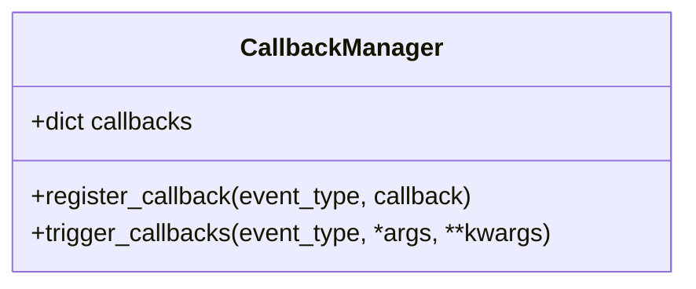
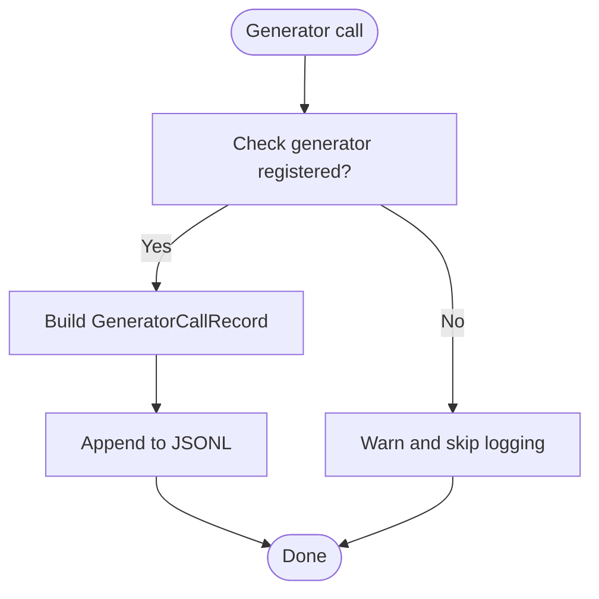
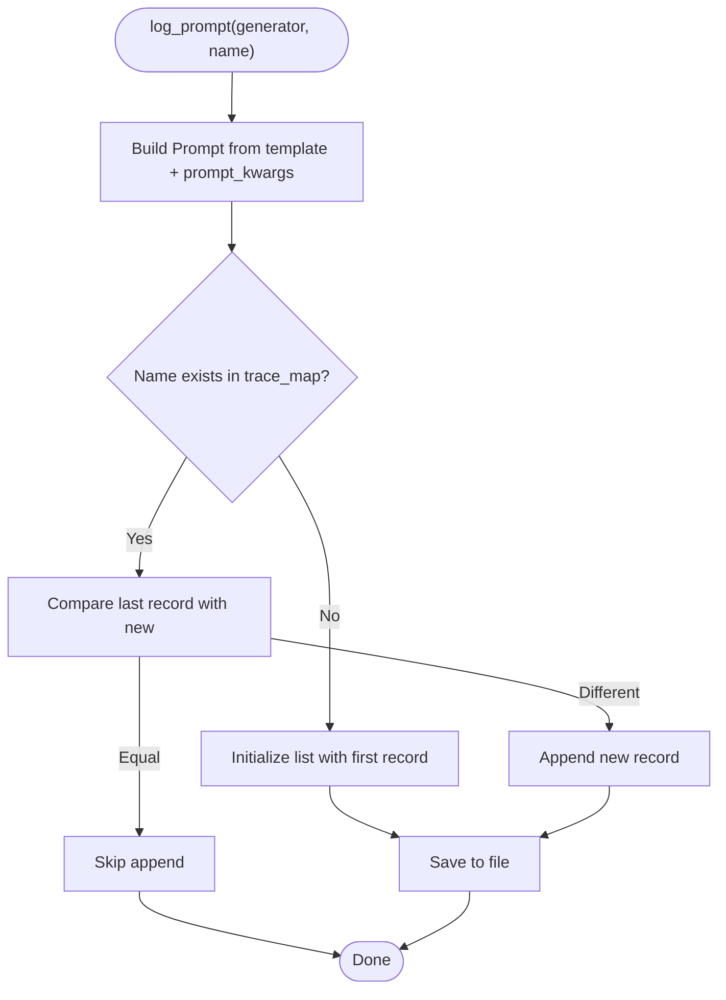
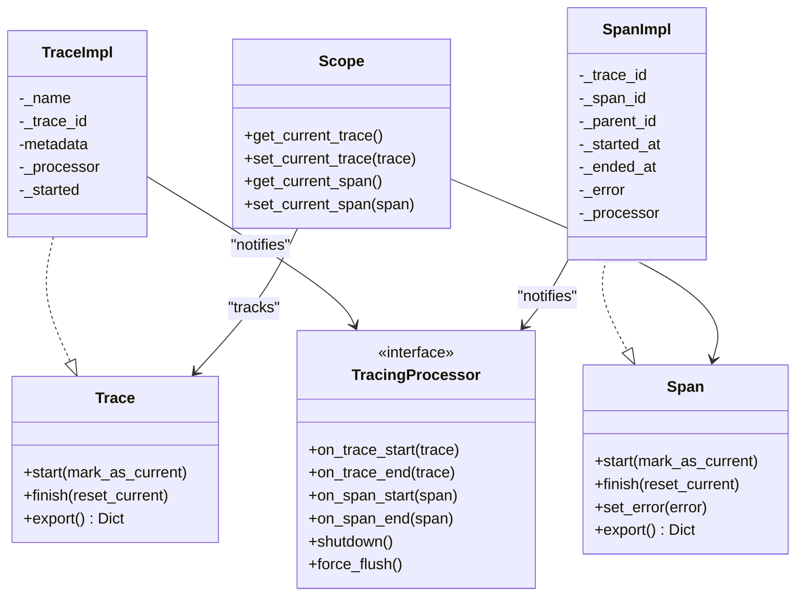
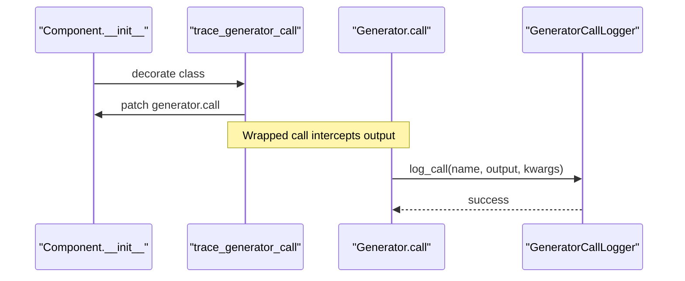
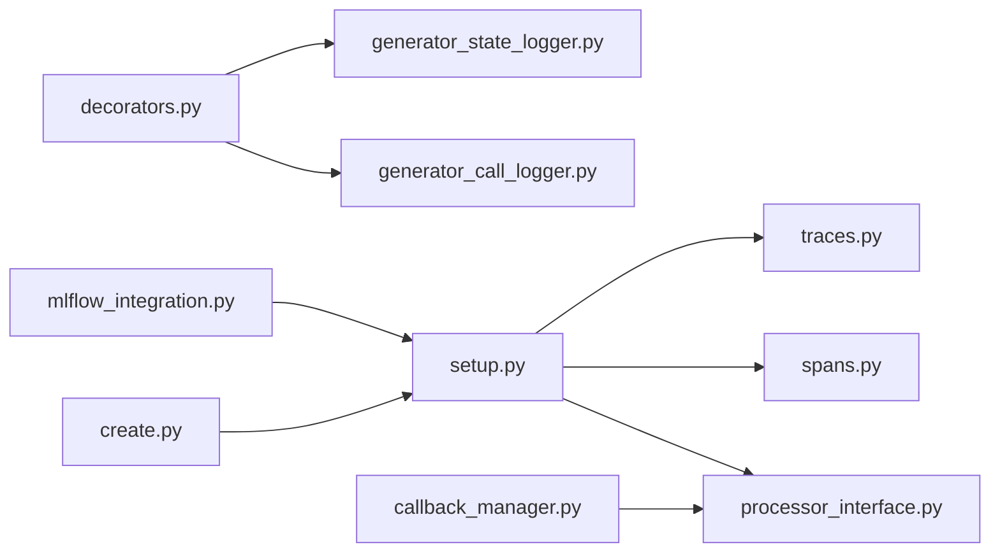

# Callback Management

<cite>
**Referenced Files in This Document**
- [callback_manager.py](file://adalflow/adalflow/tracing/callback_manager.py)
- [decorators.py](file://adalflow/adalflow/tracing/decorators.py)
- [generator_call_logger.py](file://adalflow/adalflow/tracing/generator_call_logger.py)
- [generator_state_logger.py](file://adalflow/adalflow/tracing/generator_state_logger.py)
- [processor_interface.py](file://adalflow/adalflow/tracing/processor_interface.py)
- [setup.py](file://adalflow/adalflow/tracing/setup.py)
- [spans.py](file://adalflow/adalflow/tracing/spans.py)
- [traces.py](file://adalflow/adalflow/tracing/traces.py)
- [scope.py](file://adalflow/adalflow/tracing/scope.py)
- [util.py](file://adalflow/adalflow/tracing/util.py)
- [span_data.py](file://adalflow/adalflow/tracing/span_data.py)
- [create.py](file://adalflow/adalflow/tracing/create.py)
- [mlflow_integration.py](file://adalflow/adalflow/tracing/mlflow_integration.py)
</cite>

## Table of Contents
1. [Introduction](#introduction)
2. [Project Structure](#project-structure)
3. [Core Components](#core-components)
4. [Architecture Overview](#architecture-overview)
5. [Detailed Component Analysis](#detailed-component-analysis)
6. [Dependency Analysis](#dependency-analysis)
7. [Performance Considerations](#performance-considerations)
8. [Troubleshooting Guide](#troubleshooting-guide)
9. [Conclusion](#conclusion)
10. [Appendices](#appendices)

## Introduction
This document explains AdalFlow’s Callback Management subsystem with a focus on event handling and logging for generator calls and state tracking. It covers:
- The CallbackManager architecture for registering and triggering callbacks
- Generator call logging and state tracking mechanisms
- Event processing and asynchronous handling considerations
- Practical examples for setting up callbacks, custom event handlers, and logging configurations
- How callbacks relate to component execution, performance monitoring, and debugging workflows
- Best practices for production monitoring, performance impact mitigation, error handling, and extending the callback system

## Project Structure
The tracing subsystem resides under adalflow/adalflow/tracing and provides:
- A lightweight callback mechanism for success/failure/complete events
- Decorators to instrument components for generator call and state logging
- A tracing framework built on traces, spans, and processors compatible with OpenAI Agents SDK patterns
- An MLflow integration layer for exporting traces to MLflow

**Diagram sources**
- [callback_manager.py](file://adalflow/adalflow/tracing/callback_manager.py#L4-L35)
- [spans.py](file://adalflow/adalflow/tracing/spans.py#L35-L289)
- [traces.py](file://adalflow/adalflow/tracing/traces.py#L24-L215)
- [scope.py](file://adalflow/adalflow/tracing/scope.py#L30-L99)
- [setup.py](file://adalflow/adalflow/tracing/setup.py#L28-L267)
- [processor_interface.py](file://adalflow/adalflow/tracing/processor_interface.py#L19-L80)
- [span_data.py](file://adalflow/adalflow/tracing/span_data.py#L18-L779)
- [generator_call_logger.py](file://adalflow/adalflow/tracing/generator_call_logger.py#L39-L145)
- [generator_state_logger.py](file://adalflow/adalflow/tracing/generator_state_logger.py#L32-L134)
- [decorators.py](file://adalflow/adalflow/tracing/decorators.py#L11-L243)
- [create.py](file://adalflow/adalflow/tracing/create.py#L33-L388)
- [mlflow_integration.py](file://adalflow/adalflow/tracing/mlflow_integration.py#L31-L352)

**Section sources**
- [callback_manager.py](file://adalflow/adalflow/tracing/callback_manager.py#L4-L35)
- [setup.py](file://adalflow/adalflow/tracing/setup.py#L100-L267)
- [spans.py](file://adalflow/adalflow/tracing/spans.py#L35-L289)
- [traces.py](file://adalflow/adalflow/tracing/traces.py#L24-L215)
- [scope.py](file://adalflow/adalflow/tracing/scope.py#L30-L99)
- [processor_interface.py](file://adalflow/adalflow/tracing/processor_interface.py#L19-L80)
- [span_data.py](file://adalflow/adalflow/tracing/span_data.py#L18-L779)
- [generator_call_logger.py](file://adalflow/adalflow/tracing/generator_call_logger.py#L39-L145)
- [generator_state_logger.py](file://adalflow/adalflow/tracing/generator_state_logger.py#L32-L134)
- [decorators.py](file://adalflow/adalflow/tracing/decorators.py#L11-L243)
- [create.py](file://adalflow/adalflow/tracing/create.py#L33-L388)
- [mlflow_integration.py](file://adalflow/adalflow/tracing/mlflow_integration.py#L31-L352)

## Core Components
- CallbackManager: Lightweight event bus supporting three event types (success, failure, complete). It registers callbacks and triggers them synchronously for a given event type.
- GeneratorCallLogger: Persists generator calls to JSONL files per generator with metadata and timestamps.
- GeneratorStateLogger: Tracks and logs prompt state changes to a single JSON file keyed by generator name, deduplicating unchanged states.
- TracingProcessor interface: Defines the contract for processors that receive trace/span lifecycle events.
- TraceProvider and SynchronousMultiTracingProcessor: Manage processors and forward lifecycle events to all registered processors.
- Spans and Traces: Hierarchical execution units with start/finish semantics and context propagation.
- SpanData types: Structured payload containers for different kinds of spans (agent, function, generation, response, custom, etc.).
- Decorators: Instrument components to automatically log generator calls and state changes.
- MLflow integration: Enables exporting traces to MLflow via a dedicated processor.

**Section sources**
- [callback_manager.py](file://adalflow/adalflow/tracing/callback_manager.py#L4-L35)
- [generator_call_logger.py](file://adalflow/adalflow/tracing/generator_call_logger.py#L39-L145)
- [generator_state_logger.py](file://adalflow/adalflow/tracing/generator_state_logger.py#L32-L134)
- [processor_interface.py](file://adalflow/adalflow/tracing/processor_interface.py#L19-L80)
- [setup.py](file://adalflow/adalflow/tracing/setup.py#L28-L267)
- [spans.py](file://adalflow/adalflow/tracing/spans.py#L35-L289)
- [traces.py](file://adalflow/adalflow/tracing/traces.py#L24-L215)
- [span_data.py](file://adalflow/adalflow/tracing/span_data.py#L18-L779)
- [decorators.py](file://adalflow/adalflow/tracing/decorators.py#L11-L243)
- [mlflow_integration.py](file://adalflow/adalflow/tracing/mlflow_integration.py#L31-L352)

## Architecture Overview
The tracing architecture follows OpenAI Agents SDK patterns:
- Traces represent top-level workflows; spans represent nested execution units.
- A TraceProvider manages current trace/span context and delegates lifecycle events to a multi-processor.
- SynchronousMultiTracingProcessor forwards events to all registered processors in order.
- SpanData encapsulates structured data for each span type.
- Decorators integrate logging into components by wrapping generator call methods and logging prompt state changes.

**Diagram sources**
- [setup.py](file://adalflow/adalflow/tracing/setup.py#L140-L222)
- [traces.py](file://adalflow/adalflow/tracing/traces.py#L171-L194)
- [spans.py](file://adalflow/adalflow/tracing/spans.py#L226-L261)
- [processor_interface.py](file://adalflow/adalflow/tracing/processor_interface.py#L19-L80)
- [setup.py](file://adalflow/adalflow/tracing/setup.py#L28-L98)

## Detailed Component Analysis

### CallbackManager
- Purpose: Centralized event bus for success, failure, and completion events.
- Registration: Accepts callable callbacks for supported event types.
- Triggering: Iterates registered callbacks for a given event type and invokes them with provided args/kwargs.
- Thread-safety: Not explicitly guarded; consider synchronization if used concurrently.

**Diagram sources**
- [callback_manager.py](file://adalflow/adalflow/tracing/callback_manager.py#L4-L35)

**Section sources**
- [callback_manager.py](file://adalflow/adalflow/tracing/callback_manager.py#L4-L35)

### Generator Call Logging
- Mechanism: Per-generator JSONL logging of prompt/model kwargs, input, output, and timestamp.
- Registration: Associates a generator name with a JSONL file; metadata persisted separately.
- Retrieval: Loads records from JSONL and deserializes to typed records.
- Usage: Intended for debugging and auditing generator calls; supports filtering by error-only mode.

**Diagram sources**
- [generator_call_logger.py](file://adalflow/adalflow/tracing/generator_call_logger.py#L123-L145)

**Section sources**
- [generator_call_logger.py](file://adalflow/adalflow/tracing/generator_call_logger.py#L39-L145)

### Generator State Tracking
- Mechanism: Logs prompt state changes to a single JSON file keyed by generator name.
- Deduplication: Compares serialized prompt states; only appends when changed.
- Persistence: Supports loading previous state history and saving incremental updates.

**Diagram sources**
- [generator_state_logger.py](file://adalflow/adalflow/tracing/generator_state_logger.py#L78-L111)

**Section sources**
- [generator_state_logger.py](file://adalflow/adalflow/tracing/generator_state_logger.py#L32-L134)

### Tracing and Span Lifecycle
- Trace: Root-level workflow with start/finish and context management.
- Span: Nested unit with parent/child relationships and error recording.
- Scope: Context variables for current trace/span propagation.
- SpanData: Structured payloads for different span types.

**Diagram sources**
- [traces.py](file://adalflow/adalflow/tracing/traces.py#L24-L215)
- [spans.py](file://adalflow/adalflow/tracing/spans.py#L35-L289)
- [scope.py](file://adalflow/adalflow/tracing/scope.py#L30-L99)
- [processor_interface.py](file://adalflow/adalflow/tracing/processor_interface.py#L19-L80)

**Section sources**
- [traces.py](file://adalflow/adalflow/tracing/traces.py#L24-L215)
- [spans.py](file://adalflow/adalflow/tracing/spans.py#L35-L289)
- [scope.py](file://adalflow/adalflow/tracing/scope.py#L30-L99)
- [processor_interface.py](file://adalflow/adalflow/tracing/processor_interface.py#L19-L80)

### Decorators for Callbacks and Logging
- trace_generator_call: Wraps generator call to log successful or error-only calls to JSONL.
- trace_generator_states: Logs prompt state changes for generator attributes in a component.

**Diagram sources**
- [decorators.py](file://adalflow/adalflow/tracing/decorators.py#L108-L243)
- [generator_call_logger.py](file://adalflow/adalflow/tracing/generator_call_logger.py#L123-L145)

**Section sources**
- [decorators.py](file://adalflow/adalflow/tracing/decorators.py#L11-L243)
- [generator_call_logger.py](file://adalflow/adalflow/tracing/generator_call_logger.py#L39-L145)
- [generator_state_logger.py](file://adalflow/adalflow/tracing/generator_state_logger.py#L32-L134)

### Asynchronous Callback Handling
- Current design: CallbackManager triggers callbacks synchronously in the calling thread.
- Implications: Blocking behavior; long-running callbacks can delay component execution.
- Recommendations:
  - Offload heavy work to worker threads or async tasks
  - Use batching to reduce I/O overhead
  - Consider non-blocking exporters for tracing processors

**Section sources**
- [callback_manager.py](file://adalflow/adalflow/tracing/callback_manager.py#L23-L35)
- [setup.py](file://adalflow/adalflow/tracing/setup.py#L28-L98)

### Practical Examples

- Registering callbacks
  - Use CallbackManager.register_callback to attach handlers for on_success, on_failure, on_complete.
  - Trigger callbacks via CallbackManager.trigger_callbacks with appropriate arguments.

- Custom event handlers
  - Implement a callable that accepts the same signature as the trigger invocation.
  - Attach to CallbackManager for centralized event routing.

- Logging configuration
  - Configure GeneratorCallLogger and GeneratorStateLogger directories and filenames.
  - Use decorators to auto-instrument components for call/state logging.

- Integrating with MLflow
  - Enable MLflow tracing via enable_mlflow_local or enable_mlflow_local_with_server.
  - Set processors globally through set_trace_processors.

**Section sources**
- [callback_manager.py](file://adalflow/adalflow/tracing/callback_manager.py#L12-L35)
- [generator_call_logger.py](file://adalflow/adalflow/tracing/generator_call_logger.py#L55-L145)
- [generator_state_logger.py](file://adalflow/adalflow/tracing/generator_state_logger.py#L48-L134)
- [decorators.py](file://adalflow/adalflow/tracing/decorators.py#L108-L243)
- [mlflow_integration.py](file://adalflow/adalflow/tracing/mlflow_integration.py#L36-L209)

## Dependency Analysis
- Coupling
  - TraceProvider depends on TracingProcessor and Scope; processors depend on spans/traces.
  - Decorators depend on GeneratorCallLogger and GeneratorStateLogger.
  - MLflow integration depends on the global TraceProvider and optional MLflow availability.
- Cohesion
  - Each module focuses on a single responsibility: callbacks, logging, tracing, or integration.
- External dependencies
  - MLflow (optional); OpenAI Agents SDK compatibility patterns.

**Diagram sources**
- [setup.py](file://adalflow/adalflow/tracing/setup.py#L100-L267)
- [processor_interface.py](file://adalflow/adalflow/tracing/processor_interface.py#L19-L80)
- [spans.py](file://adalflow/adalflow/tracing/spans.py#L35-L289)
- [traces.py](file://adalflow/adalflow/tracing/traces.py#L24-L215)
- [create.py](file://adalflow/adalflow/tracing/create.py#L33-L388)
- [mlflow_integration.py](file://adalflow/adalflow/tracing/mlflow_integration.py#L31-L352)
- [decorators.py](file://adalflow/adalflow/tracing/decorators.py#L11-L243)
- [generator_call_logger.py](file://adalflow/adalflow/tracing/generator_call_logger.py#L39-L145)
- [generator_state_logger.py](file://adalflow/adalflow/tracing/generator_state_logger.py#L32-L134)
- [callback_manager.py](file://adalflow/adalflow/tracing/callback_manager.py#L4-L35)

**Section sources**
- [setup.py](file://adalflow/adalflow/tracing/setup.py#L100-L267)
- [create.py](file://adalflow/adalflow/tracing/create.py#L33-L388)
- [mlflow_integration.py](file://adalflow/adalflow/tracing/mlflow_integration.py#L31-L352)
- [decorators.py](file://adalflow/adalflow/tracing/decorators.py#L11-L243)
- [callback_manager.py](file://adalflow/adalflow/tracing/callback_manager.py#L4-L35)

## Performance Considerations
- CallbackManager synchronous invocation can block execution; prefer offloading heavy work.
- GeneratorCallLogger writes JSONL per generator; ensure separate files per generator to avoid contention.
- GeneratorStateLogger serializes and compares prompt states; consider limiting frequency of state changes or batching updates.
- Tracing adds overhead through span creation and processor notifications; disable tracing in production via environment variable or provider flag when not needed.
- MLflow exporter introduces network/file I/O; tune batch sizes and flush intervals.

[No sources needed since this section provides general guidance]

## Troubleshooting Guide
- Unsupported event type in CallbackManager
  - Symptom: ValueError when registering or triggering callbacks with unsupported event type.
  - Resolution: Use supported event types: on_success, on_failure, on_complete.

- Generator not registered in GeneratorCallLogger
  - Symptom: FileNotFoundError or warning when attempting to log a call.
  - Resolution: Register the generator name before logging via register_generator.

- Empty or missing state log file
  - Symptom: Empty file or deserialization errors.
  - Resolution: Ensure the file exists and contains valid JSON; verify load logic handles empty files gracefully.

- Tracing disabled unexpectedly
  - Symptom: No traces/spans recorded.
  - Resolution: Check ADALFLOW_DISABLE_TRACING environment variable and provider disabled flag.

- MLflow not available
  - Symptom: Import error or warnings when enabling MLflow.
  - Resolution: Install MLflow; confirm server is reachable or use file-backed backend.

**Section sources**
- [callback_manager.py](file://adalflow/adalflow/tracing/callback_manager.py#L18-L21)
- [generator_call_logger.py](file://adalflow/adalflow/tracing/generator_call_logger.py#L114-L119)
- [generator_state_logger.py](file://adalflow/adalflow/tracing/generator_state_logger.py#L118-L128)
- [setup.py](file://adalflow/adalflow/tracing/setup.py#L103-L108)
- [mlflow_integration.py](file://adalflow/adalflow/tracing/mlflow_integration.py#L12-L22)

## Conclusion
AdalFlow’s Callback Management integrates a minimal event bus with robust logging for generator calls and state tracking, and a tracing framework aligned with OpenAI Agents SDK patterns. By leveraging decorators, processors, and exporters (including MLflow), teams can instrument components, monitor execution, and debug workflows effectively. For production, carefully manage callback performance, logging I/O, and tracing overhead, and adopt best practices for error handling and observability.

[No sources needed since this section summarizes without analyzing specific files]

## Appendices

### Extending the Callback System
- Implement custom processors
  - Implement TracingProcessor interface methods to receive trace/span lifecycle events.
  - Register processors via TraceProvider.set_processors or add via SynchronousMultiTracingProcessor.add_tracing_processor.

- Implement custom exporters
  - Implement TracingExporter.export to persist or transmit traces/spans.

- Extend CallbackManager
  - Add new event types and ensure consistent callback signatures across handlers.

**Section sources**
- [processor_interface.py](file://adalflow/adalflow/tracing/processor_interface.py#L19-L80)
- [setup.py](file://adalflow/adalflow/tracing/setup.py#L38-L98)

### Implementing Custom Logging Processors
- For tracing processors:
  - Implement on_trace_start/on_trace_end/on_span_start/on_span_end and export/shutdown/force_flush as needed.
  - Use create.py span factories to construct spans with appropriate SpanData types.

- For call/state logging:
  - Extend or compose GeneratorCallLogger and GeneratorStateLogger to write to custom sinks (e.g., databases, cloud storage).

**Section sources**
- [create.py](file://adalflow/adalflow/tracing/create.py#L181-L388)
- [span_data.py](file://adalflow/adalflow/tracing/span_data.py#L18-L779)
- [generator_call_logger.py](file://adalflow/adalflow/tracing/generator_call_logger.py#L39-L145)
- [generator_state_logger.py](file://adalflow/adalflow/tracing/generator_state_logger.py#L32-L134)