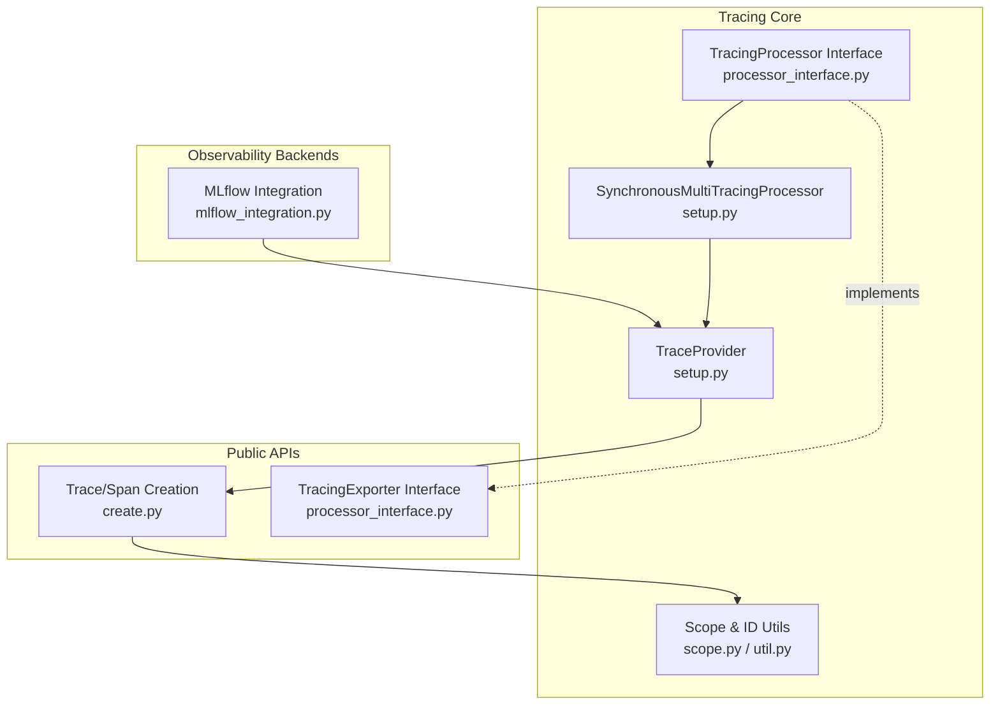
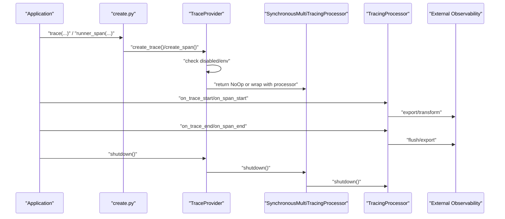
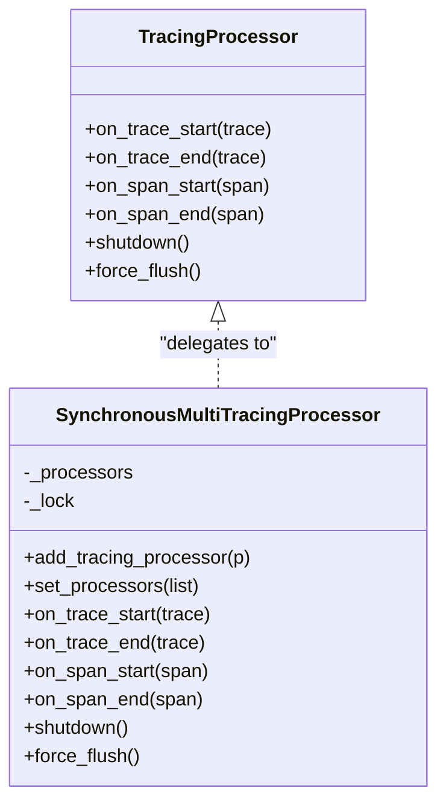
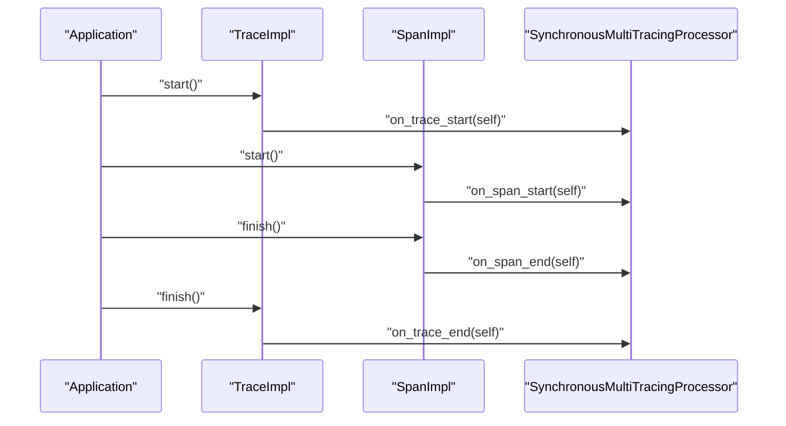
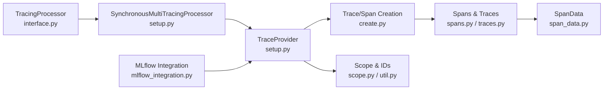

# Custom Tracing Processors

<cite>
**Referenced Files in This Document**
- [processor_interface.py](file://adalflow/adalflow/tracing/processor_interface.py)
- [setup.py](file://adalflow/adalflow/tracing/setup.py)
- [create.py](file://adalflow/adalflow/tracing/create.py)
- [spans.py](file://adalflow/adalflow/tracing/spans.py)
- [traces.py](file://adalflow/adalflow/tracing/traces.py)
- [scope.py](file://adalflow/adalflow/tracing/scope.py)
- [span_data.py](file://adalflow/adalflow/tracing/span_data.py)
- [mlflow_integration.py](file://adalflow/adalflow/tracing/mlflow_integration.py)
- [util.py](file://adalflow/adalflow/tracing/util.py)
- [test_tracing.py](file://adalflow/tests/test_tracing.py)
- [trace_generator.py](file://use_cases/tracing/trace_generator.py)
</cite>

## Table of Contents
1. [Introduction](#introduction)
2. [Project Structure](#project-structure)
3. [Core Components](#core-components)
4. [Architecture Overview](#architecture-overview)
5. [Detailed Component Analysis](#detailed-component-analysis)
6. [Dependency Analysis](#dependency-analysis)
7. [Performance Considerations](#performance-considerations)
8. [Troubleshooting Guide](#troubleshooting-guide)
9. [Conclusion](#conclusion)
10. [Appendices](#appendices)

## Introduction
This document focuses on extending AdalFlow’s tracing capabilities through Custom Tracing Processors. It explains the TracingProcessor interface, processor implementation patterns, and how to develop custom processors. It covers processor registration, event handling, and data transformation workflows. Practical examples demonstrate creating custom processors, chaining processors, and advanced tracing scenarios. It also addresses the processor lifecycle, error handling, performance optimization, testing methodologies, debugging techniques, production deployment considerations, and integration with external observability systems.

## Project Structure
The tracing subsystem is organized around a provider pattern with a global trace provider, synchronous multi-processor forwarding, and OpenAI Agents SDK-compatible interfaces for traces, spans, and span data. Convenience APIs expose functions to create traces and spans, manage processors, and integrate with MLflow.

**Diagram sources**
- [processor_interface.py](file://adalflow/adalflow/tracing/processor_interface.py#L19-L80)
- [setup.py](file://adalflow/adalflow/tracing/setup.py#L28-L241)
- [create.py](file://adalflow/adalflow/tracing/create.py#L33-L388)
- [scope.py](file://adalflow/adalflow/tracing/scope.py#L30-L99)
- [mlflow_integration.py](file://adalflow/adalflow/tracing/mlflow_integration.py#L31-L209)

**Section sources**
- [processor_interface.py](file://adalflow/adalflow/tracing/processor_interface.py#L1-L80)
- [setup.py](file://adalflow/adalflow/tracing/setup.py#L1-L267)
- [create.py](file://adalflow/adalflow/tracing/create.py#L1-L388)
- [scope.py](file://adalflow/adalflow/tracing/scope.py#L1-L99)
- [mlflow_integration.py](file://adalflow/adalflow/tracing/mlflow_integration.py#L1-L352)

## Core Components
- TracingProcessor: Defines the contract for processing trace and span lifecycle events, including on_trace_start, on_trace_end, on_span_start, on_span_end, shutdown, and force_flush.
- SynchronousMultiTracingProcessor: Forwards all events to a registered list of processors in order, enabling chaining and composition.
- TraceProvider: Central factory for traces and spans, honoring environment-based disabling and delegating to the multi-processor.
- Trace and Span: OpenAI Agents SDK-compatible abstractions with NoOp variants for disabled mode.
- SpanData: Extensible data models for different kinds of spans (runner, generator, tool, response, step, and custom).
- Public APIs: Functions to create traces and spans, manage processors, and toggle tracing globally.

Key responsibilities:
- Event delivery: Traces and spans emit lifecycle events that are forwarded to all registered processors.
- Global control: Environment variables and convenience functions allow enabling/disabling tracing and configuring processors.
- Compatibility: Interfaces align with OpenAI Agents SDK patterns for interoperability with existing backends.

**Section sources**
- [processor_interface.py](file://adalflow/adalflow/tracing/processor_interface.py#L19-L80)
- [setup.py](file://adalflow/adalflow/tracing/setup.py#L28-L241)
- [traces.py](file://adalflow/adalflow/tracing/traces.py#L24-L215)
- [spans.py](file://adalflow/adalflow/tracing/spans.py#L35-L289)
- [span_data.py](file://adalflow/adalflow/tracing/span_data.py#L18-L779)
- [create.py](file://adalflow/adalflow/tracing/create.py#L33-L388)

## Architecture Overview
The tracing architecture follows a provider-and-multi-processor model. Applications create traces and spans via public APIs. When a trace or span starts/ends, the provider delegates to the multi-processor, which iterates through registered processors in order. Each processor receives the event and can perform side effects (logging, exporting, transforming). Shutdown and flush operations propagate to all processors.

**Diagram sources**
- [create.py](file://adalflow/adalflow/tracing/create.py#L33-L388)
- [setup.py](file://adalflow/adalflow/tracing/setup.py#L100-L241)
- [spans.py](file://adalflow/adalflow/tracing/spans.py#L226-L261)
- [traces.py](file://adalflow/adalflow/tracing/traces.py#L171-L205)
- [processor_interface.py](file://adalflow/adalflow/tracing/processor_interface.py#L19-L80)

## Detailed Component Analysis

### TracingProcessor Interface and Implementation Patterns
- Contract: Implementations must handle lifecycle events and provide graceful shutdown and flush semantics.
- Thread-safety: The multi-processor uses a lock and immutable tuple to safely iterate over processors.
- Chaining: Multiple processors are supported; each receives all events in registration order.

Implementation patterns:
- Side-effect processors: Log events to files or streams.
- Transformation processors: Convert spans/traces into backend-specific formats.
- Export processors: Send data to external systems (e.g., MLflow).
- Composite processors: Combine multiple responsibilities (e.g., transform and export).

Lifecycle:
- on_trace_start/on_span_start: Prepare resources, allocate buffers, initialize state.
- on_trace_end/on_span_end: Finalize and persist state; avoid blocking or raising exceptions.
- shutdown: Release resources; tolerate logging system shutdown.
- force_flush: Immediately export buffered items.

**Section sources**
- [processor_interface.py](file://adalflow/adalflow/tracing/processor_interface.py#L19-L80)
- [setup.py](file://adalflow/adalflow/tracing/setup.py#L28-L98)

### Processor Registration and Management
- Global provider: Accessible via a proxy that lazily initializes the provider on first use.
- Register/add/set processors: Add single processors or replace the entire list; retrieval returns a copy to prevent mutation.
- Environment-based disabling: ADALFLOW_DISABLE_TRACING controls whether traces/spans are NoOp or real objects.

Best practices:
- Register processors early in application startup.
- Use set_trace_processors to replace the list for deterministic ordering.
- Keep processors lightweight and non-blocking in event handlers.

**Section sources**
- [setup.py](file://adalflow/adalflow/tracing/setup.py#L100-L140)
- [setup.py](file://adalflow/adalflow/tracing/setup.py#L243-L267)
- [create.py](file://adalflow/adalflow/tracing/create.py#L63-L87)

### Event Handling and Data Transformation Workflows
- Trace events: TraceImpl emits start/finish to the multi-processor.
- Span events: SpanImpl emits start/finish and supports error capture.
- Data export: Spans and traces provide export methods returning structured dictionaries.

Transformation workflows:
- Normalize span data to backend schema.
- Aggregate metrics (latency, tokens) per trace.
- Filter or enrich metadata before export.

**Section sources**
- [traces.py](file://adalflow/adalflow/tracing/traces.py#L132-L215)
- [spans.py](file://adalflow/adalflow/tracing/spans.py#L177-L289)
- [span_data.py](file://adalflow/adalflow/tracing/span_data.py#L18-L779)

### Practical Examples

#### Example 1: Custom Processor Creation
- Implement TracingProcessor and override lifecycle methods.
- Register the processor with add_trace_processor or set_trace_processors.
- Verify behavior using tests similar to the mock processor in the test suite.

Reference paths:
- [MockTracingProcessor](file://adalflow/tests/test_tracing.py#L32-L60)
- [add_trace_processor](file://adalflow/adalflow/tracing/__init__.py#L68-L71)
- [set_trace_processors](file://adalflow/adalflow/tracing/__init__.py#L63-L66)

**Section sources**
- [test_tracing.py](file://adalflow/tests/test_tracing.py#L32-L60)
- [__init__.py](file://adalflow/adalflow/tracing/__init__.py#L63-L71)

#### Example 2: Processor Chaining
- Register multiple processors; each receives all events in order.
- Validate that both processors receive trace and span events.

Reference paths:
- [Multiple processors test](file://adalflow/tests/test_tracing.py#L661-L681)

**Section sources**
- [test_tracing.py](file://adalflow/tests/test_tracing.py#L661-L681)

#### Example 3: Advanced Tracing Scenarios
- Nested spans: Parent-child relationships are inferred from active trace/span context.
- Updating span data during execution: Use update_attributes on AdalFlow span data classes.

Reference paths:
- [Nested spans test](file://adalflow/tests/test_tracing.py#L642-L660)
- [Span data update test](file://adalflow/tests/test_tracing.py#L682-L700)
- [AdalFlowRunnerSpanData.update_attributes](file://adalflow/adalflow/tracing/span_data.py#L461-L474)

**Section sources**
- [test_tracing.py](file://adalflow/tests/test_tracing.py#L642-L700)
- [span_data.py](file://adalflow/adalflow/tracing/span_data.py#L461-L474)

### Class and Event Flow Diagrams

#### TracingProcessor Lifecycle

**Diagram sources**
- [processor_interface.py](file://adalflow/adalflow/tracing/processor_interface.py#L19-L80)
- [setup.py](file://adalflow/adalflow/tracing/setup.py#L28-L98)

#### Trace and Span Event Flow

**Diagram sources**
- [traces.py](file://adalflow/adalflow/tracing/traces.py#L171-L205)
- [spans.py](file://adalflow/adalflow/tracing/spans.py#L226-L261)
- [setup.py](file://adalflow/adalflow/tracing/setup.py#L52-L97)

## Dependency Analysis
The tracing subsystem exhibits low coupling and high cohesion:
- TracingProcessor is the primary extension point; implementations depend only on the provided interfaces.
- SynchronousMultiTracingProcessor centralizes event distribution, minimizing coupling between processors.
- TraceProvider encapsulates environment checks and delegation, keeping public APIs simple.
- SpanData classes decouple data modeling from processors, enabling flexible transformations.

Potential pitfalls:
- Blocking operations in on_span_end/on_trace_end can degrade performance.
- Exceptions in processors can disrupt downstream processors; consider isolation.

**Diagram sources**
- [processor_interface.py](file://adalflow/adalflow/tracing/processor_interface.py#L19-L80)
- [setup.py](file://adalflow/adalflow/tracing/setup.py#L28-L241)
- [create.py](file://adalflow/adalflow/tracing/create.py#L33-L388)
- [spans.py](file://adalflow/adalflow/tracing/spans.py#L35-L289)
- [traces.py](file://adalflow/adalflow/tracing/traces.py#L24-L215)
- [span_data.py](file://adalflow/adalflow/tracing/span_data.py#L18-L779)
- [scope.py](file://adalflow/adalflow/tracing/scope.py#L30-L99)
- [util.py](file://adalflow/adalflow/tracing/util.py#L15-L33)
- [mlflow_integration.py](file://adalflow/adalflow/tracing/mlflow_integration.py#L31-L209)

**Section sources**
- [processor_interface.py](file://adalflow/adalflow/tracing/processor_interface.py#L19-L80)
- [setup.py](file://adalflow/adalflow/tracing/setup.py#L28-L241)
- [create.py](file://adalflow/adalflow/tracing/create.py#L33-L388)
- [spans.py](file://adalflow/adalflow/tracing/spans.py#L35-L289)
- [traces.py](file://adalflow/adalflow/tracing/traces.py#L24-L215)
- [span_data.py](file://adalflow/adalflow/tracing/span_data.py#L18-L779)
- [scope.py](file://adalflow/adalflow/tracing/scope.py#L30-L99)
- [util.py](file://adalflow/adalflow/tracing/util.py#L15-L33)
- [mlflow_integration.py](file://adalflow/adalflow/tracing/mlflow_integration.py#L31-L209)

## Performance Considerations
- Disable tracing in production when not needed via environment variable or convenience functions to minimize overhead.
- Avoid heavy computations in event handlers; defer or batch work.
- Use force_flush judiciously; excessive flushing increases I/O cost.
- Prefer non-blocking exporters; offload to async workers if necessary.
- Keep processors stateless where possible to reduce contention.

[No sources needed since this section provides general guidance]

## Troubleshooting Guide
Common issues and remedies:
- No active trace when creating spans: Ensure a trace is active or explicitly pass a parent.
- Disabled tracing unexpectedly: Check environment variable and global toggles.
- Processor not receiving events: Verify registration order and that tracing is enabled.
- Shutdown errors: Processors should tolerate logging system shutdown.

Reference paths:
- [Disabled behavior tests](file://adalflow/tests/test_tracing.py#L96-L118)
- [Environment variable tests](file://adalflow/tests/test_tracing.py#L120-L260)
- [Processor shutdown test](file://adalflow/tests/test_tracing.py#L717-L726)

**Section sources**
- [test_tracing.py](file://adalflow/tests/test_tracing.py#L96-L118)
- [test_tracing.py](file://adalflow/tests/test_tracing.py#L120-L260)
- [test_tracing.py](file://adalflow/tests/test_tracing.py#L717-L726)

## Conclusion
AdalFlow’s tracing system provides a robust, extensible foundation for observability. By implementing TracingProcessor, developers can integrate custom processors to transform, filter, and export trace and span data. The synchronous multi-processor enables chaining, while the provider model centralizes control and compatibility with OpenAI Agents SDK patterns. Following the guidelines in this document will help you build reliable, performant, and maintainable tracing extensions.

[No sources needed since this section summarizes without analyzing specific files]

## Appendices

### Processor Testing Methodologies
- Unit tests: Use a mock processor to assert event counts and argument equality.
- Integration tests: Validate chained processors and nested spans.
- Performance tests: Measure overhead with tracing disabled/enabled and many spans.

Reference paths:
- [MockTracingProcessor](file://adalflow/tests/test_tracing.py#L32-L60)
- [Multiple processors test](file://adalflow/tests/test_tracing.py#L661-L681)
- [Nested spans test](file://adalflow/tests/test_tracing.py#L642-L660)
- [Performance test](file://adalflow/tests/test_tracing.py#L728-L782)

**Section sources**
- [test_tracing.py](file://adalflow/tests/test_tracing.py#L32-L60)
- [test_tracing.py](file://adalflow/tests/test_tracing.py#L642-L782)

### Debugging Techniques
- Enable verbose logging for tracing components.
- Inspect exported dictionaries from spans/traces to validate data transformation.
- Use context managers to ensure spans are properly started and finished.

Reference paths:
- [Spans export](file://adalflow/adalflow/tracing/spans.py#L278-L289)
- [Traces export](file://adalflow/adalflow/tracing/traces.py#L207-L215)

**Section sources**
- [spans.py](file://adalflow/adalflow/tracing/spans.py#L278-L289)
- [traces.py](file://adalflow/adalflow/tracing/traces.py#L207-L215)

### Production Deployment Considerations
- Environment-based toggling: Use ADALFLOW_DISABLE_TRACING to control tracing globally.
- MLflow integration: Configure tracking URIs and experiments; optionally auto-start a server.
- API keys and secrets: Use environment variables for secure configuration.

Reference paths:
- [Environment variable handling](file://adalflow/adalflow/tracing/setup.py#L103-L108)
- [MLflow enable/disable functions](file://adalflow/adalflow/tracing/mlflow_integration.py#L31-L209)
- [API key environment variable](file://adalflow/adalflow/tracing/__init__.py#L89-L98)

**Section sources**
- [setup.py](file://adalflow/adalflow/tracing/setup.py#L103-L108)
- [mlflow_integration.py](file://adalflow/adalflow/tracing/mlflow_integration.py#L31-L209)
- [__init__.py](file://adalflow/adalflow/tracing/__init__.py#L89-L98)

### Processor Architecture Guidelines
- Keep processors pure and idempotent where possible.
- Separate concerns: one processor for transformation, another for export.
- Use span_data.update_attributes for dynamic updates during execution.

Reference paths:
- [AdalFlow span data update methods](file://adalflow/adalflow/tracing/span_data.py#L461-L775)

**Section sources**
- [span_data.py](file://adalflow/adalflow/tracing/span_data.py#L461-L775)

### Data Serialization and Interoperability
- Export dictionaries from spans/traces for backend compatibility.
- Align span data with OpenAI Agents SDK formats for third-party integrations.

Reference paths:
- [Spans export](file://adalflow/adalflow/tracing/spans.py#L278-L289)
- [Traces export](file://adalflow/adalflow/tracing/traces.py#L207-L215)
- [SpanData export](file://adalflow/adalflow/tracing/span_data.py#L24-L32)

**Section sources**
- [spans.py](file://adalflow/adalflow/tracing/spans.py#L278-L289)
- [traces.py](file://adalflow/adalflow/tracing/traces.py#L207-L215)
- [span_data.py](file://adalflow/adalflow/tracing/span_data.py#L24-L32)

### Example: Decorator-based Generator Tracing
While not a TracingProcessor, decorator-based tracing can complement custom processors by capturing generator state and call logs.

Reference paths:
- [Decorator usage example](file://use_cases/tracing/trace_generator.py#L8-L10)

**Section sources**
- [trace_generator.py](file://use_cases/tracing/trace_generator.py#L8-L10)