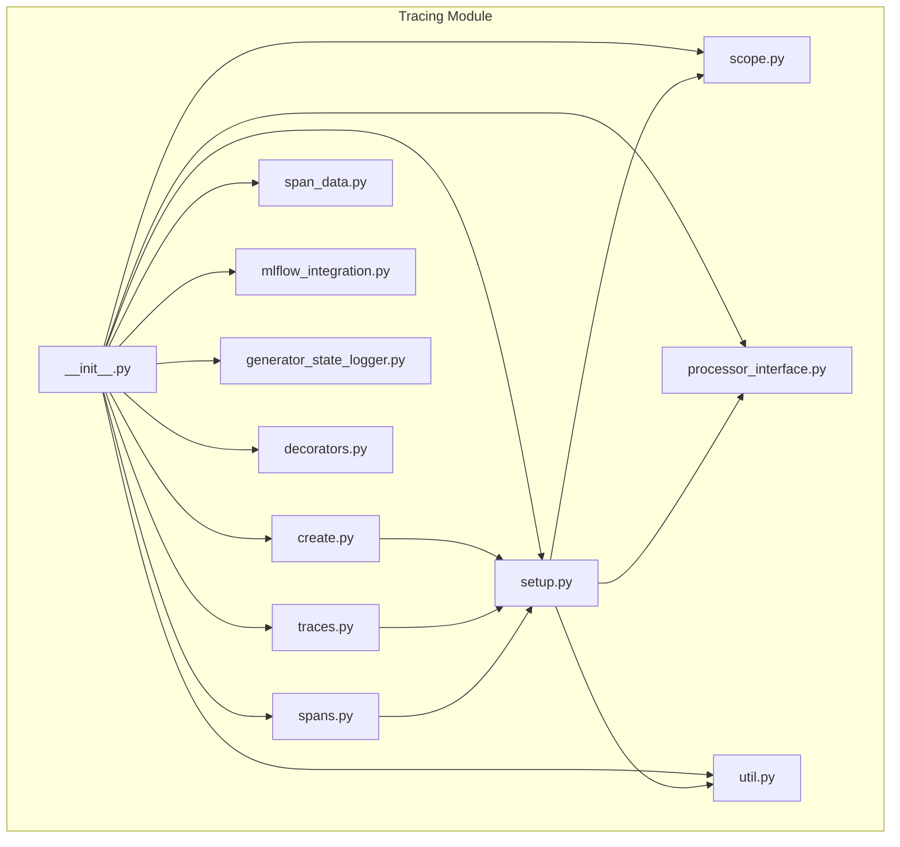
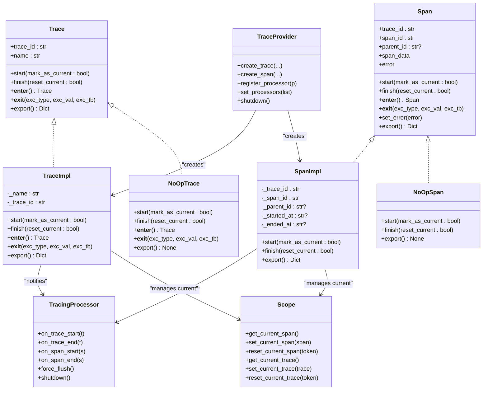
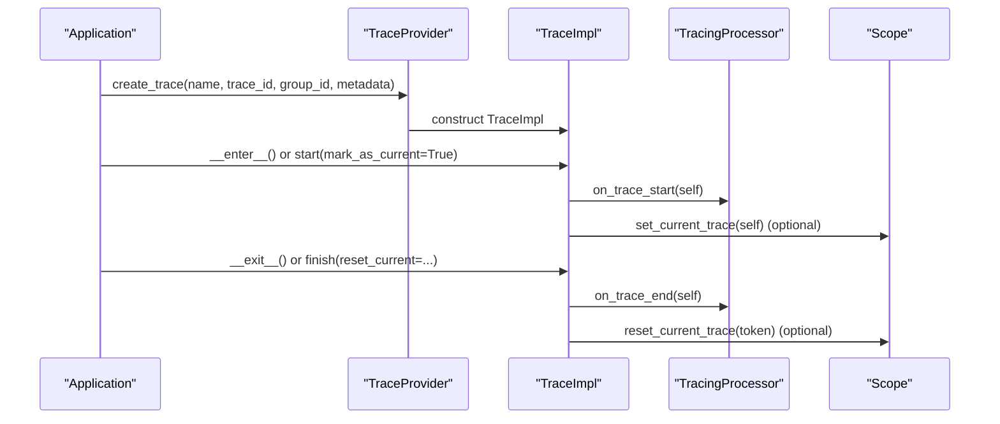
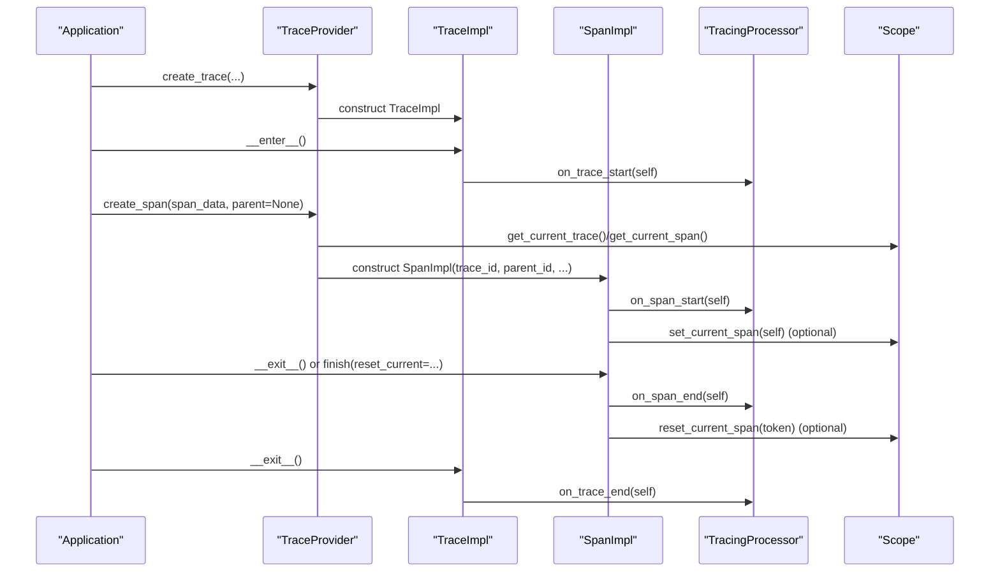
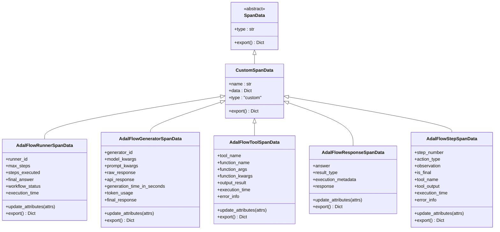
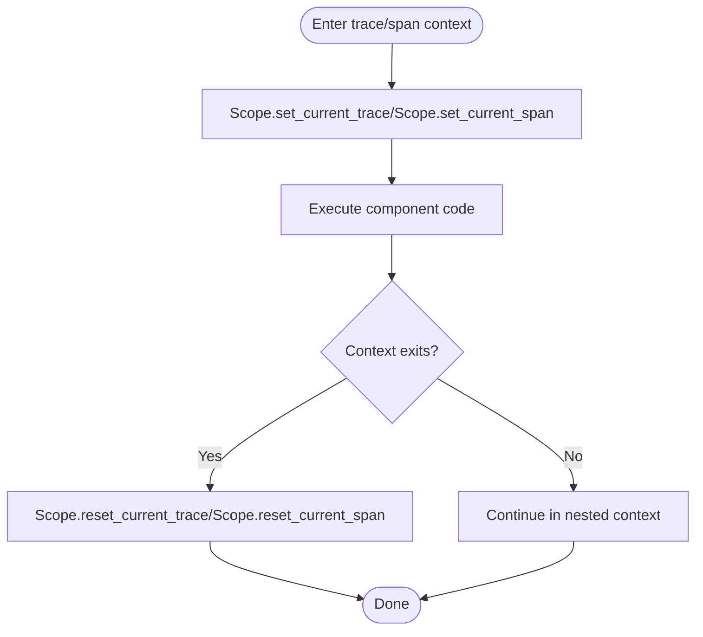
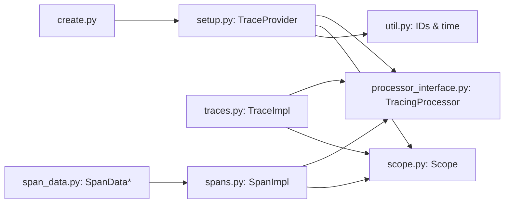

# Distributed Tracing

<cite>
**Referenced Files in This Document**
- [__init__.py](file://adalflow/adalflow/tracing/__init__.py)
- [traces.py](file://adalflow/adalflow/tracing/traces.py)
- [spans.py](file://adalflow/adalflow/tracing/spans.py)
- [scope.py](file://adalflow/adalflow/tracing/scope.py)
- [create.py](file://adalflow/adalflow/tracing/create.py)
- [span_data.py](file://adalflow/adalflow/tracing/span_data.py)
- [setup.py](file://adalflow/adalflow/tracing/setup.py)
- [processor_interface.py](file://adalflow/adalflow/tracing/processor_interface.py)
- [util.py](file://adalflow/adalflow/tracing/util.py)
- [mlflow_integration.py](file://adalflow/adalflow/tracing/mlflow_integration.py)
- [test_tracing.py](file://adalflow/tests/test_tracing.py)
- [generator_state_logger.py](file://adalflow/adalflow/tracing/generator_state_logger.py)
- [decorators.py](file://adalflow/adalflow/tracing/decorators.py)
</cite>

## Table of Contents
1. [Introduction](#introduction)
2. [Project Structure](#project-structure)
3. [Core Components](#core-components)
4. [Architecture Overview](#architecture-overview)
5. [Detailed Component Analysis](#detailed-component-analysis)
6. [Dependency Analysis](#dependency-analysis)
7. [Performance Considerations](#performance-considerations)
8. [Troubleshooting Guide](#troubleshooting-guide)
9. [Conclusion](#conclusion)
10. [Appendices](#appendices)

## Introduction
This document explains AdalFlow’s distributed tracing infrastructure with a focus on the OpenAI Agents SDK-compatible design. It covers the Trace abstract base class, TraceImpl implementation, and NoOpTrace for disabled tracing. It documents span creation, trace lifecycle management, and context propagation through the Scope system. Practical examples demonstrate trace creation, span nesting, and trace export functionality. It also explains the OpenAI Agents SDK compatibility layer, how traces integrate with component execution, and provides guidance for configuration, debugging, and production deployment.

## Project Structure
The tracing subsystem resides under adalflow/adalflow/tracing and exposes a public API via the module’s __init__.py. Key modules include:
- traces.py: Defines Trace, TraceImpl, and NoOpTrace
- spans.py: Defines Span, SpanImpl, and NoOpSpan
- scope.py: Provides context propagation via contextvars
- create.py: Factory functions for creating traces and spans
- span_data.py: Data models for spans mapped to OpenAI formats
- setup.py: Global provider, multi-processor, and environment-driven disabling
- processor_interface.py: TracingProcessor and TracingExporter interfaces
- util.py: ID generation and time formatting utilities
- mlflow_integration.py: Helpers to enable MLflow tracing
- test_tracing.py: Comprehensive unit tests validating behavior
- generator_state_logger.py and decorators.py: Legacy generator tracing utilities

**Diagram sources**
- [__init__.py](file://adalflow/adalflow/tracing/__init__.py#L1-L147)
- [traces.py](file://adalflow/adalflow/tracing/traces.py#L1-L215)
- [spans.py](file://adalflow/adalflow/tracing/spans.py#L1-L289)
- [scope.py](file://adalflow/adalflow/tracing/scope.py#L1-L99)
- [create.py](file://adalflow/adalflow/tracing/create.py#L1-L388)
- [span_data.py](file://adalflow/adalflow/tracing/span_data.py#L1-L779)
- [setup.py](file://adalflow/adalflow/tracing/setup.py#L1-L267)
- [processor_interface.py](file://adalflow/adalflow/tracing/processor_interface.py#L1-L80)
- [util.py](file://adalflow/adalflow/tracing/util.py#L1-L33)
- [mlflow_integration.py](file://adalflow/adalflow/tracing/mlflow_integration.py#L1-L352)
- [generator_state_logger.py](file://adalflow/adalflow/tracing/generator_state_logger.py#L1-L134)
- [decorators.py](file://adalflow/adalflow/tracing/decorators.py#L1-L243)

**Section sources**
- [__init__.py](file://adalflow/adalflow/tracing/__init__.py#L1-L147)

## Core Components
- Trace: Abstract base for logical workflows. Supports manual start/finish and context-manager usage. Exposes trace_id, name, and export.
- TraceImpl: Real implementation that notifies processors on start/end and manages current context when requested.
- NoOpTrace: Disabled implementation that does nothing and returns None on export.
- Span: Abstract base for timed units of work with parent-child relationships. Supports start/finish, error recording, and export.
- SpanImpl: Real implementation that records timestamps, parent IDs, and errors, and notifies processors.
- NoOpSpan: Disabled implementation with minimal overhead.
- Scope: ContextVar-based current span/trace holder enabling cross-component visibility.
- TraceProvider: Central factory for traces and spans, honoring environment-driven disabling and parent resolution.
- TracingProcessor/TracingExporter: Interfaces for exporting and processing traces/spans.
- SpanData: Extensible data models aligned with OpenAI’s formats, including AdalFlow-specific variants.

**Section sources**
- [traces.py](file://adalflow/adalflow/tracing/traces.py#L24-L215)
- [spans.py](file://adalflow/adalflow/tracing/spans.py#L35-L289)
- [scope.py](file://adalflow/adalflow/tracing/scope.py#L30-L99)
- [setup.py](file://adalflow/adalflow/tracing/setup.py#L100-L223)
- [processor_interface.py](file://adalflow/adalflow/tracing/processor_interface.py#L19-L80)
- [span_data.py](file://adalflow/adalflow/tracing/span_data.py#L18-L779)

## Architecture Overview
The tracing architecture follows OpenAI Agents SDK patterns and integrates with MLflow via a dedicated processor. The global TraceProvider coordinates creation, context propagation, and processor dispatch. Utilities provide deterministic IDs and timestamps.

**Diagram sources**
- [traces.py](file://adalflow/adalflow/tracing/traces.py#L24-L215)
- [spans.py](file://adalflow/adalflow/tracing/spans.py#L35-L289)
- [setup.py](file://adalflow/adalflow/tracing/setup.py#L100-L223)
- [processor_interface.py](file://adalflow/adalflow/tracing/processor_interface.py#L19-L80)
- [scope.py](file://adalflow/adalflow/tracing/scope.py#L30-L99)

## Detailed Component Analysis

### Trace and TraceImpl Lifecycle
- Trace defines the contract for workflow-level tracing with context-manager support and explicit start/finish semantics.
- TraceImpl delegates to a TracingProcessor on start/end and optionally marks itself as the current trace in Scope.
- NoOpTrace avoids all processing and returns None on export.

**Diagram sources**
- [traces.py](file://adalflow/adalflow/tracing/traces.py#L132-L215)
- [setup.py](file://adalflow/adalflow/tracing/setup.py#L140-L166)
- [scope.py](file://adalflow/adalflow/tracing/scope.py#L52-L66)

**Section sources**
- [traces.py](file://adalflow/adalflow/tracing/traces.py#L24-L215)
- [setup.py](file://adalflow/adalflow/tracing/setup.py#L140-L166)

### Span Creation and Nesting
- SpanImpl records timestamps, parent IDs, and errors, notifying processors on start/end.
- Parent resolution logic in TraceProvider determines trace_id and parent_id based on current context or explicit parent.
- NoOpSpan is returned when tracing is disabled or when parent is NoOp.

**Diagram sources**
- [spans.py](file://adalflow/adalflow/tracing/spans.py#L177-L289)
- [setup.py](file://adalflow/adalflow/tracing/setup.py#L167-L223)
- [scope.py](file://adalflow/adalflow/tracing/scope.py#L30-L66)

**Section sources**
- [spans.py](file://adalflow/adalflow/tracing/spans.py#L177-L289)
- [create.py](file://adalflow/adalflow/tracing/create.py#L134-L388)
- [setup.py](file://adalflow/adalflow/tracing/setup.py#L167-L223)

### Span Data Models and Export
- SpanData is an abstract base for span payloads.
- AdalFlow-specific span data classes (Runner, Generator, Tool, Response, Step) wrap a data dictionary and expose a type and export method.
- Export returns a normalized representation suitable for processors and backends.

**Diagram sources**
- [span_data.py](file://adalflow/adalflow/tracing/span_data.py#L18-L779)

**Section sources**
- [span_data.py](file://adalflow/adalflow/tracing/span_data.py#L408-L779)

### Context Propagation with Scope
- Scope uses contextvars to maintain the current span and trace per execution context.
- set_current_span/set_current_trace return tokens for later resetting, ensuring proper cleanup.

**Diagram sources**
- [scope.py](file://adalflow/adalflow/tracing/scope.py#L30-L99)

**Section sources**
- [scope.py](file://adalflow/adalflow/tracing/scope.py#L30-L99)

### OpenAI Agents SDK Compatibility Layer
- The module aligns with OpenAI Agents SDK patterns for spans, traces, and processors.
- SpanData types mirror OpenAI’s formats (e.g., agent, function, generation, response, handoff) while extending with CustomSpanData and AdalFlow-specific variants.
- Export methods normalize data for processors/backends.

**Section sources**
- [spans.py](file://adalflow/adalflow/tracing/spans.py#L35-L106)
- [span_data.py](file://adalflow/adalflow/tracing/span_data.py#L35-L197)

### Practical Examples

#### Trace Creation and Export
- Create a trace with a workflow name, optional group_id, and metadata.
- Use as context manager or call start/finish manually.
- Export returns a structured dictionary for downstream processors.

**Section sources**
- [create.py](file://adalflow/adalflow/tracing/create.py#L33-L77)
- [traces.py](file://adalflow/adalflow/tracing/traces.py#L132-L215)

#### Span Nesting and Parent Resolution
- Create runner, generator, tool, response, and step spans within a trace.
- Parent is inferred from current context if not provided; otherwise explicitly passed.
- Nested spans inherit parent_id and share trace_id.

**Section sources**
- [create.py](file://adalflow/adalflow/tracing/create.py#L134-L388)
- [setup.py](file://adalflow/adalflow/tracing/setup.py#L167-L223)

#### Trace Export Functionality
- TraceImpl.export returns an object with id, workflow_name, group_id, and metadata.
- SpanImpl.export returns an object with ids, timestamps, parent_id, span_data, and error.

**Section sources**
- [traces.py](file://adalflow/adalflow/tracing/traces.py#L207-L215)
- [spans.py](file://adalflow/adalflow/tracing/spans.py#L278-L289)

### Legacy Generator Tracing
- GeneratorStateLogger persists prompt state changes to JSON for debugging.
- Decorators trace_generator_states and trace_generator_call wrap components to log generator state transitions and calls (optionally error-only).

**Section sources**
- [generator_state_logger.py](file://adalflow/adalflow/tracing/generator_state_logger.py#L32-L134)
- [decorators.py](file://adalflow/adalflow/tracing/decorators.py#L11-L243)

## Dependency Analysis
- TraceProvider aggregates processors and routes lifecycle events to all registered processors.
- create.py functions delegate to TraceProvider for creation and rely on Scope for parent inference.
- SpanImpl and TraceImpl depend on TracingProcessor and Scope.
- Utilities provide deterministic IDs and ISO-formatted timestamps.

**Diagram sources**
- [create.py](file://adalflow/adalflow/tracing/create.py#L1-L388)
- [setup.py](file://adalflow/adalflow/tracing/setup.py#L100-L223)
- [processor_interface.py](file://adalflow/adalflow/tracing/processor_interface.py#L19-L80)
- [scope.py](file://adalflow/adalflow/tracing/scope.py#L30-L99)
- [util.py](file://adalflow/adalflow/tracing/util.py#L15-L33)
- [traces.py](file://adalflow/adalflow/tracing/traces.py#L132-L215)
- [spans.py](file://adalflow/adalflow/tracing/spans.py#L177-L289)
- [span_data.py](file://adalflow/adalflow/tracing/span_data.py#L18-L779)

**Section sources**
- [setup.py](file://adalflow/adalflow/tracing/setup.py#L100-L223)
- [create.py](file://adalflow/adalflow/tracing/create.py#L1-L388)

## Performance Considerations
- Disabled tracing: When tracing is disabled (via environment or explicit flag), TraceImpl and SpanImpl become NoOp variants, minimizing overhead.
- Minimal allocations: NoOpTrace and NoOpSpan avoid processor notifications and context mutations.
- Batch exports: Multi-processor forwards events to all processors; keep the number of processors reasonable to avoid contention.
- Timestamps: ISO timestamps are generated per start/finish; ensure processors batch writes to reduce I/O overhead.
- Memory footprint: SpanData stores attributes in dictionaries; avoid excessively large payloads in metadata or span_data.

[No sources needed since this section provides general guidance]

## Troubleshooting Guide
Common issues and resolutions:
- No active trace when creating spans: Ensure a trace is active or explicitly pass a parent. The provider logs an error and returns NoOpSpan when no active trace exists.
- Tracing appears inactive: Verify ADALFLOW_DISABLE_TRACING is not set to true or 1. Also confirm processors are registered and not filtered out.
- Context leaks: Ensure spans and traces are exited properly; context resets occur on exit unless GeneratorExit is detected.
- Export not appearing: Confirm processors implement force_flush and shutdown correctly; call shutdown to flush buffered events.

**Section sources**
- [setup.py](file://adalflow/adalflow/tracing/setup.py#L177-L223)
- [spans.py](file://adalflow/adalflow/tracing/spans.py#L255-L262)
- [traces.py](file://adalflow/adalflow/tracing/traces.py#L204-L206)
- [test_tracing.py](file://adalflow/tests/test_tracing.py#L535-L782)

## Conclusion
AdalFlow’s tracing system provides a robust, OpenAI Agents SDK-compatible foundation for observability. The Trace/TraceImpl and Span/SpanImpl abstractions cleanly separate concerns, while Scope enables seamless context propagation. The TraceProvider centralizes creation and processor coordination, and utilities ensure deterministic identifiers and timestamps. With MLflow integration and legacy generator tracing helpers, teams can adopt tracing incrementally and scale to production-grade deployments.

[No sources needed since this section summarizes without analyzing specific files]

## Appendices

### Configuration and Deployment Strategies
- Environment-driven disabling: Use ADALFLOW_DISABLE_TRACING to globally disable tracing in CI or low-overhead environments.
- Processor registration: Register one or more TracingProcessor instances to forward events to your backend.
- MLflow integration: Use enable_mlflow_local or enable_mlflow_local_with_server to connect to MLflow; the latter can auto-start a server and fall back to a local file store.
- API keys: set_tracing_export_api_key stores credentials in environment variables for compatibility.

**Section sources**
- [setup.py](file://adalflow/adalflow/tracing/setup.py#L103-L109)
- [mlflow_integration.py](file://adalflow/adalflow/tracing/mlflow_integration.py#L36-L208)
- [__init__.py](file://adalflow/adalflow/tracing/__init__.py#L89-L98)

### Debugging Workflows
- Use context managers for traces and spans to ensure lifecycle events fire deterministically.
- Leverage update_attributes on AdalFlow span data classes to enrich spans during execution.
- For generator debugging, apply trace_generator_states or trace_generator_call decorators to capture prompt/state changes and call outcomes.

**Section sources**
- [spans.py](file://adalflow/adalflow/tracing/spans.py#L251-L262)
- [span_data.py](file://adalflow/adalflow/tracing/span_data.py#L461-L474)
- [decorators.py](file://adalflow/adalflow/tracing/decorators.py#L11-L243)