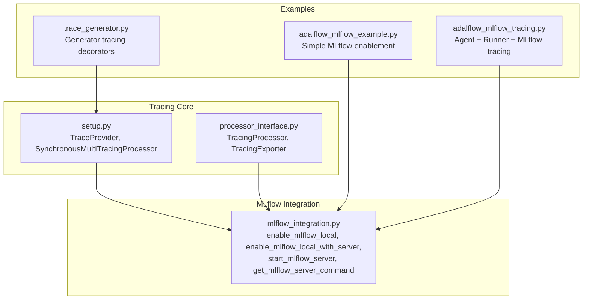
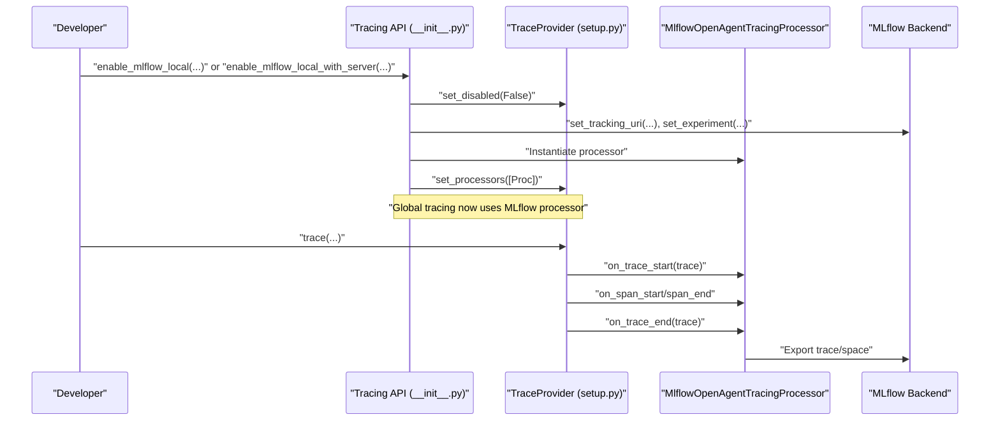
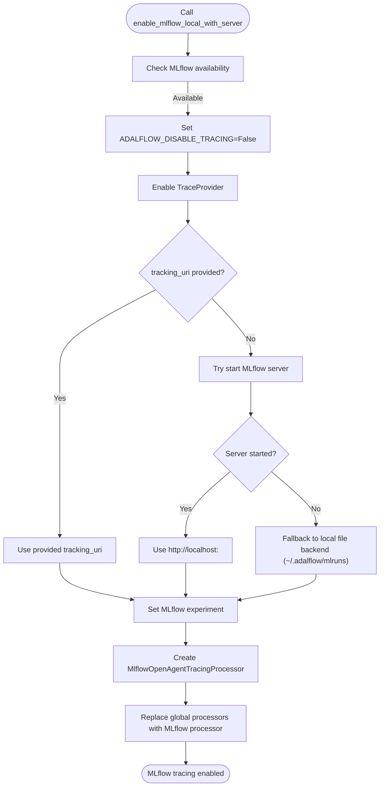
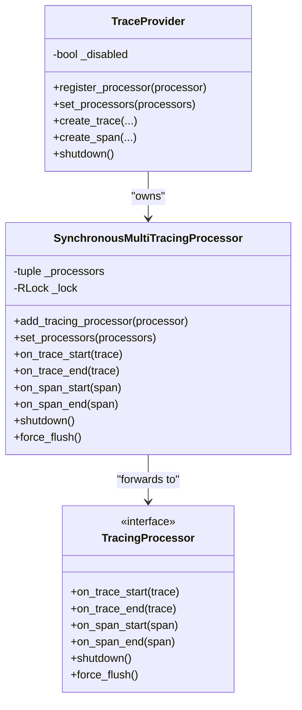
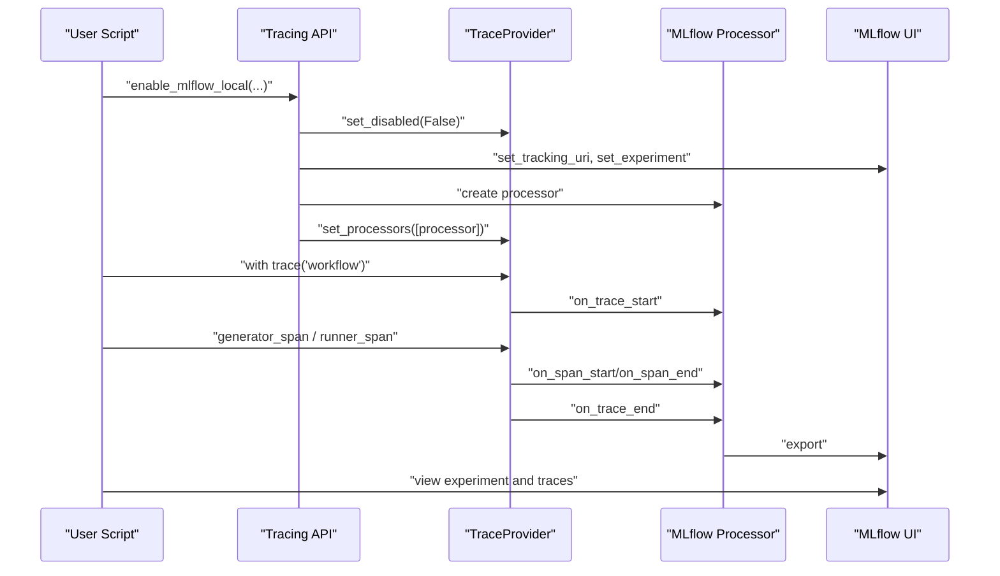
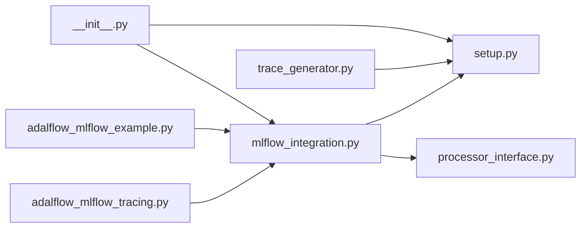

# MLflow Integration

<cite>
**Referenced Files in This Document**
- [mlflow_integration.py](file://adalflow/adalflow/tracing/mlflow_integration.py)
- [__init__.py](file://adalflow/adalflow/tracing/__init__.py)
- [setup.py](file://adalflow/adalflow/tracing/setup.py)
- [processor_interface.py](file://adalflow/adalflow/tracing/processor_interface.py)
- [adalflow_mlflow_example.py](file://tutorials/v1_agent_runner/adalflow_mlflow_example.py)
- [adalflow_mlflow_tracing.py](file://tutorials/v1_agent_runner/adalflow_mlflow_tracing.py)
- [trace_generator.py](file://use_cases/tracing/trace_generator.py)
</cite>

## Table of Contents
1. [Introduction](#introduction)
2. [Project Structure](#project-structure)
3. [Core Components](#core-components)
4. [Architecture Overview](#architecture-overview)
5. [Detailed Component Analysis](#detailed-component-analysis)
6. [Dependency Analysis](#dependency-analysis)
7. [Performance Considerations](#performance-considerations)
8. [Troubleshooting Guide](#troubleshooting-guide)
9. [Conclusion](#conclusion)
10. [Appendices](#appendices)

## Introduction
This document explains AdalFlow’s MLflow integration for external monitoring and experiment tracking. It covers how AdalFlow integrates with MLflow via a dedicated tracing processor, how to set up local and remote tracking servers, how to create and manage experiments, and how to visualize results. It also clarifies the relationship between AdalFlow tracing and MLflow experiments, outlines data persistence and experiment comparison workflows, and provides deployment, privacy, and production monitoring guidance. Finally, it includes guidelines for building custom MLflow processors and best practices for experiment management.

## Project Structure
AdalFlow’s MLflow integration centers around a small set of tracing infrastructure files and two tutorial scripts demonstrating usage. The key elements are:
- Tracing core: provider, multi-processor, and processor interface
- MLflow integration helpers: convenience functions to enable MLflow locally or with an auto-started server
- Tutorial examples: end-to-end demonstrations of enabling MLflow and running traced workflows

**Diagram sources**
- [mlflow_integration.py](file://adalflow/adalflow/tracing/mlflow_integration.py#L1-L352)
- [__init__.py](file://adalflow/adalflow/tracing/__init__.py#L1-L147)
- [setup.py](file://adalflow/adalflow/tracing/setup.py#L1-L267)
- [processor_interface.py](file://adalflow/adalflow/tracing/processor_interface.py#L1-L80)
- [adalflow_mlflow_example.py](file://tutorials/v1_agent_runner/adalflow_mlflow_example.py#L1-L61)
- [adalflow_mlflow_tracing.py](file://tutorials/v1_agent_runner/adalflow_mlflow_tracing.py#L1-L310)
- [trace_generator.py](file://use_cases/tracing/trace_generator.py#L1-L51)

**Section sources**
- [mlflow_integration.py](file://adalflow/adalflow/tracing/mlflow_integration.py#L1-L352)
- [__init__.py](file://adalflow/adalflow/tracing/__init__.py#L1-L147)
- [setup.py](file://adalflow/adalflow/tracing/setup.py#L1-L267)
- [processor_interface.py](file://adalflow/adalflow/tracing/processor_interface.py#L1-L80)
- [adalflow_mlflow_example.py](file://tutorials/v1_agent_runner/adalflow_mlflow_example.py#L1-L61)
- [adalflow_mlflow_tracing.py](file://tutorials/v1_agent_runner/adalflow_mlflow_tracing.py#L1-L310)
- [trace_generator.py](file://use_cases/tracing/trace_generator.py#L1-L51)

## Core Components
- MLflow integration helpers:
  - Enable MLflow with an existing server
  - Enable MLflow with an auto-started server and fallback storage
  - Start MLflow server programmatically
  - Build MLflow server command for local file-backed backend
- Tracing provider and multi-processor:
  - Global TraceProvider with environment-driven enable/disable
  - SynchronousMultiTracingProcessor forwarding lifecycle events to registered processors
  - TracingProcessor interface for exporters/backends
- Public API surface:
  - Convenience functions to set processors and toggle tracing globally
  - Re-export of MLflow integration functions in the tracing package

Key responsibilities:
- Manage MLflow server lifecycle and tracking URI
- Create or select an MLflow experiment
- Instantiate the MLflow tracing processor and register it globally
- Provide developer-friendly APIs to enable MLflow with minimal friction

**Section sources**
- [mlflow_integration.py](file://adalflow/adalflow/tracing/mlflow_integration.py#L36-L208)
- [setup.py](file://adalflow/adalflow/tracing/setup.py#L100-L166)
- [processor_interface.py](file://adalflow/adalflow/tracing/processor_interface.py#L19-L80)
- [__init__.py](file://adalflow/adalflow/tracing/__init__.py#L52-L87)

## Architecture Overview
AdalFlow’s tracing architecture follows an event-driven pattern: the TraceProvider creates traces and spans, and the SynchronousMultiTracingProcessor forwards lifecycle callbacks to all registered processors. The MLflow integration plugs into this pipeline by instantiating an MLflow tracing processor and setting it as the global processor. This allows all traces and spans to be exported to MLflow while preserving AdalFlow’s internal tracing semantics.

**Diagram sources**
- [__init__.py](file://adalflow/adalflow/tracing/__init__.py#L52-L87)
- [setup.py](file://adalflow/adalflow/tracing/setup.py#L100-L166)
- [mlflow_integration.py](file://adalflow/adalflow/tracing/mlflow_integration.py#L36-L208)

## Detailed Component Analysis

### MLflow Integration Helpers
- Purpose: Provide simple, robust APIs to enable MLflow tracing with either an existing server or an auto-started server, including fallback to local file storage.
- Key functions:
  - enable_mlflow_local: Configure MLflow with an existing server and set the experiment
  - enable_mlflow_local_with_server: Auto-start MLflow server or fall back to local file storage
  - start_mlflow_server: Start MLflow server programmatically with optional port-killing and readiness checks
  - get_mlflow_server_command: Build the MLflow server command pointing to AdalFlow’s default backend store
- Behavior:
  - Sets environment flags to enable tracing globally
  - Configures MLflow tracking URI and experiment
  - Instantiates the MLflow tracing processor and registers it as the single global processor

**Diagram sources**
- [mlflow_integration.py](file://adalflow/adalflow/tracing/mlflow_integration.py#L115-L208)

**Section sources**
- [mlflow_integration.py](file://adalflow/adalflow/tracing/mlflow_integration.py#L36-L208)

### Tracing Provider and Multi-Processor
- TraceProvider:
  - Controls global tracing enable/disable via environment flag
  - Creates traces and spans, forwarding events to the multi-processor
- SynchronousMultiTracingProcessor:
  - Maintains an ordered list of processors and forwards all lifecycle events
  - Thread-safe updates via lock
- TracingProcessor interface:
  - Defines the contract for processors: on_trace_start/end, on_span_start/end, shutdown, force_flush

**Diagram sources**
- [setup.py](file://adalflow/adalflow/tracing/setup.py#L28-L98)
- [processor_interface.py](file://adalflow/adalflow/tracing/processor_interface.py#L19-L80)

**Section sources**
- [setup.py](file://adalflow/adalflow/tracing/setup.py#L100-L166)
- [processor_interface.py](file://adalflow/adalflow/tracing/processor_interface.py#L19-L80)

### Public API Surface and Environment Flags
- Public functions:
  - set_trace_processors, add_trace_processor, get_trace_processors
  - set_tracing_disabled, is_tracing_disabled
  - set_tracing_export_api_key
  - MLflow integration re-exports: enable_mlflow_local, enable_mlflow_local_with_server, get_mlflow_server_command
- Environment flags:
  - ADALFLOW_DISABLE_TRACING: controls global tracing enable/disable
  - ADALFLOW_TRACING_API_KEY: stores optional API key for tracing export

**Section sources**
- [__init__.py](file://adalflow/adalflow/tracing/__init__.py#L52-L98)
- [setup.py](file://adalflow/adalflow/tracing/setup.py#L103-L108)

### Practical Examples and Workflows
- Simple MLflow enablement:
  - Demonstrates enabling MLflow with minimal configuration and viewing traces in the MLflow UI
  - Shows how to create a trace and optionally invoke a model client within the trace
- Agent + Runner + MLflow tracing:
  - Shows how to set up MLflow, create agents and runners, and trace multi-step workflows
  - Includes streaming execution examples and error handling scenarios
- Generator tracing decorators:
  - Demonstrates how to instrument generator calls and state transitions for observability

**Diagram sources**
- [adalflow_mlflow_example.py](file://tutorials/v1_agent_runner/adalflow_mlflow_example.py#L13-L58)
- [adalflow_mlflow_tracing.py](file://tutorials/v1_agent_runner/adalflow_mlflow_tracing.py#L35-L54)
- [trace_generator.py](file://use_cases/tracing/trace_generator.py#L8-L33)

**Section sources**
- [adalflow_mlflow_example.py](file://tutorials/v1_agent_runner/adalflow_mlflow_example.py#L1-L61)
- [adalflow_mlflow_tracing.py](file://tutorials/v1_agent_runner/adalflow_mlflow_tracing.py#L1-L310)
- [trace_generator.py](file://use_cases/tracing/trace_generator.py#L1-L51)

## Dependency Analysis
- Internal dependencies:
  - mlflow_integration depends on setup.py’s TraceProvider and processor_interface.py’s TracingProcessor
  - __init__.py re-exports MLflow integration functions and exposes processor management APIs
- External dependencies:
  - MLflow Python SDK and the OpenAI Agents tracing processor for exporting traces
- Coupling and cohesion:
  - Low coupling between tracing internals and MLflow integration via the TracingProcessor interface
  - Cohesive MLflow integration module encapsulating server management and processor setup

**Diagram sources**
- [mlflow_integration.py](file://adalflow/adalflow/tracing/mlflow_integration.py#L1-L352)
- [setup.py](file://adalflow/adalflow/tracing/setup.py#L1-L267)
- [processor_interface.py](file://adalflow/adalflow/tracing/processor_interface.py#L1-L80)
- [__init__.py](file://adalflow/adalflow/tracing/__init__.py#L1-L147)
- [adalflow_mlflow_example.py](file://tutorials/v1_agent_runner/adalflow_mlflow_example.py#L1-L61)
- [adalflow_mlflow_tracing.py](file://tutorials/v1_agent_runner/adalflow_mlflow_tracing.py#L1-L310)
- [trace_generator.py](file://use_cases/tracing/trace_generator.py#L1-L51)

**Section sources**
- [mlflow_integration.py](file://adalflow/adalflow/tracing/mlflow_integration.py#L1-L352)
- [__init__.py](file://adalflow/adalflow/tracing/__init__.py#L1-L147)
- [setup.py](file://adalflow/adalflow/tracing/setup.py#L1-L267)
- [processor_interface.py](file://adalflow/adalflow/tracing/processor_interface.py#L1-L80)
- [adalflow_mlflow_example.py](file://tutorials/v1_agent_runner/adalflow_mlflow_example.py#L1-L61)
- [adalflow_mlflow_tracing.py](file://tutorials/v1_agent_runner/adalflow_mlflow_tracing.py#L1-L310)
- [trace_generator.py](file://use_cases/tracing/trace_generator.py#L1-L51)

## Performance Considerations
- Processor overhead:
  - SynchronousMultiTracingProcessor forwards all events synchronously; keep the number of processors reasonable
- Export latency:
  - MLflow exports occur on span and trace lifecycle events; ensure MLflow server responsiveness to avoid blocking
- Server startup:
  - start_mlflow_server performs readiness checks; consider disabling wait or providing a pre-started server in production
- Storage backend:
  - Local file-backed backend is convenient for development; for scale, prefer a remote MLflow tracking server

[No sources needed since this section provides general guidance]

## Troubleshooting Guide
Common issues and resolutions:
- MLflow not installed:
  - The integration logs a warning and returns early; install MLflow to enable tracing
- MLflow server not reachable:
  - Use enable_mlflow_local_with_server to auto-start a server or point to an existing server
  - Verify port conflicts and consider killing existing processes before starting
- Traces not appearing:
  - Ensure ADALFLOW_DISABLE_TRACING is not set to a truthy value
  - Confirm that the MLflow processor is the only processor registered
- Experiment not visible:
  - Verify the experiment name and tracking URI; ensure the experiment exists or allow creation

**Section sources**
- [mlflow_integration.py](file://adalflow/adalflow/tracing/mlflow_integration.py#L11-L21)
- [mlflow_integration.py](file://adalflow/adalflow/tracing/mlflow_integration.py#L148-L150)
- [mlflow_integration.py](file://adalflow/adalflow/tracing/mlflow_integration.py#L258-L260)
- [mlflow_integration.py](file://adalflow/adalflow/tracing/mlflow_integration.py#L350-L351)

## Conclusion
AdalFlow’s MLflow integration provides a streamlined pathway to external monitoring and experiment tracking. By plugging into the tracing provider and multi-processor architecture, developers can quickly enable MLflow with minimal code changes, persist traces to a local or remote backend, and compare experiments across runs. The included examples demonstrate practical workflows, and the design supports extensibility for custom processors and advanced production monitoring strategies.

[No sources needed since this section summarizes without analyzing specific files]

## Appendices

### Relationship Between AdalFlow Tracing and MLflow Experiments
- AdalFlow tracing produces traces and spans; MLflow integration exports them to an experiment
- Each run corresponds to a trace; spans become nested steps within the trace
- Experiment creation/selecting is handled by the integration; parameters and metrics can be logged alongside spans

**Section sources**
- [mlflow_integration.py](file://adalflow/adalflow/tracing/mlflow_integration.py#L91-L95)
- [mlflow_integration.py](file://adalflow/adalflow/tracing/mlflow_integration.py#L187-L191)

### Data Persistence and Experiment Comparison
- Local development:
  - Auto-start MLflow server or use local file-backed backend
- Remote tracking:
  - Point to a remote MLflow tracking server and create/select an experiment
- Experiment comparison:
  - Use the MLflow UI to filter and compare runs by experiment name and tags

**Section sources**
- [mlflow_integration.py](file://adalflow/adalflow/tracing/mlflow_integration.py#L161-L181)
- [mlflow_integration.py](file://adalflow/adalflow/tracing/mlflow_integration.py#L211-L232)

### Deployment Considerations, Privacy, and Production Monitoring
- Deployment:
  - Prefer a managed MLflow tracking server for reliability and scalability
  - Use environment variables to configure tracking URI and experiment name
- Privacy:
  - Restrict access to MLflow UI and server
  - Avoid logging sensitive data in spans; sanitize inputs and outputs
- Production monitoring:
  - Monitor MLflow server health and export latency
  - Use structured tags and parameters to facilitate filtering and dashboards

[No sources needed since this section provides general guidance]

### Guidelines for Custom MLflow Processors and Best Practices
- Custom processor:
  - Implement TracingProcessor to handle on_trace_start/end and on_span_start/end
  - Register the processor via set_trace_processors to replace or augment the default pipeline
- Best practices:
  - Keep processors lightweight and non-blocking
  - Use consistent experiment names and tags for reproducible comparisons
  - Log meaningful parameters and metrics alongside spans
  - Disable tracing in performance-critical paths when not needed

**Section sources**
- [processor_interface.py](file://adalflow/adalflow/tracing/processor_interface.py#L19-L80)
- [setup.py](file://adalflow/adalflow/tracing/setup.py#L100-L166)
- [__init__.py](file://adalflow/adalflow/tracing/__init__.py#L63-L87)