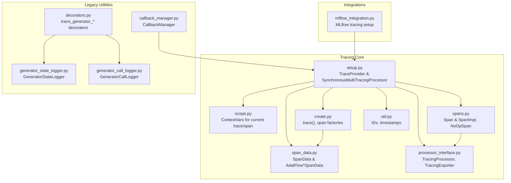
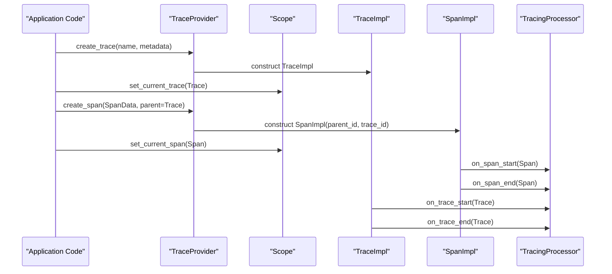
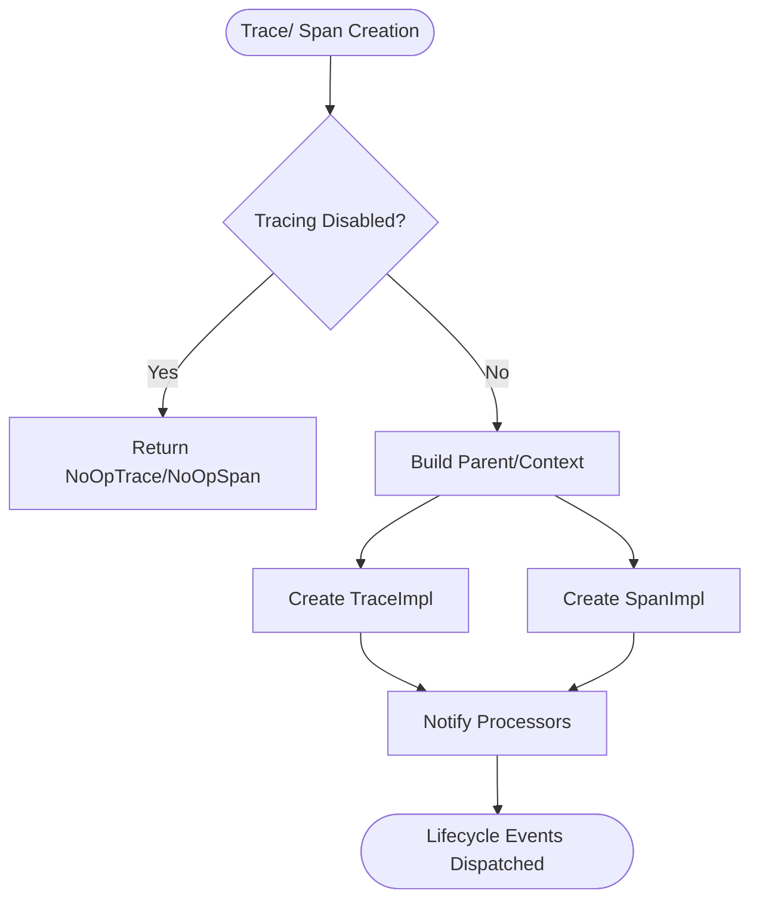
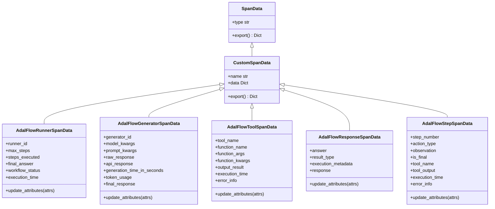
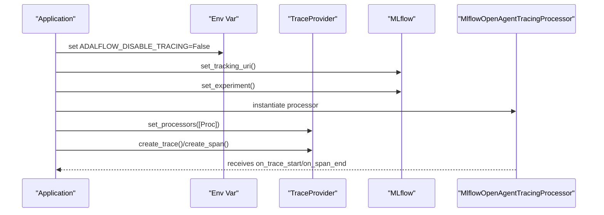
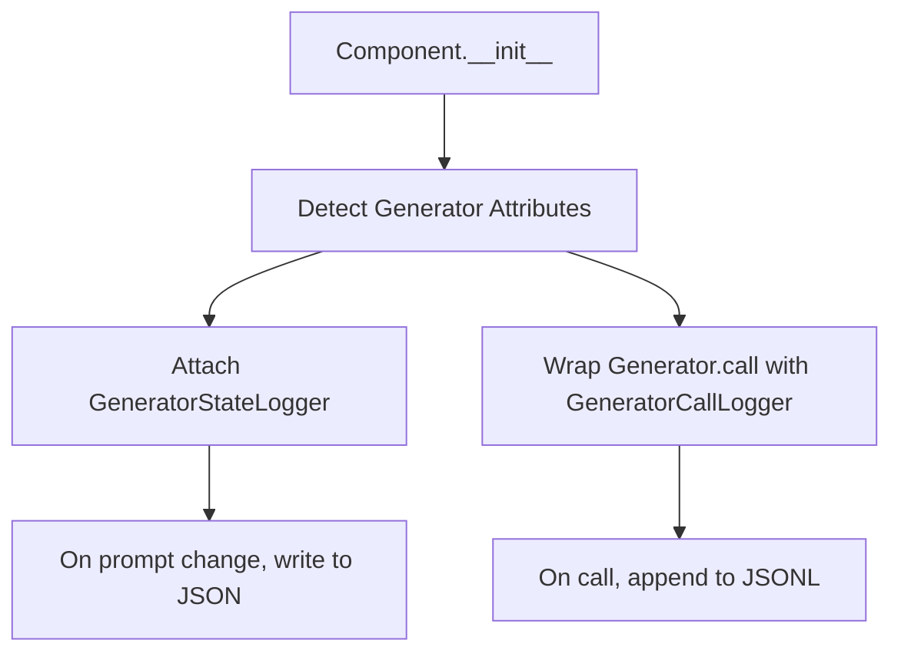
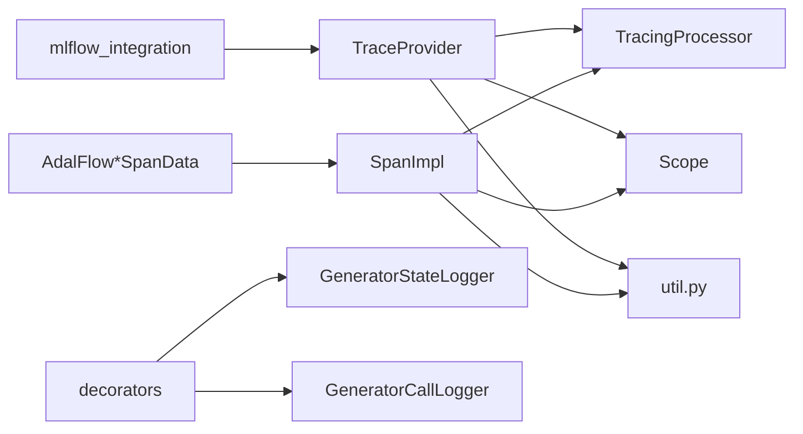

# Tracing and Monitoring

<cite>
**Referenced Files in This Document**
- [__init__.py](file://adalflow/adalflow/tracing/__init__.py)
- [setup.py](file://adalflow/adalflow/tracing/setup.py)
- [create.py](file://adalflow/adalflow/tracing/create.py)
- [spans.py](file://adalflow/adalflow/tracing/spans.py)
- [scope.py](file://adalflow/adalflow/tracing/scope.py)
- [span_data.py](file://adalflow/adalflow/tracing/span_data.py)
- [processor_interface.py](file://adalflow/adalflow/tracing/processor_interface.py)
- [util.py](file://adalflow/adalflow/tracing/util.py)
- [mlflow_integration.py](file://adalflow/adalflow/tracing/mlflow_integration.py)
- [callback_manager.py](file://adalflow/adalflow/tracing/callback_manager.py)
- [decorators.py](file://adalflow/adalflow/tracing/decorators.py)
- [generator_state_logger.py](file://adalflow/adalflow/tracing/generator_state_logger.py)
- [generator_call_logger.py](file://adalflow/adalflow/tracing/generator_call_logger.py)
- [test_tracing.py](file://adalflow/tests/test_tracing.py)
- [adalflow_mlflow_tracing.py](file://tutorials/v1_agent_runner/adalflow_mlflow_tracing.py)
- [adalflow_tracing.py](file://tutorials/adalflow_tracing.py)
- [trace_generator.py](file://use_cases/tracing/trace_generator.py)
</cite>

## Table of Contents
1. [Introduction](#introduction)
2. [Project Structure](#project-structure)
3. [Core Components](#core-components)
4. [Architecture Overview](#architecture-overview)
5. [Detailed Component Analysis](#detailed-component-analysis)
6. [Dependency Analysis](#dependency-analysis)
7. [Performance Considerations](#performance-considerations)
8. [Troubleshooting Guide](#troubleshooting-guide)
9. [Conclusion](#conclusion)
10. [Appendices](#appendices)

## Introduction
This document explains AdalFlow’s observability and debugging capabilities with a focus on distributed tracing, callback management, and integration with MLflow and other monitoring tools. It covers how to configure tracing, create spans and traces, process and export events, and leverage both the modern OpenAI Agents SDK-compatible tracing API and legacy generator tracing utilities. Practical examples demonstrate setup, monitoring workflows, and debugging techniques. The guide also addresses performance impact, data privacy considerations, production deployment strategies, and guidelines for building custom tracing processors and integrations.

## Project Structure
AdalFlow’s tracing subsystem is organized into cohesive modules that implement a provider-based tracing architecture with a focus on compatibility with OpenAI Agents SDK patterns. Key areas include:
- Provider and scope management for context propagation
- Span and trace creation APIs
- Span data models aligned with OpenAI’s span types
- Processor interface and multi-processor orchestration
- MLflow integration helpers
- Legacy generator state and call logging utilities
- Callback management for event-driven workflows

**Diagram sources**
- [setup.py](file://adalflow/adalflow/tracing/setup.py#L100-L266)
- [scope.py](file://adalflow/adalflow/tracing/scope.py#L30-L99)
- [spans.py](file://adalflow/adalflow/tracing/spans.py#L35-L289)
- [create.py](file://adalflow/adalflow/tracing/create.py#L33-L388)
- [span_data.py](file://adalflow/adalflow/tracing/span_data.py#L18-L779)
- [processor_interface.py](file://adalflow/adalflow/tracing/processor_interface.py#L19-L80)
- [util.py](file://adalflow/adalflow/tracing/util.py#L15-L33)
- [mlflow_integration.py](file://adalflow/adalflow/tracing/mlflow_integration.py#L31-L352)
- [decorators.py](file://adalflow/adalflow/tracing/decorators.py#L11-L243)
- [generator_state_logger.py](file://adalflow/adalflow/tracing/generator_state_logger.py#L32-L134)
- [generator_call_logger.py](file://adalflow/adalflow/tracing/generator_call_logger.py#L39-L145)
- [callback_manager.py](file://adalflow/adalflow/tracing/callback_manager.py#L4-L35)

**Section sources**
- [__init__.py](file://adalflow/adalflow/tracing/__init__.py#L1-L147)
- [setup.py](file://adalflow/adalflow/tracing/setup.py#L100-L266)
- [scope.py](file://adalflow/adalflow/tracing/scope.py#L30-L99)
- [spans.py](file://adalflow/adalflow/tracing/spans.py#L35-L289)
- [create.py](file://adalflow/adalflow/tracing/create.py#L33-L388)
- [span_data.py](file://adalflow/adalflow/tracing/span_data.py#L18-L779)
- [processor_interface.py](file://adalflow/adalflow/tracing/processor_interface.py#L19-L80)
- [util.py](file://adalflow/adalflow/tracing/util.py#L15-L33)
- [mlflow_integration.py](file://adalflow/adalflow/tracing/mlflow_integration.py#L31-L352)
- [decorators.py](file://adalflow/adalflow/tracing/decorators.py#L11-L243)
- [generator_state_logger.py](file://adalflow/adalflow/tracing/generator_state_logger.py#L32-L134)
- [generator_call_logger.py](file://adalflow/adalflow/tracing/generator_call_logger.py#L39-L145)
- [callback_manager.py](file://adalflow/adalflow/tracing/callback_manager.py#L4-L35)

## Core Components
- TraceProvider and SynchronousMultiTracingProcessor: Central provider that creates traces and spans, manages processors, and coordinates lifecycle events. Supports environment-based disabling and thread-safe processor registration.
- Scope: Context management using contextvars to track the current trace and span across async and nested calls.
- Span and SpanImpl: Abstractions for timing, parent-child relationships, error recording, and export. NoOpSpan is used when tracing is disabled.
- SpanData and AdalFlow*SpanData: Typed data containers for spans, aligned with OpenAI’s span types and extended for AdalFlow runner, generator, tool, response, and step spans.
- TracingProcessor and TracingExporter: Interfaces for implementing exporters and processors that receive trace/span lifecycle events.
- MLflow Integration: Helpers to enable MLflow tracing with OpenAI Agents-compatible processors, including server management and experiment configuration.
- Legacy Generator Tracing: Decorators and loggers for capturing generator prompt state changes and call outcomes, supporting debugging and reproducibility.
- CallbackManager: Event-driven callback registration and triggering for success, failure, and completion events.

**Section sources**
- [setup.py](file://adalflow/adalflow/tracing/setup.py#L100-L266)
- [spans.py](file://adalflow/adalflow/tracing/spans.py#L35-L289)
- [span_data.py](file://adalflow/adalflow/tracing/span_data.py#L18-L779)
- [processor_interface.py](file://adalflow/adalflow/tracing/processor_interface.py#L19-L80)
- [mlflow_integration.py](file://adalflow/adalflow/tracing/mlflow_integration.py#L31-L352)
- [decorators.py](file://adalflow/adalflow/tracing/decorators.py#L11-L243)
- [generator_state_logger.py](file://adalflow/adalflow/tracing/generator_state_logger.py#L32-L134)
- [generator_call_logger.py](file://adalflow/adalflow/tracing/generator_call_logger.py#L39-L145)
- [callback_manager.py](file://adalflow/adalflow/tracing/callback_manager.py#L4-L35)

## Architecture Overview
The tracing architecture follows a provider pattern with a multi-processor pipeline. Traces and spans are created via factory functions and the provider, which enforces context and parent-child relationships. Processors receive lifecycle callbacks and can export or transform events. The system supports environment-based toggles and graceful shutdown.

**Diagram sources**
- [setup.py](file://adalflow/adalflow/tracing/setup.py#L140-L222)
- [scope.py](file://adalflow/adalflow/tracing/scope.py#L35-L66)
- [spans.py](file://adalflow/adalflow/tracing/spans.py#L226-L261)
- [processor_interface.py](file://adalflow/adalflow/tracing/processor_interface.py#L22-L56)

**Section sources**
- [create.py](file://adalflow/adalflow/tracing/create.py#L33-L388)
- [setup.py](file://adalflow/adalflow/tracing/setup.py#L140-L222)
- [scope.py](file://adalflow/adalflow/tracing/scope.py#L35-L66)
- [spans.py](file://adalflow/adalflow/tracing/spans.py#L226-L261)
- [processor_interface.py](file://adalflow/adalflow/tracing/processor_interface.py#L22-L56)

## Detailed Component Analysis

### Distributed Tracing System
- Trace creation: Use the trace factory to create logical workflows with optional metadata and grouping identifiers. Traces can be used as context managers or started and finished manually.
- Span creation: Use specialized factories for runner, generator, tool, response, step, and custom spans. Spans inherit parent context from the current trace or span.
- Lifecycle hooks: Processors receive on_trace_start/on_trace_end and on_span_start/on_span_end callbacks. Exporters can batch and flush items.
- Disabling and environment controls: Tracing can be globally disabled via environment variable or API toggle. When disabled, NoOpTrace and NoOpSpan are returned.

**Diagram sources**
- [setup.py](file://adalflow/adalflow/tracing/setup.py#L140-L222)
- [create.py](file://adalflow/adalflow/tracing/create.py#L33-L388)
- [spans.py](file://adalflow/adalflow/tracing/spans.py#L226-L261)

**Section sources**
- [create.py](file://adalflow/adalflow/tracing/create.py#L33-L388)
- [setup.py](file://adalflow/adalflow/tracing/setup.py#L140-L222)
- [spans.py](file://adalflow/adalflow/tracing/spans.py#L226-L261)
- [test_tracing.py](file://adalflow/tests/test_tracing.py#L83-L118)

### Span Data Models and Export
- SpanData hierarchy: Base SpanData with type and export; OpenAI-aligned types plus AdalFlow-specific CustomSpanData variants for runner, generator, tool, response, and step spans.
- AdalFlow*SpanData: Provide structured fields for workflow execution, generation metrics, tool invocation, and step-wise progress. Each exposes update_attributes for runtime updates and export for serialization.
- Export format: Spans export a standardized structure including identifiers, timestamps, parent info, span data payload, and error metadata.

**Diagram sources**
- [span_data.py](file://adalflow/adalflow/tracing/span_data.py#L18-L779)

**Section sources**
- [span_data.py](file://adalflow/adalflow/tracing/span_data.py#L18-L779)
- [spans.py](file://adalflow/adalflow/tracing/spans.py#L278-L289)

### MLflow Integration
- Enable MLflow tracing locally or with an auto-started server. Configure tracking URI, experiment, and project name. Replace default processors with MLflow’s OpenAI Agents-compatible processor.
- Server management utilities: Start MLflow server with backend store, kill existing servers, and generate server commands. Fallback to local file-backed store if needed.
- Compatibility: Uses MlflowOpenAgentTracingProcessor to align with OpenAI Agents tracing semantics.

**Diagram sources**
- [mlflow_integration.py](file://adalflow/adalflow/tracing/mlflow_integration.py#L36-L208)
- [setup.py](file://adalflow/adalflow/tracing/setup.py#L110-L121)

**Section sources**
- [mlflow_integration.py](file://adalflow/adalflow/tracing/mlflow_integration.py#L36-L208)
- [adalflow_mlflow_tracing.py](file://tutorials/v1_agent_runner/adalflow_mlflow_tracing.py#L35-L55)

### Legacy Generator Tracing
- trace_generator_states: Decorator that attaches a GeneratorStateLogger to a component and logs prompt state changes to JSON.
- trace_generator_call: Decorator that wraps generator call methods to log calls to JSONL, optionally error-only. Provides access to a GeneratorCallLogger for inspection.
- Use cases: Debugging prompt engineering, tracking generator behavior across runs, and diagnosing failures.

**Diagram sources**
- [decorators.py](file://adalflow/adalflow/tracing/decorators.py#L11-L243)
- [generator_state_logger.py](file://adalflow/adalflow/tracing/generator_state_logger.py#L78-L112)
- [generator_call_logger.py](file://adalflow/adalflow/tracing/generator_call_logger.py#L123-L145)

**Section sources**
- [decorators.py](file://adalflow/adalflow/tracing/decorators.py#L11-L243)
- [generator_state_logger.py](file://adalflow/adalflow/tracing/generator_state_logger.py#L78-L112)
- [generator_call_logger.py](file://adalflow/adalflow/tracing/generator_call_logger.py#L123-L145)
- [trace_generator.py](file://use_cases/tracing/trace_generator.py#L8-L33)
- [adalflow_tracing.py](file://tutorials/adalflow_tracing.py#L15-L48)

### Callback Management
- CallbackManager: Registers callbacks for on_success, on_failure, and on_complete events. Useful for integrating with external monitoring or alerting systems.

**Section sources**
- [callback_manager.py](file://adalflow/adalflow/tracing/callback_manager.py#L4-L35)

## Dependency Analysis
Key dependencies and relationships:
- TraceProvider depends on Scope for context, processor interface for lifecycle events, and utilities for IDs and timestamps.
- SpanImpl depends on TracingProcessor for event dispatch and on Scope for current span tracking.
- SpanData implementations depend on typed exports for interoperability with processors.
- MLflow integration depends on the presence of MLflow and uses MlflowOpenAgentTracingProcessor.
- Legacy tracing utilities depend on generator internals and file I/O utilities.

**Diagram sources**
- [setup.py](file://adalflow/adalflow/tracing/setup.py#L100-L266)
- [spans.py](file://adalflow/adalflow/tracing/spans.py#L177-L289)
- [span_data.py](file://adalflow/adalflow/tracing/span_data.py#L408-L779)
- [mlflow_integration.py](file://adalflow/adalflow/tracing/mlflow_integration.py#L31-L113)
- [decorators.py](file://adalflow/adalflow/tracing/decorators.py#L11-L243)

**Section sources**
- [setup.py](file://adalflow/adalflow/tracing/setup.py#L100-L266)
- [spans.py](file://adalflow/adalflow/tracing/spans.py#L177-L289)
- [span_data.py](file://adalflow/adalflow/tracing/span_data.py#L408-L779)
- [mlflow_integration.py](file://adalflow/adalflow/tracing/mlflow_integration.py#L31-L113)
- [decorators.py](file://adalflow/adalflow/tracing/decorators.py#L11-L243)

## Performance Considerations
- Overhead with tracing disabled: Tests confirm negligible overhead when tracing is disabled, validating NoOp behavior.
- Batch and flush: Use force_flush to ensure timely export; shutdown triggers processor cleanup.
- Concurrency: Multi-processor uses a lock-free immutable tuple for thread safety; ensure processors are lightweight to minimize contention.
- Export cost: Prefer batching exporters and avoid heavy synchronous work in on_span_start/on_trace_end.

[No sources needed since this section provides general guidance]

## Troubleshooting Guide
Common issues and resolutions:
- No active trace when creating spans: Ensure a trace is active or explicitly pass a parent. The provider logs an error and returns NoOpSpan when no active trace exists.
- Environment variable overrides: ADALFLOW_DISABLE_TRACING controls global tracing. Confirm environment variable values and case-insensitivity behavior.
- Processor registration: Use set_trace_processors or add_trace_processor to configure exporters. Verify processors receive events in order.
- MLflow server connectivity: Ensure tracking URI is reachable; use start_mlflow_server or get_mlflow_server_command to manage local servers.
- Legacy tracing files: Check ./traces/ directory permissions and JSON/JSONL file integrity.

**Section sources**
- [setup.py](file://adalflow/adalflow/tracing/setup.py#L184-L196)
- [test_tracing.py](file://adalflow/tests/test_tracing.py#L102-L118)
- [mlflow_integration.py](file://adalflow/adalflow/tracing/mlflow_integration.py#L235-L352)

## Conclusion
AdalFlow’s tracing system combines a modern, OpenAI Agents SDK-compatible provider with flexible processors and strong compatibility with MLflow. It offers robust debugging and monitoring through structured spans, typed data models, and legacy generator tracing utilities. By leveraging environment controls, context-aware scopes, and extensible processors, teams can instrument workflows effectively while maintaining performance and privacy.

[No sources needed since this section summarizes without analyzing specific files]

## Appendices

### Practical Examples and Workflows

- Basic tracing setup and usage
  - Create a trace and spans around a workflow; use context managers for automatic lifecycle.
  - Reference: [create.py](file://adalflow/adalflow/tracing/create.py#L33-L388), [test_tracing.py](file://adalflow/tests/test_tracing.py#L374-L388)

- MLflow integration
  - Enable MLflow locally or with auto-started server; configure experiment and project; replace processors.
  - Reference: [mlflow_integration.py](file://adalflow/adalflow/tracing/mlflow_integration.py#L36-L208), [adalflow_mlflow_tracing.py](file://tutorials/v1_agent_runner/adalflow_mlflow_tracing.py#L35-L55)

- Legacy generator tracing
  - Decorate components to log prompt states and generator calls; inspect JSON/JSONL outputs.
  - Reference: [decorators.py](file://adalflow/adalflow/tracing/decorators.py#L11-L243), [trace_generator.py](file://use_cases/tracing/trace_generator.py#L8-L33), [adalflow_tracing.py](file://tutorials/adalflow_tracing.py#L15-L48)

- Debugging techniques
  - Use on_span_start/on_span_end to correlate events; capture error metadata; leverage update_attributes for runtime diagnostics.
  - Reference: [spans.py](file://adalflow/adalflow/tracing/spans.py#L263-L269), [span_data.py](file://adalflow/adalflow/tracing/span_data.py#L461-L474)

### Guidelines for Custom Tracing Processors and Integrations
- Implement TracingProcessor to receive lifecycle events; implement TracingExporter for export batches.
- Keep processors stateless and non-blocking; defer heavy work to background threads or queues.
- Respect environment toggles and gracefully handle disabled mode.
- Align span data exports with downstream consumers (e.g., MLflow) for compatibility.

**Section sources**
- [processor_interface.py](file://adalflow/adalflow/tracing/processor_interface.py#L19-L80)
- [setup.py](file://adalflow/adalflow/tracing/setup.py#L28-L98)