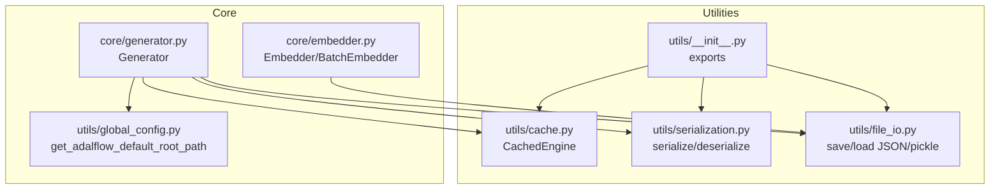
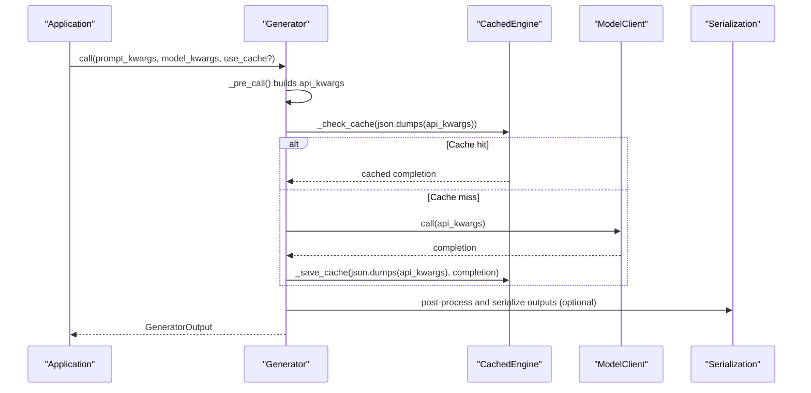
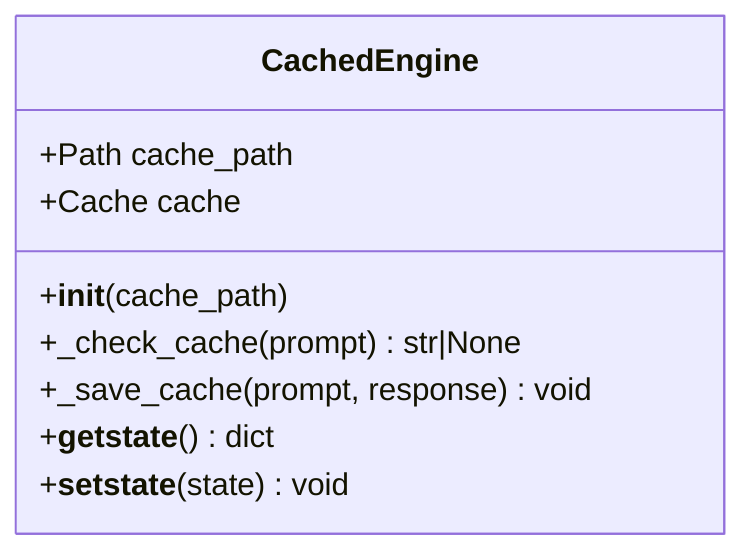
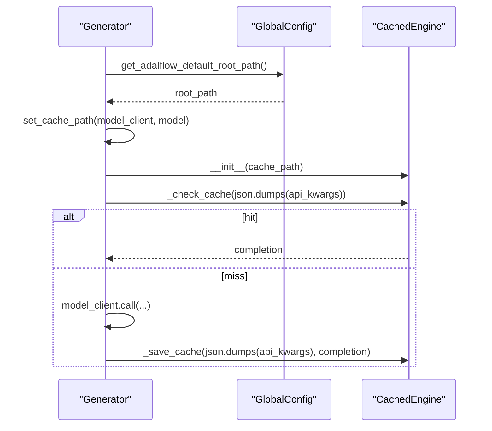
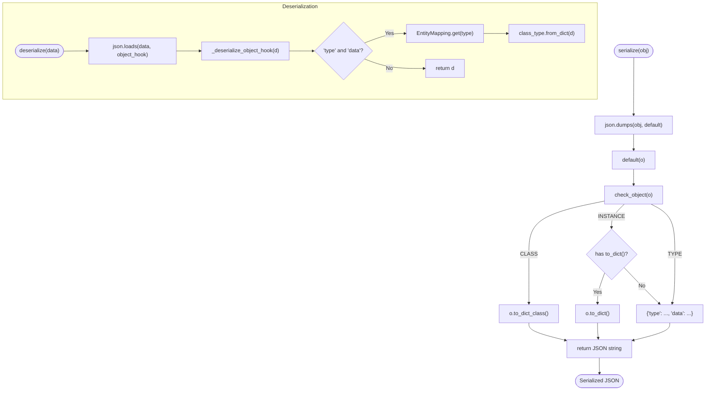
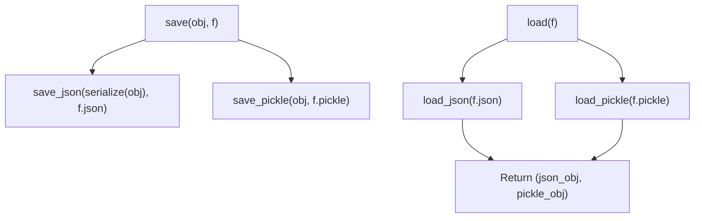
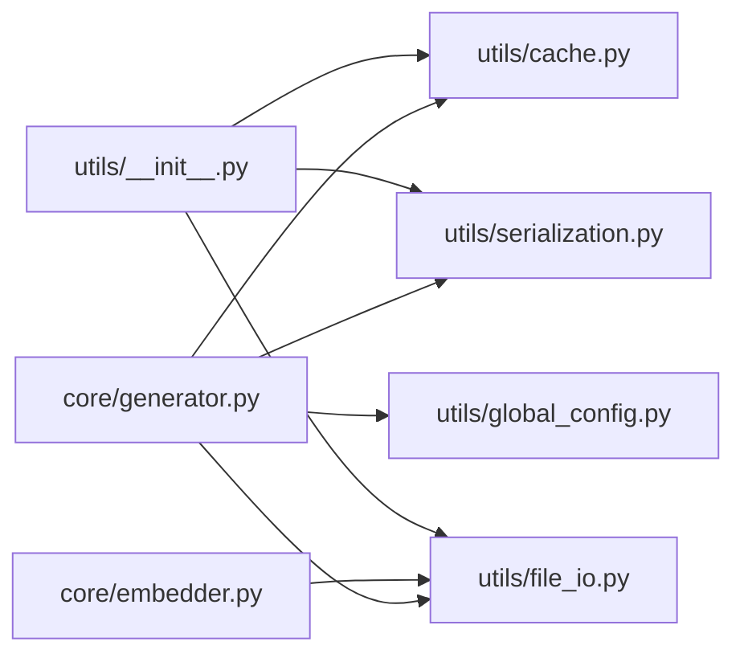

# Caching and Serialization

<cite>
**Referenced Files in This Document**
- [cache.py](file://adalflow/adalflow/utils/cache.py)
- [serialization.py](file://adalflow/adalflow/utils/serialization.py)
- [file_io.py](file://adalflow/adalflow/utils/file_io.py)
- [generator.py](file://adalflow/adalflow/core/generator.py)
- [embedder.py](file://adalflow/adalflow/core/embedder.py)
- [global_config.py](file://adalflow/adalflow/utils/global_config.py)
- [__init__.py](file://adalflow/adalflow/utils/__init__.py)
</cite>

## Table of Contents
1. [Introduction](#introduction)
2. [Project Structure](#project-structure)
3. [Core Components](#core-components)
4. [Architecture Overview](#architecture-overview)
5. [Detailed Component Analysis](#detailed-component-analysis)
6. [Dependency Analysis](#dependency-analysis)
7. [Performance Considerations](#performance-considerations)
8. [Troubleshooting Guide](#troubleshooting-guide)
9. [Conclusion](#conclusion)

## Introduction
This document explains AdalFlow’s caching and serialization utilities with a focus on performance optimization and data persistence. It covers:
- How LLM responses, embeddings, and intermediate results are cached
- Serialization formats, alternatives to pickle, and state management for component restoration
- Practical cache configuration, TTL management, and invalidation strategies
- Serialization patterns for complex objects, memory optimization, and performance benchmarking
- Cache consistency, thread safety, and storage backends

## Project Structure
The caching and serialization capabilities are implemented in the utilities module and integrated into core components such as the Generator and Embedder. The utilities module exposes:
- A disk-backed cache engine for LLM responses
- A robust JSON serialization system supporting internal and external objects
- File I/O helpers for saving/loading JSON and pickle artifacts

**Diagram sources**
- [cache.py](file://adalflow/adalflow/utils/cache.py#L1-L48)
- [serialization.py](file://adalflow/adalflow/utils/serialization.py#L1-L138)
- [file_io.py](file://adalflow/adalflow/utils/file_io.py#L1-L257)
- [generator.py](file://adalflow/adalflow/core/generator.py#L1-L1594)
- [embedder.py](file://adalflow/adalflow/core/embedder.py#L1-L236)
- [global_config.py](file://adalflow/adalflow/utils/global_config.py#L1-L13)
- [__init__.py](file://adalflow/adalflow/utils/__init__.py#L1-L55)

**Section sources**
- [cache.py](file://adalflow/adalflow/utils/cache.py#L1-L48)
- [serialization.py](file://adalflow/adalflow/utils/serialization.py#L1-L138)
- [file_io.py](file://adalflow/adalflow/utils/file_io.py#L1-L257)
- [generator.py](file://adalflow/adalflow/core/generator.py#L1-L1594)
- [embedder.py](file://adalflow/adalflow/core/embedder.py#L1-L236)
- [global_config.py](file://adalflow/adalflow/utils/global_config.py#L1-L13)
- [__init__.py](file://adalflow/adalflow/utils/__init__.py#L1-L55)

## Core Components
- CachedEngine: Disk-backed cache keyed by hashed prompt/index content, with pickle-safe state management for component restoration.
- Generator: Orchestrates LLM calls with built-in cache integration, hashing of api_kwargs, and skipping cache for streaming responses.
- Embedder/BatchEmbedder: Provides embedding orchestration; integrates with file I/O for persistence of embeddings and related artifacts.
- Serialization: JSON-based serializer with hooks to restore internal types and fallbacks for external objects.
- File I/O: Dual-format persistence (JSON and pickle) for artifacts, with convenience helpers for JSONL logging.

Key integration points:
- Generator caches LLM completions keyed by serialized api_kwargs to avoid repeated model calls.
- CachedEngine participates as a mixin in Generator to reuse cache methods and lifecycle.
- Serialization and file I/O enable durable artifact storage and component restoration.

**Section sources**
- [cache.py](file://adalflow/adalflow/utils/cache.py#L19-L48)
- [generator.py](file://adalflow/adalflow/core/generator.py#L82-L210)
- [generator.py](file://adalflow/adalflow/core/generator.py#L496-L544)
- [embedder.py](file://adalflow/adalflow/core/embedder.py#L23-L193)
- [serialization.py](file://adalflow/adalflow/utils/serialization.py#L90-L138)
- [file_io.py](file://adalflow/adalflow/utils/file_io.py#L89-L102)

## Architecture Overview
The caching and serialization architecture centers on:
- DiskCache for LLM response caching with deterministic keys derived from api_kwargs
- JSON serialization for human-readable persistence and cross-language compatibility
- Pickle for preserving complex Python objects when needed
- Global root path configuration for portable cache locations

**Diagram sources**
- [generator.py](file://adalflow/adalflow/core/generator.py#L496-L544)
- [cache.py](file://adalflow/adalflow/utils/cache.py#L27-L36)
- [serialization.py](file://adalflow/adalflow/utils/serialization.py#L90-L106)

## Detailed Component Analysis

### CachedEngine: Disk-backed Cache for LLM Responses
- Purpose: Provide persistent, keyed storage for LLM completions using a disk-backed cache.
- Keying: Hash of serialized api_kwargs to ensure deterministic lookup.
- Lifecycle: Supports pickle/unpickle by excluding the cache instance during pickling and reconstructing it upon unpickling.
- Streaming exclusion: Skips caching for streaming responses to avoid unpickleable objects.

**Diagram sources**
- [cache.py](file://adalflow/adalflow/utils/cache.py#L19-L48)

**Section sources**
- [cache.py](file://adalflow/adalflow/utils/cache.py#L19-L48)
- [generator.py](file://adalflow/adalflow/core/generator.py#L496-L544)

### Generator: Cache Integration and LLM Response Caching
- Cache path construction: Uses a global root path and appends a model-specific cache filename derived from client class and model name.
- Cache usage: Serializes api_kwargs to JSON for deterministic keys; checks cache before model calls; saves non-streaming responses.
- Streaming safety: Skips caching when stream is enabled to avoid unpickleable objects.
- State management: Inherits CachedEngine behavior for cache restoration across process boundaries.

**Diagram sources**
- [generator.py](file://adalflow/adalflow/core/generator.py#L231-L253)
- [generator.py](file://adalflow/adalflow/core/generator.py#L156-L162)
- [generator.py](file://adalflow/adalflow/core/generator.py#L496-L544)
- [global_config.py](file://adalflow/adalflow/utils/global_config.py#L5-L12)

**Section sources**
- [generator.py](file://adalflow/adalflow/core/generator.py#L231-L253)
- [generator.py](file://adalflow/adalflow/core/generator.py#L156-L162)
- [generator.py](file://adalflow/adalflow/core/generator.py#L496-L544)
- [global_config.py](file://adalflow/adalflow/utils/global_config.py#L5-L12)

### Serialization: JSON-first Persistence with Type Restoration
- Object types: Distinguishes classes, instances, and types to route serialization appropriately.
- Internal objects: Calls to_dict/to_dict_class when available; falls back to string representation.
- External objects: Uses generic type/data envelope with string conversion.
- Deserialization: Restores internal types via an entity mapping; handles sets and generic envelopes.

**Diagram sources**
- [serialization.py](file://adalflow/adalflow/utils/serialization.py#L20-L87)
- [serialization.py](file://adalflow/adalflow/utils/serialization.py#L103-L125)

**Section sources**
- [serialization.py](file://adalflow/adalflow/utils/serialization.py#L20-L87)
- [serialization.py](file://adalflow/adalflow/utils/serialization.py#L103-L125)

### File I/O: Dual-Format Persistence (JSON + Pickle)
- Save/load dual formats: Writes both JSON (serialized) and pickle (native) for artifacts.
- JSONL logging: Append/write helpers for trace and dataset persistence.
- Error handling: Comprehensive IO and JSON decode error handling.

**Diagram sources**
- [file_io.py](file://adalflow/adalflow/utils/file_io.py#L89-L102)
- [file_io.py](file://adalflow/adalflow/utils/file_io.py#L179-L191)

**Section sources**
- [file_io.py](file://adalflow/adalflow/utils/file_io.py#L89-L102)
- [file_io.py](file://adalflow/adalflow/utils/file_io.py#L179-L191)

### Embeddings: Batched Embedding Caching and Persistence
- Embedder orchestrates model client calls and output processing.
- BatchEmbedder batches large inputs to reduce cost and improve throughput.
- Persistence: Use file I/O helpers to save embeddings and related metadata to JSON/PKL or JSONL for traceability.

Note: Embedder does not directly integrate with CachedEngine. For embedding caching, consider:
- Using CachedEngine with a custom wrapper around Embedder calls
- Persisting embeddings via file I/O helpers for downstream retrieval

**Section sources**
- [embedder.py](file://adalflow/adalflow/core/embedder.py#L23-L193)
- [embedder.py](file://adalflow/adalflow/core/embedder.py#L195-L236)
- [file_io.py](file://adalflow/adalflow/utils/file_io.py#L1-L257)

## Dependency Analysis
- Generator depends on CachedEngine for cache operations and on ModelClient for LLM calls.
- Serialization is used by file I/O and can be invoked directly for component persistence.
- Global configuration provides a cross-platform cache root path.

**Diagram sources**
- [generator.py](file://adalflow/adalflow/core/generator.py#L1-L1594)
- [cache.py](file://adalflow/adalflow/utils/cache.py#L1-L48)
- [serialization.py](file://adalflow/adalflow/utils/serialization.py#L1-L138)
- [file_io.py](file://adalflow/adalflow/utils/file_io.py#L1-L257)
- [global_config.py](file://adalflow/adalflow/utils/global_config.py#L1-L13)
- [__init__.py](file://adalflow/adalflow/utils/__init__.py#L1-L55)

**Section sources**
- [generator.py](file://adalflow/adalflow/core/generator.py#L1-L1594)
- [cache.py](file://adalflow/adalflow/utils/cache.py#L1-L48)
- [serialization.py](file://adalflow/adalflow/utils/serialization.py#L1-L138)
- [file_io.py](file://adalflow/adalflow/utils/file_io.py#L1-L257)
- [global_config.py](file://adalflow/adalflow/utils/global_config.py#L1-L13)
- [__init__.py](file://adalflow/adalflow/utils/__init__.py#L1-L55)

## Performance Considerations
- Cache key determinism: Use stable serialization of api_kwargs to avoid cache misses due to ordering or extra fields.
- Streaming exclusion: Skip caching for streaming responses to prevent unpickleable objects and unnecessary disk writes.
- Memory optimization:
  - Prefer JSON serialization for large artifacts to reduce pickle overhead and improve readability.
  - Use JSONL for incremental logging and trace aggregation.
  - Batch embeddings to reduce API calls and cache pressure.
- Storage backends: DiskCache provides efficient disk-backed caching; ensure adequate disk space and permissions in the configured root path.
- Thread safety: DiskCache is thread-safe for reads/writes; however, avoid concurrent writes to the same cache key from multiple processes.

[No sources needed since this section provides general guidance]

## Troubleshooting Guide
Common issues and resolutions:
- Cache not restoring properly after unpickling:
  - Ensure the cache path is valid and accessible; CachedEngine reconstructs the cache instance on unpickling.
- Streaming responses not cached:
  - Expected behavior; CachedEngine skips caching when stream is enabled.
- JSON serialization failures:
  - Objects without to_dict/to_dict_class fall back to string envelopes; verify custom types are registered in the entity mapping for restoration.
- File I/O errors:
  - Check file paths and permissions; file I/O functions raise explicit exceptions on failures.

**Section sources**
- [cache.py](file://adalflow/adalflow/utils/cache.py#L38-L48)
- [generator.py](file://adalflow/adalflow/core/generator.py#L512-L515)
- [serialization.py](file://adalflow/adalflow/utils/serialization.py#L30-L87)
- [file_io.py](file://adalflow/adalflow/utils/file_io.py#L120-L140)

## Conclusion
AdalFlow’s caching and serialization utilities provide a practical balance between performance and portability:
- Disk-backed caching for LLM responses with deterministic keys and safe state management
- JSON-first serialization with type restoration for broad compatibility
- Dual-format persistence and JSONL logging for robust artifact lifecycle
- Clear integration points in core components enable targeted optimization for LLMs, embeddings, and intermediate results