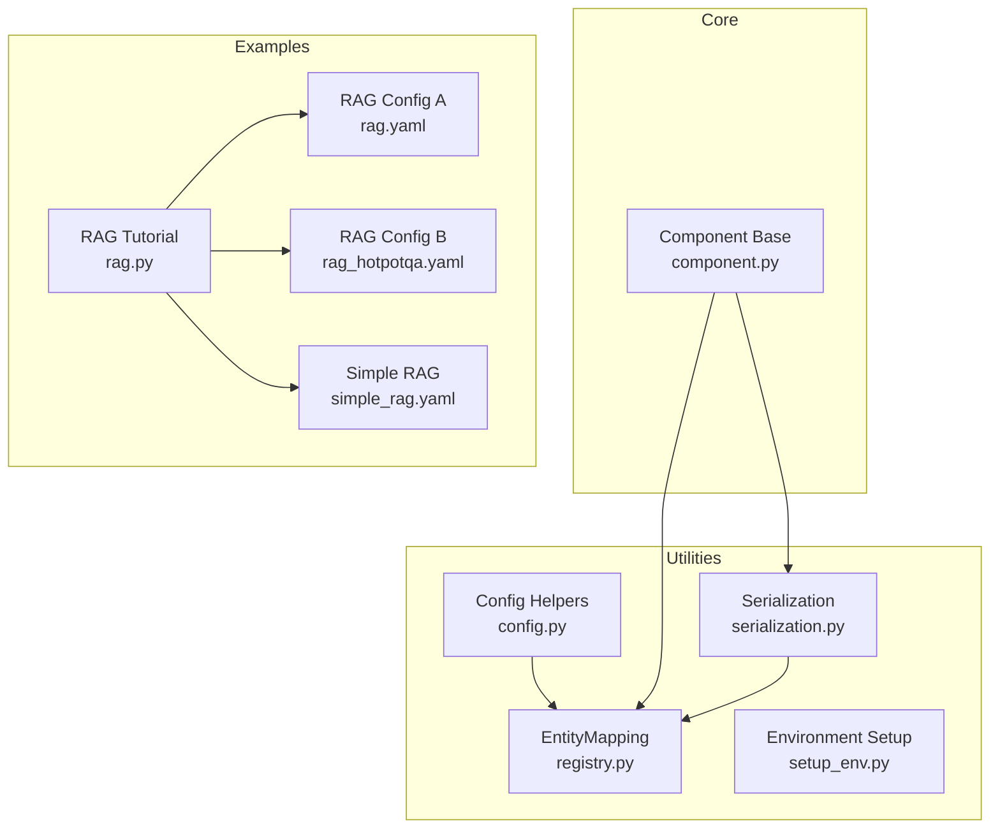
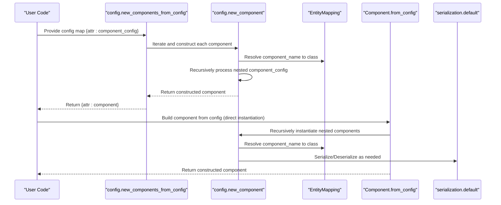
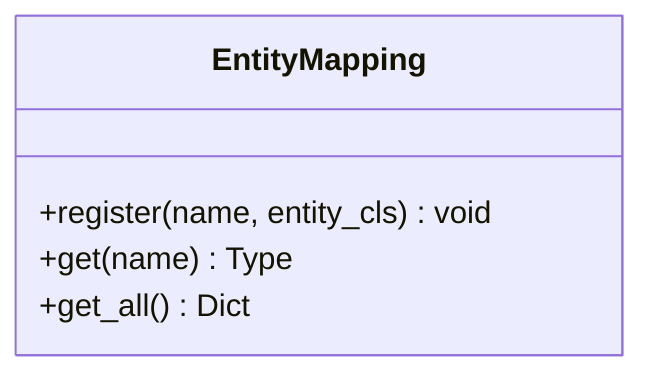
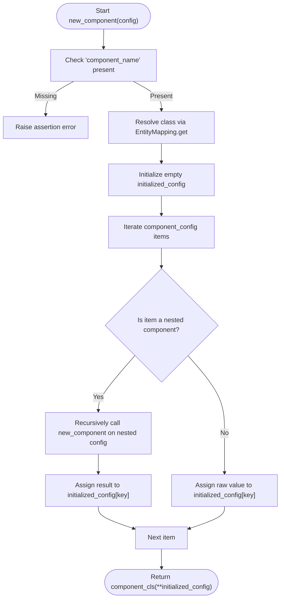
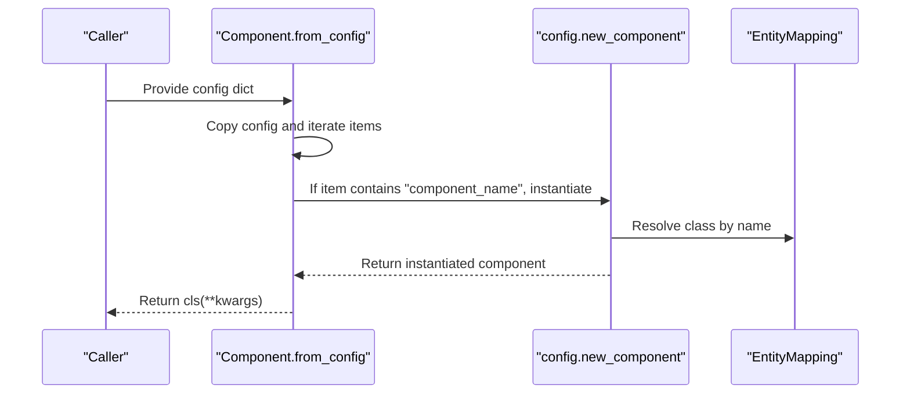
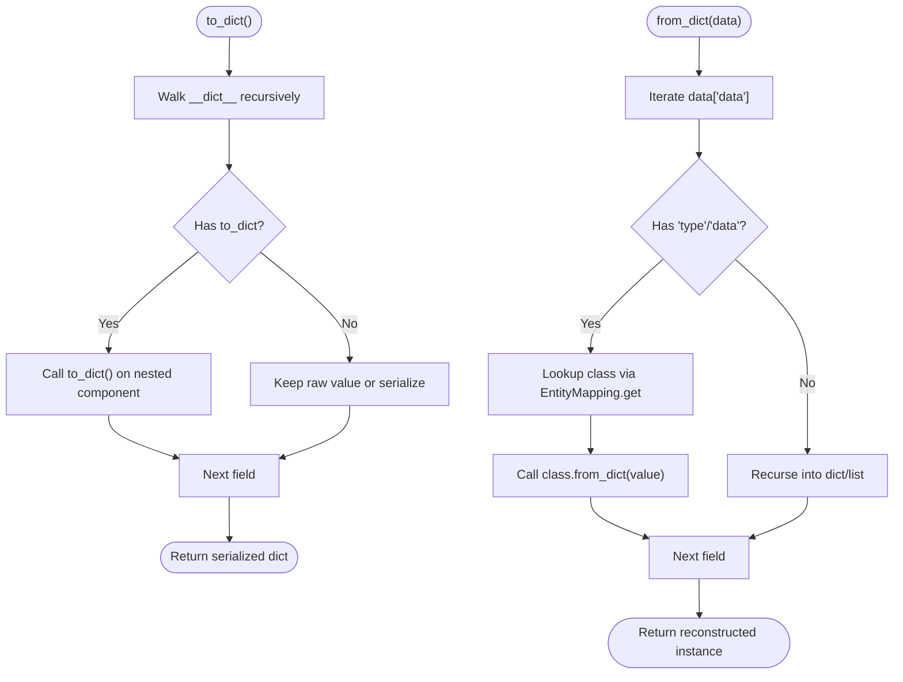
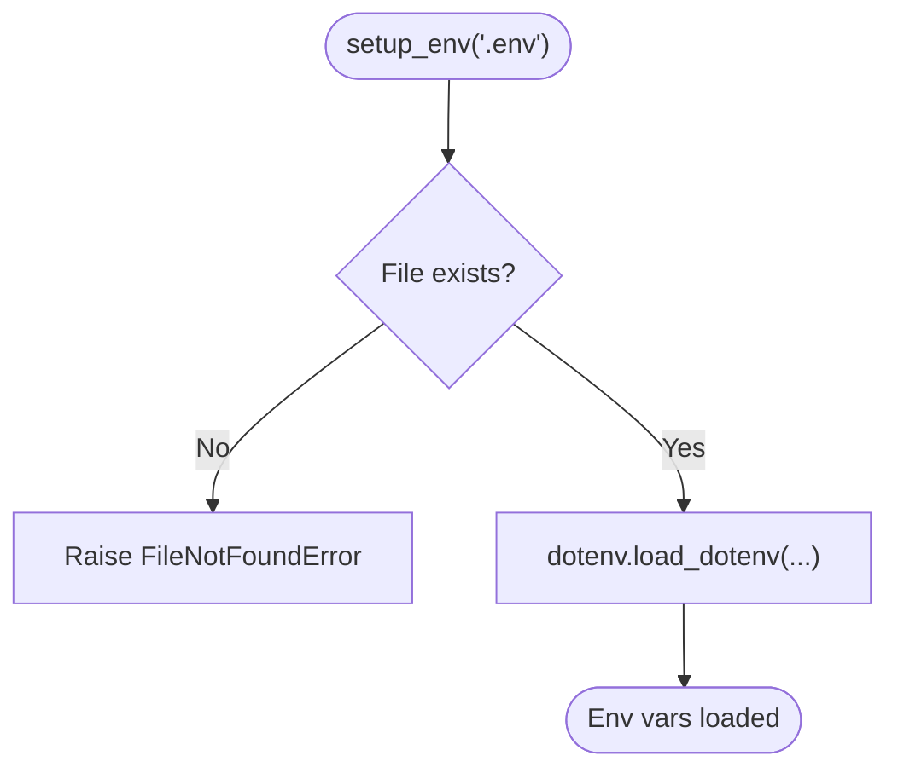
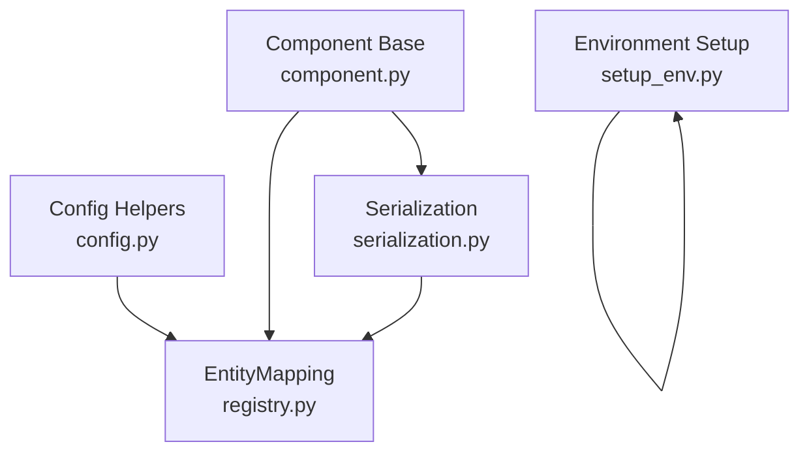

# Configuration Management

<cite>
**Referenced Files in This Document**
- [config.py](file://adalflow/adalflow/utils/config.py)
- [registry.py](file://adalflow/adalflow/utils/registry.py)
- [component.py](file://adalflow/adalflow/core/component.py)
- [serialization.py](file://adalflow/adalflow/utils/serialization.py)
- [setup_env.py](file://adalflow/adalflow/utils/setup_env.py)
- [rag.yaml](file://use_cases/configs/rag.yaml)
- [rag_hotpotqa.yaml](file://use_cases/configs/rag_hotpotqa.yaml)
- [simple_rag.yaml](file://use_cases/rag/simple_rag.yaml)
- [rag.py](file://tutorials/rag/rag.py)
</cite>

## Table of Contents
1. [Introduction](#introduction)
2. [Project Structure](#project-structure)
3. [Core Components](#core-components)
4. [Architecture Overview](#architecture-overview)
5. [Detailed Component Analysis](#detailed-component-analysis)
6. [Dependency Analysis](#dependency-analysis)
7. [Performance Considerations](#performance-considerations)
8. [Troubleshooting Guide](#troubleshooting-guide)
9. [Conclusion](#conclusion)
10. [Appendices](#appendices)

## Introduction
This document explains AdalFlow’s configuration management system and its pipeline reconstruction capabilities. It focuses on two configuration formats:
- Component-based reconstruction: nested component definitions with explicit component names and configuration dictionaries, enabling recursive building of complex pipelines.
- Direct instantiation pattern: simplified configuration dictionaries that map class names to their constructor arguments, suitable for manual construction.

The system leverages an EntityMapping registry to dynamically resolve and instantiate classes, supports JSON-based configuration, integrates environment variables via a dedicated setup utility, and provides robust serialization and deserialization for state restoration. The document also covers configuration validation, error handling strategies, and best practices for managing complex pipeline configurations.

## Project Structure
The configuration system spans several modules:
- Utilities for configuration parsing and component instantiation
- Core component base class with serialization and reconstruction hooks
- Serialization helpers for JSON-safe representation
- Environment variable setup
- YAML configuration examples for typical pipelines

**Diagram sources**
- [registry.py](file://adalflow/adalflow/utils/registry.py#L1-L22)
- [config.py](file://adalflow/adalflow/utils/config.py#L1-L101)
- [serialization.py](file://adalflow/adalflow/utils/serialization.py#L1-L138)
- [component.py](file://adalflow/adalflow/core/component.py#L1-L1200)
- [rag.yaml](file://use_cases/configs/rag.yaml#L1-L20)
- [rag_hotpotqa.yaml](file://use_cases/configs/rag_hotpotqa.yaml#L1-L25)
- [simple_rag.yaml](file://use_cases/rag/simple_rag.yaml#L1-L20)
- [rag.py](file://tutorials/rag/rag.py#L1-L106)

**Section sources**
- [registry.py](file://adalflow/adalflow/utils/registry.py#L1-L22)
- [config.py](file://adalflow/adalflow/utils/config.py#L1-L101)
- [serialization.py](file://adalflow/adalflow/utils/serialization.py#L1-L138)
- [component.py](file://adalflow/adalflow/core/component.py#L1-L1200)
- [rag.yaml](file://use_cases/configs/rag.yaml#L1-L20)
- [rag_hotpotqa.yaml](file://use_cases/configs/rag_hotpotqa.yaml#L1-L25)
- [simple_rag.yaml](file://use_cases/rag/simple_rag.yaml#L1-L20)
- [rag.py](file://tutorials/rag/rag.py#L1-L106)

## Core Components
- EntityMapping: A registry that maps string names to class types, enabling dynamic resolution of components during configuration-driven instantiation.
- Config helpers: Functions to create single components and multiple components from configuration dictionaries, supporting recursive construction of nested components.
- Component base class: Provides serialization (to_dict/from_dict), state restoration, and reconstruction from configuration dictionaries.
- Serialization utilities: Custom JSON encoder/decoder that preserves class types and instance state, integrating with the registry for restoration.
- Environment setup: Loads environment variables from a .env file to support configuration-driven secrets and settings.

Key responsibilities:
- Dynamic component creation from configuration
- Recursive component building and validation
- Safe serialization/deserialization for state persistence
- Registry-driven class resolution

**Section sources**
- [registry.py](file://adalflow/adalflow/utils/registry.py#L1-L22)
- [config.py](file://adalflow/adalflow/utils/config.py#L66-L101)
- [component.py](file://adalflow/adalflow/core/component.py#L294-L352)
- [serialization.py](file://adalflow/adalflow/utils/serialization.py#L30-L138)
- [setup_env.py](file://adalflow/adalflow/utils/setup_env.py#L8-L19)

## Architecture Overview
The configuration system orchestrates component creation and pipeline reconstruction through the following flow:
- Configuration dictionaries define components and their arguments.
- EntityMapping resolves class names to types.
- new_component recursively constructs nested components.
- Component.from_config builds instances from configuration dictionaries.
- Serialization utilities persist and restore component states.

**Diagram sources**
- [config.py](file://adalflow/adalflow/utils/config.py#L66-L101)
- [registry.py](file://adalflow/adalflow/utils/registry.py#L15-L17)
- [component.py](file://adalflow/adalflow/core/component.py#L308-L315)
- [serialization.py](file://adalflow/adalflow/utils/serialization.py#L30-L88)

## Detailed Component Analysis

### EntityMapping System
EntityMapping maintains a registry of class names to types. It supports registration, retrieval, and listing all registered entities. This enables dynamic component resolution from configuration names.

**Diagram sources**
- [registry.py](file://adalflow/adalflow/utils/registry.py#L4-L22)

**Section sources**
- [registry.py](file://adalflow/adalflow/utils/registry.py#L1-L22)

### Component-Based Reconstruction (Format Type 1)
Format Type 1 uses nested dictionaries with explicit component names and configuration blocks. The system recursively constructs components by resolving component_name and processing component_config.

Key behaviors:
- Validates presence of component_name
- Recursively instantiates nested components
- Builds component instances with resolved arguments

**Diagram sources**
- [config.py](file://adalflow/adalflow/utils/config.py#L66-L92)

**Section sources**
- [config.py](file://adalflow/adalflow/utils/config.py#L66-L101)

### Direct Instantiation Pattern (Format Type 2)
Format Type 2 allows constructing components directly from configuration dictionaries without requiring explicit attribute names. The Component base class provides from_config to instantiate components from configuration dictionaries, automatically resolving nested components marked with component_name.

Highlights:
- Copies configuration and replaces nested component entries with instantiated objects
- Supports recursive resolution of nested components

**Diagram sources**
- [component.py](file://adalflow/adalflow/core/component.py#L308-L315)
- [config.py](file://adalflow/adalflow/utils/config.py#L66-L92)
- [registry.py](file://adalflow/adalflow/utils/registry.py#L15-L17)

**Section sources**
- [component.py](file://adalflow/adalflow/core/component.py#L308-L315)

### Serialization and State Restoration
The system serializes components to dictionaries and restores them later, preserving types and state. The serialization utilities integrate with the registry to restore class instances safely.

Key mechanisms:
- Component.to_dict/_process_value recursively serialize nested components and special types
- Component.from_dict/_restore_value reconstructs instances using registry-resolved types
- serialization.default handles class and instance serialization with fallbacks
- serialization.deserialize uses object hooks to restore types via registry

**Diagram sources**
- [component.py](file://adalflow/adalflow/core/component.py#L230-L352)
- [serialization.py](file://adalflow/adalflow/utils/serialization.py#L30-L126)
- [registry.py](file://adalflow/adalflow/utils/registry.py#L15-L17)

**Section sources**
- [component.py](file://adalflow/adalflow/core/component.py#L230-L352)
- [serialization.py](file://adalflow/adalflow/utils/serialization.py#L30-L126)

### Environment Variable Integration
Environment variables are loaded from a .env file to support configuration-driven secrets and settings. The setup utility validates the existence of the file and loads variables with logging and error handling.

**Diagram sources**
- [setup_env.py](file://adalflow/adalflow/utils/setup_env.py#L8-L19)

**Section sources**
- [setup_env.py](file://adalflow/adalflow/utils/setup_env.py#L1-L19)

### Configuration Inheritance Patterns and Best Practices
- Use YAML for high-level pipeline configuration and pass structured dictionaries to component constructors.
- Prefer nested component definitions for complex pipelines to leverage recursive construction and clear hierarchy.
- Keep configuration keys aligned with component constructor signatures to minimize manual mapping.
- Use environment variables for secrets and provider-specific settings, loading them via setup_env before pipeline construction.
- Validate configuration shapes early by asserting required keys and types before instantiation.

Examples of configuration structures:
- YAML-based configuration for vectorizer, retriever, generator, and text splitter
- Tutorial-style composition combining components into a pipeline

**Section sources**
- [rag.yaml](file://use_cases/configs/rag.yaml#L1-L20)
- [rag_hotpotqa.yaml](file://use_cases/configs/rag_hotpotqa.yaml#L1-L25)
- [simple_rag.yaml](file://use_cases/rag/simple_rag.yaml#L1-L20)
- [rag.py](file://tutorials/rag/rag.py#L21-L33)

## Dependency Analysis
The configuration system relies on tight coupling between utilities and the core component base class. The registry centralizes class resolution, while serialization utilities depend on the registry for restoration.

**Diagram sources**
- [registry.py](file://adalflow/adalflow/utils/registry.py#L1-L22)
- [config.py](file://adalflow/adalflow/utils/config.py#L1-L101)
- [component.py](file://adalflow/adalflow/core/component.py#L1-L1200)
- [serialization.py](file://adalflow/adalflow/utils/serialization.py#L1-L138)
- [setup_env.py](file://adalflow/adalflow/utils/setup_env.py#L1-L19)

**Section sources**
- [registry.py](file://adalflow/adalflow/utils/registry.py#L1-L22)
- [config.py](file://adalflow/adalflow/utils/config.py#L1-L101)
- [component.py](file://adalflow/adalflow/core/component.py#L1-L1200)
- [serialization.py](file://adalflow/adalflow/utils/serialization.py#L1-L138)
- [setup_env.py](file://adalflow/adalflow/utils/setup_env.py#L1-L19)

## Performance Considerations
- Recursive component construction scales with nesting depth; keep configuration hierarchies reasonable.
- Serialization overhead increases with component complexity; use selective serialization and avoid unnecessary recursion.
- Registry lookups are O(1); ensure minimal redundant registrations.
- Environment variable loading should be performed once at startup to avoid repeated I/O.

## Troubleshooting Guide
Common issues and resolutions:
- Missing component_name in configuration: Ensure component_name is present for nested components to enable dynamic resolution.
- Unknown class type during restoration: Verify that classes are registered via EntityMapping before attempting reconstruction.
- Unpicklable objects: The system falls back to string representation; prefer components implementing to_dict for reliable restoration.
- Environment file errors: Confirm the .env file exists and is readable; setup_env raises explicit errors on failure.

Validation and error handling strategies:
- Assert required keys in configuration before instantiation.
- Use try/except around serialization/deserialization to capture and log errors.
- Leverage logging throughout the configuration and reconstruction pipeline for traceability.

**Section sources**
- [config.py](file://adalflow/adalflow/utils/config.py#L75-L77)
- [component.py](file://adalflow/adalflow/core/component.py#L332-L346)
- [serialization.py](file://adalflow/adalflow/utils/serialization.py#L117-L125)
- [setup_env.py](file://adalflow/adalflow/utils/setup_env.py#L11-L18)

## Conclusion
AdalFlow’s configuration management provides a flexible and powerful mechanism for defining, constructing, and reconstructing complex pipeline components. Through EntityMapping, recursive component building, and robust serialization, it supports both declarative configuration and programmatic composition. By following the recommended patterns—using YAML for high-level configuration, leveraging environment variables for secrets, validating configuration shapes, and relying on the registry for dynamic resolution—you can manage intricate pipeline setups with clarity and reliability.

## Appendices

### Configuration Formats and Examples
- Component-based reconstruction (Format Type 1): Nested dictionaries with component_name and component_config, enabling recursive building of pipelines.
- Direct instantiation pattern (Format Type 2): Simplified dictionaries mapping class names to constructor arguments, with automatic resolution of nested components.

YAML configuration examples:
- [rag.yaml](file://use_cases/configs/rag.yaml#L1-L20)
- [rag_hotpotqa.yaml](file://use_cases/configs/rag_hotpotqa.yaml#L1-L25)
- [simple_rag.yaml](file://use_cases/rag/simple_rag.yaml#L1-L20)

Tutorial usage:
- [rag.py](file://tutorials/rag/rag.py#L21-L33)