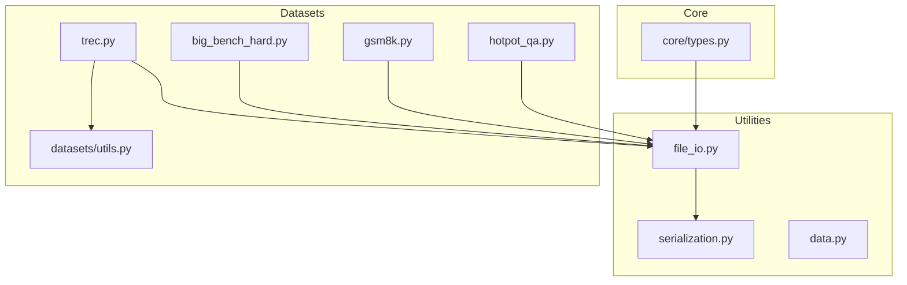
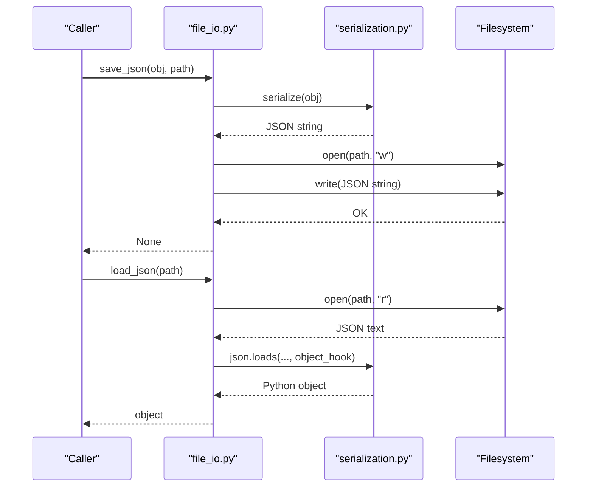
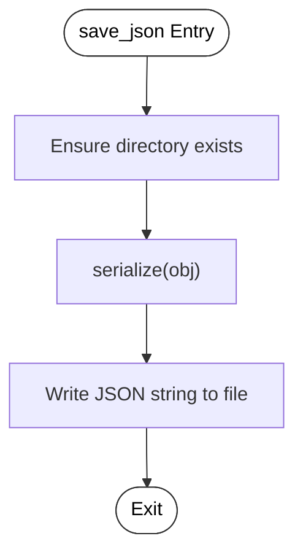
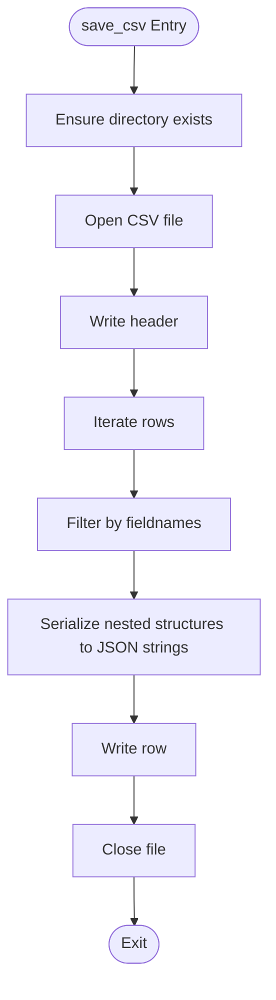
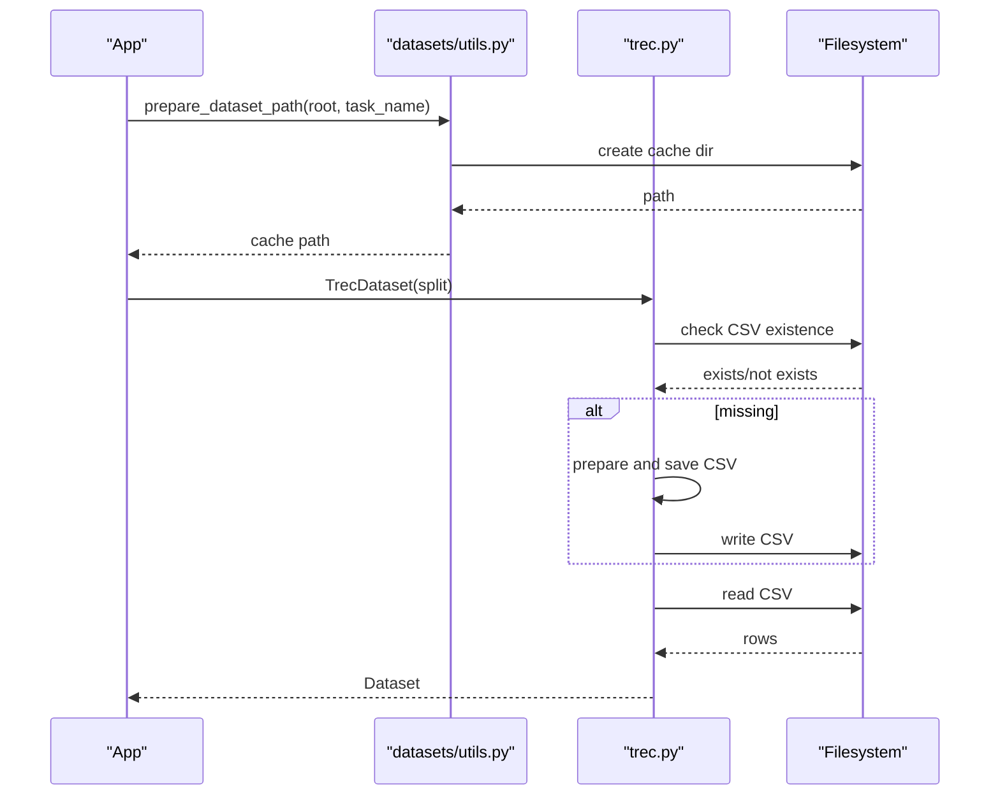
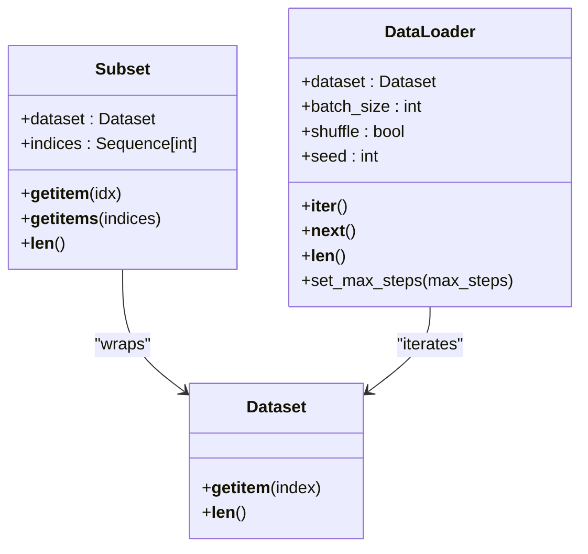
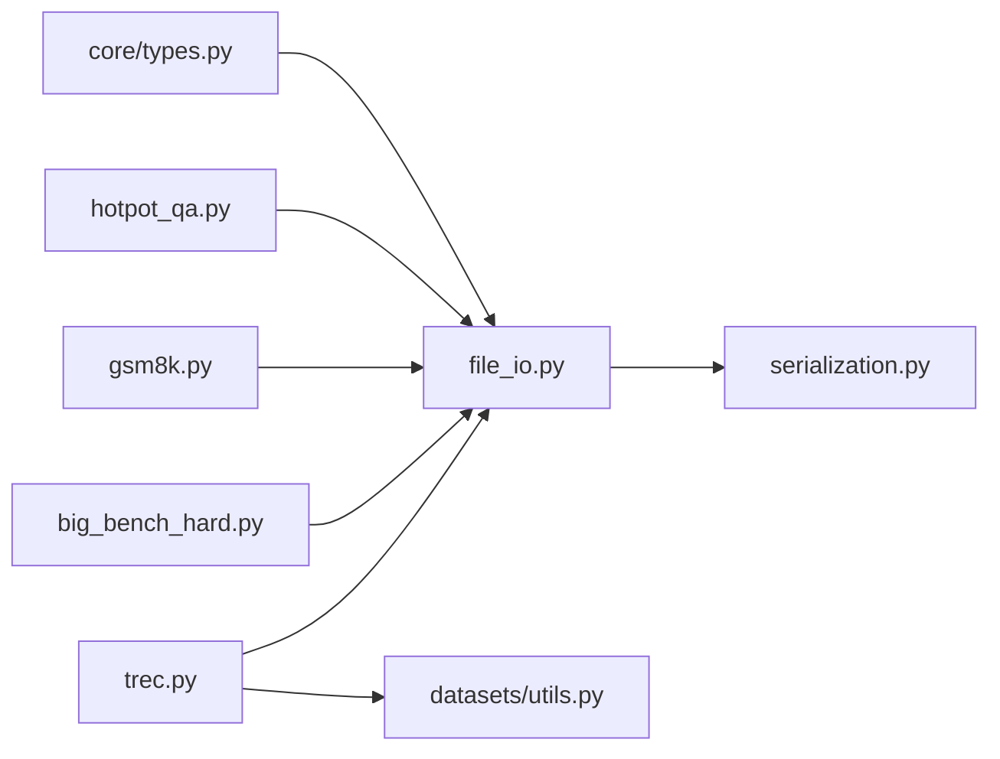

# File I/O Operations

<cite>
**Referenced Files in This Document**
- [file_io.py](file://adalflow/adalflow/utils/file_io.py)
- [serialization.py](file://adalflow/adalflow/utils/serialization.py)
- [data.py](file://adalflow/adalflow/utils/data.py)
- [trec.py](file://adalflow/adalflow/datasets/trec.py)
- [utils.py](file://adalflow/adalflow/datasets/utils.py)
- [types.py](file://adalflow/adalflow/core/types.py)
- [big_bench_hard.py](file://adalflow/adalflow/datasets/big_bench_hard.py)
- [gsm8k.py](file://adalflow/adalflow/datasets/gsm8k.py)
- [hotpot_qa.py](file://adalflow/adalflow/datasets/hotpot_qa.py)
- [trec.py (tutorial data)](file://tutorials/retriever/data.py)
</cite>

## Table of Contents
1. [Introduction](#introduction)
2. [Project Structure](#project-structure)
3. [Core Components](#core-components)
4. [Architecture Overview](#architecture-overview)
5. [Detailed Component Analysis](#detailed-component-analysis)
6. [Dependency Analysis](#dependency-analysis)
7. [Performance Considerations](#performance-considerations)
8. [Troubleshooting Guide](#troubleshooting-guide)
9. [Conclusion](#conclusion)
10. [Appendices](#appendices)

## Introduction
This document explains AdalFlow’s file I/O operations and data handling utilities. It covers supported file formats, reading and writing operations, data transformation functions, batch processing, streaming, and memory-efficient handling. It also documents CSV/JSON/JSONL processing, binary data handling, validation during I/O, error handling, encoding management, filesystem integration patterns, large file processing, compression support, and cross-platform compatibility considerations.

## Project Structure
AdalFlow organizes file I/O utilities under a dedicated module and integrates them with dataset loaders and core streaming types. The primary modules involved are:
- File I/O utilities: reading/writing JSON, CSV, Pickle, and JSONL
- Serialization helpers: custom JSON encoder/decoder for framework objects
- Dataset loaders: CSV-based datasets and caching to disk
- Streaming types: JSON streaming for agent events

**Diagram sources**
- [file_io.py](file://adalflow/adalflow/utils/file_io.py#L1-L257)
- [serialization.py](file://adalflow/adalflow/utils/serialization.py#L1-L138)
- [data.py](file://adalflow/adalflow/utils/data.py#L1-L143)
- [trec.py](file://adalflow/adalflow/datasets/trec.py#L1-L239)
- [utils.py](file://adalflow/adalflow/datasets/utils.py#L1-L12)
- [types.py](file://adalflow/adalflow/core/types.py#L1653-L1754)

**Section sources**
- [file_io.py](file://adalflow/adalflow/utils/file_io.py#L1-L257)
- [serialization.py](file://adalflow/adalflow/utils/serialization.py#L1-L138)
- [data.py](file://adalflow/adalflow/utils/data.py#L1-L143)
- [trec.py](file://adalflow/adalflow/datasets/trec.py#L1-L239)
- [utils.py](file://adalflow/adalflow/datasets/utils.py#L1-L12)
- [types.py](file://adalflow/adalflow/core/types.py#L1653-L1754)

## Core Components
- JSON I/O: save and load with custom serialization for framework objects; standardized loader without custom hooks
- CSV I/O: write lists of dictionaries to CSV with optional field filtering and nested structure serialization
- Pickle I/O: binary persistence for arbitrary Python objects
- JSONL I/O: streaming append and bulk write for line-delimited JSON logs
- Dataset I/O: CSV-backed datasets with caching and splitting
- Streaming I/O: JSON streaming for asynchronous agent events

Key APIs:
- Save/load JSON: [save_json](file://adalflow/adalflow/utils/file_io.py#L13-L31), [load_json](file://adalflow/adalflow/utils/file_io.py#L120-L139), [load_standard_json](file://adalflow/adalflow/utils/file_io.py#L142-L160)
- Save/load Pickle: [save_pickle](file://adalflow/adalflow/utils/file_io.py#L74-L86), [load_pickle](file://adalflow/adalflow/utils/file_io.py#L163-L176)
- Save CSV: [save_csv](file://adalflow/adalflow/utils/file_io.py#L42-L71)
- JSONL operations: [load_jsonl](file://adalflow/adalflow/utils/file_io.py#L193-L212), [append_to_jsonl](file://adalflow/adalflow/utils/file_io.py#L215-L236), [write_list_to_jsonl](file://adalflow/adalflow/utils/file_io.py#L239-L256)
- Combined save/load: [save](file://adalflow/adalflow/utils/file_io.py#L89-L101), [load](file://adalflow/adalflow/utils/file_io.py#L179-L190)
- Serialization helpers: [serialize](file://adalflow/adalflow/utils/serialization.py#L90-L100), [_deserialize_object_hook](file://adalflow/adalflow/utils/serialization.py#L108-L125), [to_dict](file://adalflow/adalflow/utils/serialization.py#L128-L137)
- Dataset I/O: [prepare_dataset_path](file://adalflow/adalflow/datasets/utils.py#L5-L11), CSV dataset [TrecDataset](file://adalflow/adalflow/datasets/trec.py#L148-L229)
- Streaming I/O: [stream_to_json](file://adalflow/adalflow/core/types.py#L1670-L1670), [stream_to_json_sync](file://adalflow/adalflow/core/types.py#L1739-L1739)

**Section sources**
- [file_io.py](file://adalflow/adalflow/utils/file_io.py#L13-L31)
- [file_io.py](file://adalflow/adalflow/utils/file_io.py#L42-L71)
- [file_io.py](file://adalflow/adalflow/utils/file_io.py#L74-L86)
- [file_io.py](file://adalflow/adalflow/utils/file_io.py#L89-L101)
- [file_io.py](file://adalflow/adalflow/utils/file_io.py#L120-L139)
- [file_io.py](file://adalflow/adalflow/utils/file_io.py#L142-L160)
- [file_io.py](file://adalflow/adalflow/utils/file_io.py#L163-L176)
- [file_io.py](file://adalflow/adalflow/utils/file_io.py#L179-L190)
- [file_io.py](file://adalflow/adalflow/utils/file_io.py#L193-L212)
- [file_io.py](file://adalflow/adalflow/utils/file_io.py#L215-L236)
- [file_io.py](file://adalflow/adalflow/utils/file_io.py#L239-L256)
- [serialization.py](file://adalflow/adalflow/utils/serialization.py#L90-L100)
- [serialization.py](file://adalflow/adalflow/utils/serialization.py#L108-L125)
- [serialization.py](file://adalflow/adalflow/utils/serialization.py#L128-L137)
- [utils.py](file://adalflow/adalflow/datasets/utils.py#L5-L11)
- [trec.py](file://adalflow/adalflow/datasets/trec.py#L148-L229)
- [types.py](file://adalflow/adalflow/core/types.py#L1670-L1670)
- [types.py](file://adalflow/adalflow/core/types.py#L1739-L1739)

## Architecture Overview
The file I/O architecture centers around a unified set of helpers that integrate with custom serialization to preserve framework object semantics. Datasets leverage CSV caching and splitting, while streaming types support JSON event logs.

**Diagram sources**
- [file_io.py](file://adalflow/adalflow/utils/file_io.py#L13-L31)
- [file_io.py](file://adalflow/adalflow/utils/file_io.py#L120-L139)
- [serialization.py](file://adalflow/adalflow/utils/serialization.py#L90-L100)
- [serialization.py](file://adalflow/adalflow/utils/serialization.py#L108-L125)

## Detailed Component Analysis

### JSON I/O
- Purpose: Persist and restore Python objects to/from JSON with custom serialization for framework-specific types.
- Features:
  - Custom serialization via [serialize](file://adalflow/adalflow/utils/serialization.py#L90-L100) and [default](file://adalflow/adalflow/utils/serialization.py#L30-L87)
  - Deserialization via [load_json](file://adalflow/adalflow/utils/file_io.py#L120-L139) with object hook
  - Standard loader without custom hooks via [load_standard_json](file://adalflow/adalflow/utils/file_io.py#L142-L160)
  - Batch save/load via [save](file://adalflow/adalflow/utils/file_io.py#L89-L101) and [load](file://adalflow/adalflow/utils/file_io.py#L179-L190)
- Encoding: UTF-8 by default for text files; custom serialization ensures portable representation
- Validation: JSON decode errors surfaced as ValueError; missing files raise FileNotFoundError for loaders

**Diagram sources**
- [file_io.py](file://adalflow/adalflow/utils/file_io.py#L13-L31)
- [serialization.py](file://adalflow/adalflow/utils/serialization.py#L90-L100)

**Section sources**
- [file_io.py](file://adalflow/adalflow/utils/file_io.py#L13-L31)
- [file_io.py](file://adalflow/adalflow/utils/file_io.py#L89-L101)
- [file_io.py](file://adalflow/adalflow/utils/file_io.py#L120-L139)
- [file_io.py](file://adalflow/adalflow/utils/file_io.py#L142-L160)
- [serialization.py](file://adalflow/adalflow/utils/serialization.py#L30-L87)
- [serialization.py](file://adalflow/adalflow/utils/serialization.py#L90-L100)

### CSV I/O
- Purpose: Write structured records to CSV with optional field filtering and nested structure serialization.
- Features:
  - Writer uses [save_csv](file://adalflow/adalflow/utils/file_io.py#L42-L71) with DictWriter
  - Nested structures (dict/list/tuple/set) serialized to JSON strings before writing
  - Fieldnames filter applied to ensure consistent schema
- Integration: Used by dataset preparation in [trec.py](file://adalflow/adalflow/datasets/trec.py#L204-L215)

**Diagram sources**
- [file_io.py](file://adalflow/adalflow/utils/file_io.py#L42-L71)
- [trec.py](file://adalflow/adalflow/datasets/trec.py#L204-L215)

**Section sources**
- [file_io.py](file://adalflow/adalflow/utils/file_io.py#L42-L71)
- [trec.py](file://adalflow/adalflow/datasets/trec.py#L204-L215)

### Pickle I/O
- Purpose: Binary persistence for arbitrary Python objects.
- Features:
  - Save via [save_pickle](file://adalflow/adalflow/utils/file_io.py#L74-L86)
  - Load via [load_pickle](file://adalflow/adalflow/utils/file_io.py#L163-L176)
- Notes: Cross-language compatibility is not guaranteed; suitable for Python-to-Python workflows

**Section sources**
- [file_io.py](file://adalflow/adalflow/utils/file_io.py#L74-L86)
- [file_io.py](file://adalflow/adalflow/utils/file_io.py#L163-L176)

### JSONL I/O
- Purpose: Stream line-delimited JSON for logs and event streams.
- Features:
  - Append single entries via [append_to_jsonl](file://adalflow/adalflow/utils/file_io.py#L215-L236)
  - Bulk write via [write_list_to_jsonl](file://adalflow/adalflow/utils/file_io.py#L239-L256)
  - Read entire file via [load_jsonl](file://adalflow/adalflow/utils/file_io.py#L193-L212)
- Integration: Used by tracing and streaming agent events

**Section sources**
- [file_io.py](file://adalflow/adalflow/utils/file_io.py#L193-L212)
- [file_io.py](file://adalflow/adalflow/utils/file_io.py#L215-L236)
- [file_io.py](file://adalflow/adalflow/utils/file_io.py#L239-L256)

### Dataset I/O and Caching
- Purpose: Download, split, and cache datasets locally in CSV format for reproducibility and offline use.
- Features:
  - Path preparation via [prepare_dataset_path](file://adalflow/adalflow/datasets/utils.py#L5-L11)
  - CSV-backed dataset [TrecDataset](file://adalflow/adalflow/datasets/trec.py#L148-L229) reads cached CSV files
  - Large datasets: [Big Bench Hard](file://adalflow/adalflow/datasets/big_bench_hard.py#L22-L22), [GSM8K](file://adalflow/adalflow/datasets/gsm8k.py#L66-L66), [HotPotQA](file://adalflow/adalflow/datasets/hotpot_qa.py#L47-L47) demonstrate CSV/JSON caching patterns

**Diagram sources**
- [utils.py](file://adalflow/adalflow/datasets/utils.py#L5-L11)
- [trec.py](file://adalflow/adalflow/datasets/trec.py#L171-L223)

**Section sources**
- [utils.py](file://adalflow/adalflow/datasets/utils.py#L5-L11)
- [trec.py](file://adalflow/adalflow/datasets/trec.py#L148-L229)
- [big_bench_hard.py](file://adalflow/adalflow/datasets/big_bench_hard.py#L22-L22)
- [gsm8k.py](file://adalflow/adalflow/datasets/gsm8k.py#L66-L66)
- [hotpot_qa.py](file://adalflow/adalflow/datasets/hotpot_qa.py#L47-L47)

### Streaming Operations
- Purpose: Emit and persist streaming events as JSON for observability and replay.
- Features:
  - Async streaming to JSON via [stream_to_json](file://adalflow/adalflow/core/types.py#L1670-L1670)
  - Sync streaming to JSON via [stream_to_json_sync](file://adalflow/adalflow/core/types.py#L1739-L1739)
- Integration: Used by agent runners to capture live events

**Section sources**
- [types.py](file://adalflow/adalflow/core/types.py#L1670-L1670)
- [types.py](file://adalflow/adalflow/core/types.py#L1739-L1739)

### Batch Processing and Memory Efficiency
- Purpose: Efficiently process large datasets and I/O workloads.
- Features:
  - Custom [Dataset](file://adalflow/adalflow/utils/data.py#L13-L36) and [DataLoader](file://adalflow/adalflow/utils/data.py#L72-L135) abstractions for batching and iteration
  - Optional batched retrieval via [Subset.__getitems__](file://adalflow/adalflow/utils/data.py#L60-L66)
  - Random sampling and subset creation via [subset_dataset](file://adalflow/adalflow/utils/data.py#L138-L142)
- Notes: DataLoader yields NumPy arrays or tuples; adjust batching to control memory footprint

**Diagram sources**
- [data.py](file://adalflow/adalflow/utils/data.py#L13-L36)
- [data.py](file://adalflow/adalflow/utils/data.py#L39-L69)
- [data.py](file://adalflow/adalflow/utils/data.py#L72-L135)

**Section sources**
- [data.py](file://adalflow/adalflow/utils/data.py#L13-L36)
- [data.py](file://adalflow/adalflow/utils/data.py#L39-L69)
- [data.py](file://adalflow/adalflow/utils/data.py#L72-L135)
- [data.py](file://adalflow/adalflow/utils/data.py#L138-L142)

### Data Transformation Functions
- Purpose: Convert framework objects to dictionaries and back for serialization.
- Features:
  - [to_dict](file://adalflow/adalflow/utils/serialization.py#L128-L137) converts objects to dicts using [serialize](file://adalflow/adalflow/utils/serialization.py#L90-L100)
  - [serialize](file://adalflow/adalflow/utils/serialization.py#L90-L100) uses custom default handler for sets and framework instances
  - [deserialize](file://adalflow/adalflow/utils/serialization.py#L103-L105) and [_deserialize_object_hook](file://adalflow/adalflow/utils/serialization.py#L108-L125) reconstruct objects from JSON

**Section sources**
- [serialization.py](file://adalflow/adalflow/utils/serialization.py#L90-L100)
- [serialization.py](file://adalflow/adalflow/utils/serialization.py#L103-L105)
- [serialization.py](file://adalflow/adalflow/utils/serialization.py#L108-L125)
- [serialization.py](file://adalflow/adalflow/utils/serialization.py#L128-L137)

### Examples Index
- CSV/JSON/JSONL processing:
  - CSV write: [save_csv](file://adalflow/adalflow/utils/file_io.py#L42-L71) used by [TrecDataset](file://adalflow/adalflow/datasets/trec.py#L204-L215)
  - JSON save/load: [save_json](file://adalflow/adalflow/utils/file_io.py#L13-L31), [load_json](file://adalflow/adalflow/utils/file_io.py#L120-L139)
  - JSONL append/write: [append_to_jsonl](file://adalflow/adalflow/utils/file_io.py#L215-L236), [write_list_to_jsonl](file://adalflow/adalflow/utils/file_io.py#L239-L256)
- Binary data handling:
  - Pickle save/load: [save_pickle](file://adalflow/adalflow/utils/file_io.py#L74-L86), [load_pickle](file://adalflow/adalflow/utils/file_io.py#L163-L176)
- Data validation during I/O:
  - JSON decode errors: [load_json](file://adalflow/adalflow/utils/file_io.py#L136-L138), [load_standard_json](file://adalflow/adalflow/utils/file_io.py#L157-L159)
  - Missing files: [load_json](file://adalflow/adalflow/utils/file_io.py#L129-L130), [load_jsonl](file://adalflow/adalflow/utils/file_io.py#L203-L205)
- Streaming operations:
  - Agent event streaming: [stream_to_json](file://adalflow/adalflow/core/types.py#L1670-L1670), [stream_to_json_sync](file://adalflow/adalflow/core/types.py#L1739-L1739)

**Section sources**
- [file_io.py](file://adalflow/adalflow/utils/file_io.py#L42-L71)
- [file_io.py](file://adalflow/adalflow/utils/file_io.py#L13-L31)
- [file_io.py](file://adalflow/adalflow/utils/file_io.py#L120-L139)
- [file_io.py](file://adalflow/adalflow/utils/file_io.py#L136-L138)
- [file_io.py](file://adalflow/adalflow/utils/file_io.py#L129-L130)
- [file_io.py](file://adalflow/adalflow/utils/file_io.py#L203-L205)
- [file_io.py](file://adalflow/adalflow/utils/file_io.py#L215-L236)
- [file_io.py](file://adalflow/adalflow/utils/file_io.py#L239-L256)
- [file_io.py](file://adalflow/adalflow/utils/file_io.py#L74-L86)
- [file_io.py](file://adalflow/adalflow/utils/file_io.py#L163-L176)
- [types.py](file://adalflow/adalflow/core/types.py#L1670-L1670)
- [types.py](file://adalflow/adalflow/core/types.py#L1739-L1739)

## Dependency Analysis
- Serialization depends on custom object hooks and registry mappings to reconstruct framework types
- Dataset loaders depend on filesystem paths and CSV readers/writers
- Streaming depends on JSONL writers and async generators

**Diagram sources**
- [file_io.py](file://adalflow/adalflow/utils/file_io.py#L1-L257)
- [serialization.py](file://adalflow/adalflow/utils/serialization.py#L1-L138)
- [trec.py](file://adalflow/adalflow/datasets/trec.py#L1-L239)
- [utils.py](file://adalflow/adalflow/datasets/utils.py#L1-L12)
- [big_bench_hard.py](file://adalflow/adalflow/datasets/big_bench_hard.py#L1-L140)
- [gsm8k.py](file://adalflow/adalflow/datasets/gsm8k.py#L1-L148)
- [hotpot_qa.py](file://adalflow/adalflow/datasets/hotpot_qa.py#L1-L341)
- [types.py](file://adalflow/adalflow/core/types.py#L1653-L1754)

**Section sources**
- [file_io.py](file://adalflow/adalflow/utils/file_io.py#L1-L257)
- [serialization.py](file://adalflow/adalflow/utils/serialization.py#L1-L138)
- [trec.py](file://adalflow/adalflow/datasets/trec.py#L1-L239)
- [utils.py](file://adalflow/adalflow/datasets/utils.py#L1-L12)
- [big_bench_hard.py](file://adalflow/adalflow/datasets/big_bench_hard.py#L1-L140)
- [gsm8k.py](file://adalflow/adalflow/datasets/gsm8k.py#L1-L148)
- [hotpot_qa.py](file://adalflow/adalflow/datasets/hotpot_qa.py#L1-L341)
- [types.py](file://adalflow/adalflow/core/types.py#L1653-L1754)

## Performance Considerations
- Prefer JSONL for streaming logs to avoid large in-memory structures
- Use DataLoader batching to reduce memory pressure during training/inference loops
- For large CSV datasets, pre-cache to local storage to minimize network overhead
- Avoid unnecessary serialization of large nested structures; flatten or paginate when possible
- Use async streaming APIs for real-time event emission to decouple producers and consumers

## Troubleshooting Guide
- JSON decode errors: caught and raised as ValueError; verify file integrity and encoding
- Missing files: loaders raise FileNotFoundError; ensure paths are correct and files exist
- Import errors: JSONL functions require the optional library; install to enable functionality
- Permission errors: ensure write permissions for cache directories and target paths
- Large file handling: prefer streaming and chunked processing; avoid loading entire files into memory

Common exceptions and locations:
- JSON decode: [load_json](file://adalflow/adalflow/utils/file_io.py#L136-L138), [load_standard_json](file://adalflow/adalflow/utils/file_io.py#L157-L159)
- Missing file: [load_json](file://adalflow/adalflow/utils/file_io.py#L129-L130), [load_jsonl](file://adalflow/adalflow/utils/file_io.py#L203-L205)
- JSONL import: [load_jsonl](file://adalflow/adalflow/utils/file_io.py#L201-L202), [append_to_jsonl](file://adalflow/adalflow/utils/file_io.py#L225-L227), [write_list_to_jsonl](file://adalflow/adalflow/utils/file_io.py#L247-L249)

**Section sources**
- [file_io.py](file://adalflow/adalflow/utils/file_io.py#L129-L130)
- [file_io.py](file://adalflow/adalflow/utils/file_io.py#L136-L138)
- [file_io.py](file://adalflow/adalflow/utils/file_io.py#L157-L159)
- [file_io.py](file://adalflow/adalflow/utils/file_io.py#L201-L202)
- [file_io.py](file://adalflow/adalflow/utils/file_io.py#L203-L205)
- [file_io.py](file://adalflow/adalflow/utils/file_io.py#L225-L227)
- [file_io.py](file://adalflow/adalflow/utils/file_io.py#L247-L249)

## Conclusion
AdalFlow’s file I/O utilities provide a cohesive toolkit for JSON, CSV, Pickle, and JSONL operations, integrated with custom serialization for framework objects. The system supports dataset caching, streaming, and batch processing patterns, enabling robust, memory-efficient workflows across diverse data formats and use cases.

## Appendices
- Encoding management: Text files use UTF-8 by default; ensure consistent encoding across platforms
- Compression support: No built-in compression; consider external tools or libraries for gzip/bz2
- Cross-platform compatibility: Use forward slashes in paths; rely on os.path utilities for portability
- Example datasets and usage:
  - CSV dataset: [TrecDataset](file://adalflow/adalflow/datasets/trec.py#L148-L229)
  - Tutorial data: [retriever data](file://tutorials/retriever/data.py#L1-L22)