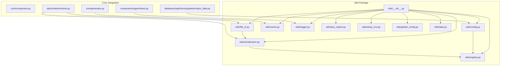
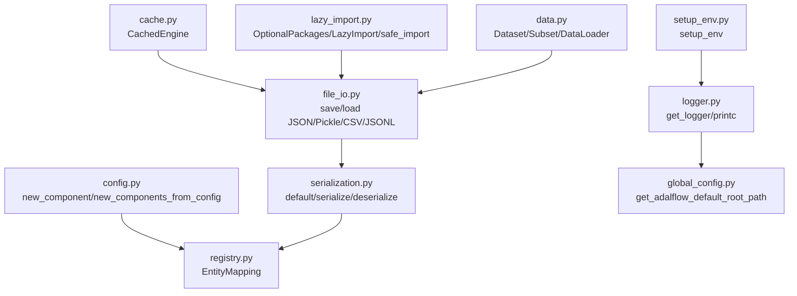
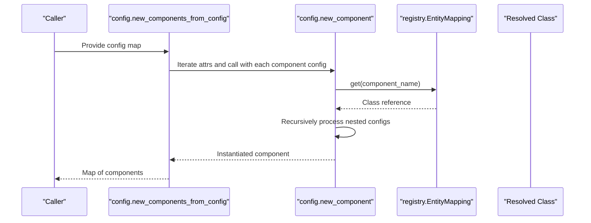
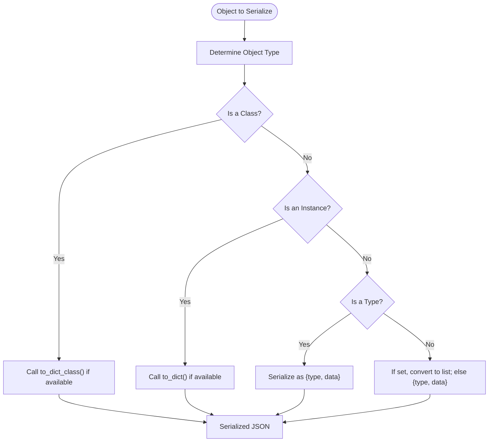
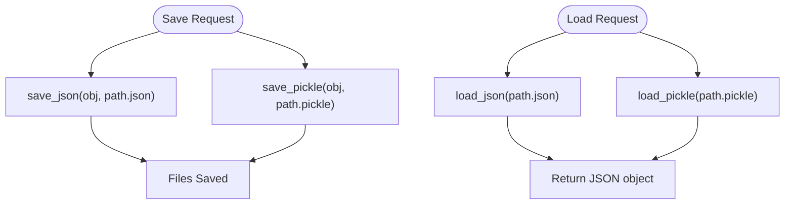
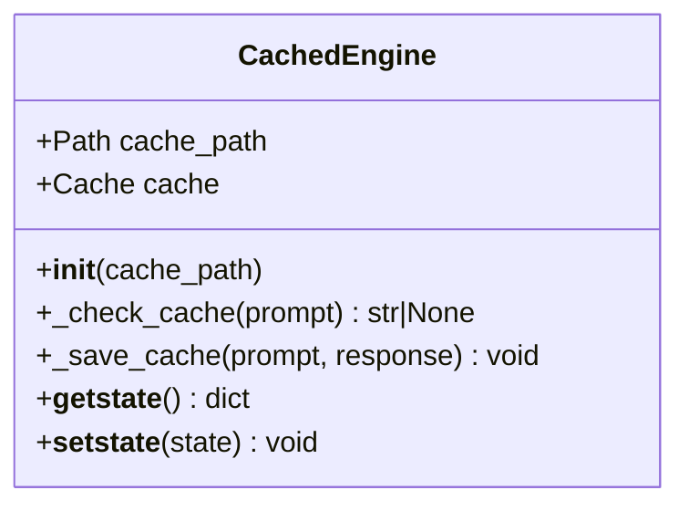
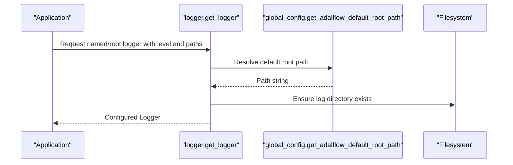
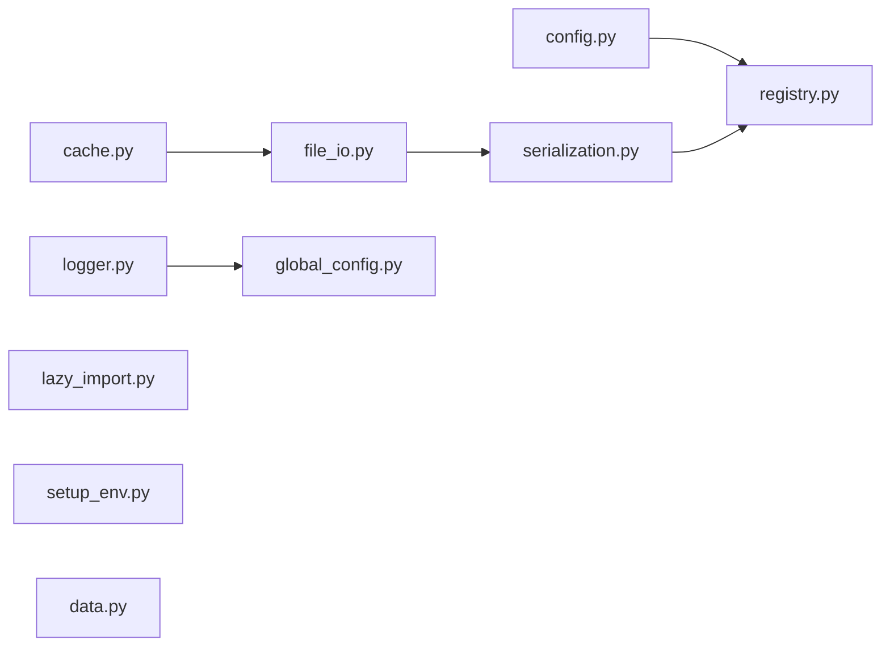

# Utilities and Helpers

<cite>
**Referenced Files in This Document**
- [__init__.py](file://adalflow/adalflow/utils/__init__.py)
- [config.py](file://adalflow/adalflow/utils/config.py)
- [cache.py](file://adalflow/adalflow/utils/cache.py)
- [file_io.py](file://adalflow/adalflow/utils/file_io.py)
- [serialization.py](file://adalflow/adalflow/utils/serialization.py)
- [logger.py](file://adalflow/adalflow/utils/logger.py)
- [registry.py](file://adalflow/adalflow/utils/registry.py)
- [lazy_import.py](file://adalflow/adalflow/utils/lazy_import.py)
- [setup_env.py](file://adalflow/adalflow/utils/setup_env.py)
- [global_config.py](file://adalflow/adalflow/utils/global_config.py)
- [data.py](file://adalflow/adalflow/utils/data.py)
- [component.py](file://adalflow/adalflow/core/component.py)
- [generator.py](file://adalflow/adalflow/core/generator.py)
- [trainer.py](file://adalflow/adalflow/optim/trainer/trainer.py)
- [react.py](file://adalflow/adalflow/components/agent/react.py)
- [inject_data.py](file://adalflow/adalflow/database/sqlalchemy/pipeline/inject_data.py)
- [rag.yaml](file://use_cases/configs/rag.yaml)
</cite>

## Table of Contents
1. [Introduction](#introduction)
2. [Project Structure](#project-structure)
3. [Core Components](#core-components)
4. [Architecture Overview](#architecture-overview)
5. [Detailed Component Analysis](#detailed-component-analysis)
6. [Dependency Analysis](#dependency-analysis)
7. [Performance Considerations](#performance-considerations)
8. [Troubleshooting Guide](#troubleshooting-guide)
9. [Conclusion](#conclusion)
10. [Appendices](#appendices)

## Introduction
This document explains AdalFlow’s Utilities and Helpers—its supporting infrastructure that enables robust configuration management, caching, file I/O, serialization, logging, environment setup, and optional-package handling. These utilities are foundational to the framework’s extensibility, maintainability, and performance. They integrate closely with core components such as generators, trainers, and data pipelines, enabling reproducible configurations, efficient caching, and streamlined development workflows.

## Project Structure
The utilities live under adalflow/adalflow/utils and expose a curated public API via the package’s __init__.py. The modules are organized by responsibility:
- Configuration and component instantiation
- Serialization and deserialization
- File I/O helpers for JSON, CSV, Pickle, and JSONL
- Logging and colored console printing
- Registry for dynamic entity resolution
- Lazy imports for optional dependencies
- Environment variable loading
- Global defaults for paths
- Lightweight data abstractions

**Diagram sources**
- [__init__.py](file://adalflow/adalflow/utils/__init__.py#L1-L55)
- [config.py](file://adalflow/adalflow/utils/config.py#L66-L101)
- [serialization.py](file://adalflow/adalflow/utils/serialization.py#L108-L138)
- [file_io.py](file://adalflow/adalflow/utils/file_io.py#L13-L257)
- [cache.py](file://adalflow/adalflow/utils/cache.py#L19-L48)
- [logger.py](file://adalflow/adalflow/utils/logger.py#L100-L169)
- [registry.py](file://adalflow/adalflow/utils/registry.py#L4-L22)
- [lazy_import.py](file://adalflow/adalflow/utils/lazy_import.py#L114-L172)
- [setup_env.py](file://adalflow/adalflow/utils/setup_env.py#L8-L19)
- [global_config.py](file://adalflow/adalflow/utils/global_config.py#L5-L13)
- [data.py](file://adalflow/adalflow/utils/data.py#L12-L143)
- [component.py](file://adalflow/adalflow/core/component.py#L27-L28)
- [generator.py](file://adalflow/adalflow/core/generator.py#L40)
- [trainer.py](file://adalflow/adalflow/optim/trainer/trainer.py#L31-L34)
- [react.py](file://adalflow/adalflow/components/agent/react.py#L26)
- [inject_data.py](file://adalflow/adalflow/database/sqlalchemy/pipeline/inject_data.py#L5)

**Section sources**
- [__init__.py](file://adalflow/adalflow/utils/__init__.py#L1-L55)

## Core Components
This section highlights the primary utility modules and their roles.

- Configuration Management
  - new_component and new_components_from_config parse configuration dictionaries and instantiate components via a registry. They support nested component construction and are used widely across pipelines and data injection.
  - Example usage appears in database pipeline injection and training workflows.

- Serialization Utilities
  - default, serialize, deserialize, to_dict provide a robust JSON serialization strategy for framework objects, sets, and external types. Deserialization leverages a registry-based reconstruction hook.

- File I/O Operations
  - save/load for JSON/Pickle pairs, load_json/load_pickle, CSV writers, and JSONL readers/writers. Includes convenience functions for appending and batch writes.

- Caching Mechanisms
  - CachedEngine wraps diskcache with prompt hashing and lifecycle hooks for pickling/unpickling.

- Logging and Console Printing
  - get_logger configures named and root loggers with file and console handlers. printc offers color-coded, position-aware console prints.

- Registry
  - EntityMapping registers and resolves classes/functions by name, powering configuration-driven instantiation.

- Lazy Imports
  - OptionalPackages and LazyImport defer importing optional dependencies until needed, raising clear installation messages.

- Environment Setup
  - setup_env loads environment variables from a .env file.

- Global Paths
  - get_adalflow_default_root_path centralizes default storage locations across platforms.

- Data Abstractions
  - Dataset, Subset, DataLoader mirror lightweight PyTorch data utilities for non-tensor data.

**Section sources**
- [config.py](file://adalflow/adalflow/utils/config.py#L66-L101)
- [serialization.py](file://adalflow/adalflow/utils/serialization.py#L30-L138)
- [file_io.py](file://adalflow/adalflow/utils/file_io.py#L13-L257)
- [cache.py](file://adalflow/adalflow/utils/cache.py#L19-L48)
- [logger.py](file://adalflow/adalflow/utils/logger.py#L100-L169)
- [registry.py](file://adalflow/adalflow/utils/registry.py#L4-L22)
- [lazy_import.py](file://adalflow/adalflow/utils/lazy_import.py#L13-L227)
- [setup_env.py](file://adalflow/adalflow/utils/setup_env.py#L8-L19)
- [global_config.py](file://adalflow/adalflow/utils/global_config.py#L5-L13)
- [data.py](file://adalflow/adalflow/utils/data.py#L12-L143)

## Architecture Overview
The utilities form a cohesive layer that:
- Enables declarative configuration-driven composition of components
- Provides deterministic serialization/deserialization for reproducibility
- Offers efficient caching for expensive operations
- Standardizes logging and environment setup across modules
- Deferloads optional integrations to keep startup lean

**Diagram sources**
- [config.py](file://adalflow/adalflow/utils/config.py#L66-L101)
- [registry.py](file://adalflow/adalflow/utils/registry.py#L4-L22)
- [serialization.py](file://adalflow/adalflow/utils/serialization.py#L30-L138)
- [file_io.py](file://adalflow/adalflow/utils/file_io.py#L13-L257)
- [cache.py](file://adalflow/adalflow/utils/cache.py#L19-L48)
- [logger.py](file://adalflow/adalflow/utils/logger.py#L100-L169)
- [lazy_import.py](file://adalflow/adalflow/utils/lazy_import.py#L114-L172)
- [setup_env.py](file://adalflow/adalflow/utils/setup_env.py#L8-L19)
- [global_config.py](file://adalflow/adalflow/utils/global_config.py#L5-L13)
- [data.py](file://adalflow/adalflow/utils/data.py#L12-L143)

## Detailed Component Analysis

### Configuration Management
- Purpose: Construct framework components from configuration dictionaries, supporting nested instantiation and entity resolution via a registry.
- Key APIs:
  - new_component: Builds a single component from a config dict.
  - new_components_from_config: Builds multiple components keyed by attribute names.
- Behavior:
  - Validates presence of component_name.
  - Resolves class via EntityMapping.
  - Recursively instantiates nested components whose config dicts include component_name.
- Integration:
  - Used in database pipeline injection and training workflows to rebuild pipelines from persisted configs.

**Diagram sources**
- [config.py](file://adalflow/adalflow/utils/config.py#L95-L101)
- [config.py](file://adalflow/adalflow/utils/config.py#L66-L93)
- [registry.py](file://adalflow/adalflow/utils/registry.py#L16)

**Section sources**
- [config.py](file://adalflow/adalflow/utils/config.py#L66-L101)
- [inject_data.py](file://adalflow/adalflow/database/sqlalchemy/pipeline/inject_data.py#L5)

### Serialization Utilities
- Purpose: Provide a unified serialization strategy for framework objects, sets, and external types, ensuring deterministic round-trips.
- Key APIs:
  - default: Custom JSON encoder for classes, instances, types, sets, and fallbacks.
  - serialize/deserialize: Convert objects to/from JSON strings.
  - to_dict: Convenience wrapper around serialize+json.loads.
  - _deserialize_object_hook: Reconstructs objects using registry-based from_dict when available.
- Integration:
  - Core component base uses default for JSON serialization.
  - Trainer and file I/O rely on serialize/to_dict for consistent persistence.

**Diagram sources**
- [serialization.py](file://adalflow/adalflow/utils/serialization.py#L30-L88)

**Section sources**
- [serialization.py](file://adalflow/adalflow/utils/serialization.py#L30-L138)
- [component.py](file://adalflow/adalflow/core/component.py#L27-L28)
- [trainer.py](file://adalflow/adalflow/optim/trainer/trainer.py#L758)

### File I/O Operations
- Purpose: Provide robust, standardized file operations for JSON, CSV, Pickle, and JSONL formats with consistent error handling and serialization hooks.
- Key APIs:
  - save_json/save_pickle/save: Persist objects to JSON and/or Pickle.
  - load_json/load_pickle/load: Load paired JSON/Pickle artifacts.
  - save_csv: Write structured lists to CSV with JSON-serialized nested fields.
  - load_jsonl/append_to_jsonl/write_list_to_jsonl: Manage JSONL streams for logging and batching.
- Integration:
  - Datasets and trainers use these helpers for artifact persistence and trace logging.

**Diagram sources**
- [file_io.py](file://adalflow/adalflow/utils/file_io.py#L13-L102)
- [file_io.py](file://adalflow/adalflow/utils/file_io.py#L179-L191)

**Section sources**
- [file_io.py](file://adalflow/adalflow/utils/file_io.py#L13-L257)

### Caching Mechanisms
- Purpose: Cache expensive computations keyed by hashed prompts to accelerate repeated runs.
- Key APIs:
  - hash_text/hash_text_sha1/direct: Hashing strategies for cache keys.
  - CachedEngine: Wraps diskcache with automatic directory creation, cache persistence across pickle/unpickle, and prompt-key lookup/insertion.
- Integration:
  - Generators leverage CachedEngine to avoid redundant model calls.

**Diagram sources**
- [cache.py](file://adalflow/adalflow/utils/cache.py#L19-L48)

**Section sources**
- [cache.py](file://adalflow/adalflow/utils/cache.py#L19-L48)
- [generator.py](file://adalflow/adalflow/core/generator.py#L40)

### Logging and Console Printing
- Purpose: Centralized logging configuration and color-enhanced console printing for quick diagnostics.
- Key APIs:
  - get_logger: Configure root or named loggers with file and console handlers, default formats, and levels.
  - printc: Print with timestamp, caller position, and color.
- Integration:
  - Agents and tutorials use printc for concise console output.

**Diagram sources**
- [logger.py](file://adalflow/adalflow/utils/logger.py#L100-L169)
- [global_config.py](file://adalflow/adalflow/utils/global_config.py#L5-L13)

**Section sources**
- [logger.py](file://adalflow/adalflow/utils/logger.py#L100-L169)
- [react.py](file://adalflow/adalflow/components/agent/react.py#L26)

### Registry
- Purpose: Dynamic mapping from string names to classes/functions for configuration-driven instantiation.
- Key APIs:
  - register(name, entity_cls), get(name), get_all().
- Integration:
  - Config and serialization modules rely on it to resolve types during construction and reconstruction.

**Section sources**
- [registry.py](file://adalflow/adalflow/utils/registry.py#L4-L22)
- [config.py](file://adalflow/adalflow/utils/config.py#L80)
- [serialization.py](file://adalflow/adalflow/utils/serialization.py#L117-L125)

### Lazy Imports
- Purpose: Defer importing optional dependencies until needed, reducing cold-start overhead and providing actionable errors.
- Key APIs:
  - OptionalPackages: Enum of optional packages with install hints.
  - LazyImport: Proxy class that loads on first access.
  - safe_import: Import one or multiple modules safely.
- Integration:
  - Internal components use these to gate optional integrations.

**Section sources**
- [lazy_import.py](file://adalflow/adalflow/utils/lazy_import.py#L13-L227)

### Environment Setup
- Purpose: Load environment variables from a .env file into the process.
- Key API:
  - setup_env: Validates existence and loads variables.
- Integration:
  - Model clients and CLI components call setup_env early.

**Section sources**
- [setup_env.py](file://adalflow/adalflow/utils/setup_env.py#L8-L19)

### Global Paths
- Purpose: Provide a cross-platform default root path for datasets, logs, cache, and trained models.
- Key API:
  - get_adalflow_default_root_path: Returns APPDATA on Windows, ~/.adalflow elsewhere.
- Integration:
  - Logger uses it to set default log directories.

**Section sources**
- [global_config.py](file://adalflow/adalflow/utils/global_config.py#L5-L13)
- [logger.py](file://adalflow/adalflow/utils/logger.py#L146)

### Data Abstractions
- Purpose: Provide lightweight Dataset, Subset, and DataLoader equivalents for non-tensor data pipelines.
- Key APIs:
  - Dataset: Abstract base with __getitem__/__len__.
  - Subset: View over a dataset at given indices with batched __getitems__ support.
  - DataLoader: Iterates shuffled indices, batches items, and supports max steps.
  - subset_dataset: Utility to create random subsets for testing.
- Integration:
  - Training and evaluation workflows use these for data iteration.

**Section sources**
- [data.py](file://adalflow/adalflow/utils/data.py#L12-L143)

## Dependency Analysis
Utilities are loosely coupled and highly cohesive within their domains. The main dependency edges are:
- config depends on registry
- serialization depends on registry for reconstruction
- file_io depends on serialization for JSON persistence
- cache depends on diskcache and file system
- logger depends on global_config for default paths
- lazy_import is standalone but integrates with downstream modules
- setup_env is standalone but used by model clients and CLI
- data is standalone and used broadly

**Diagram sources**
- [config.py](file://adalflow/adalflow/utils/config.py#L63)
- [serialization.py](file://adalflow/adalflow/utils/serialization.py#L8)
- [file_io.py](file://adalflow/adalflow/utils/file_io.py#L8)
- [cache.py](file://adalflow/adalflow/utils/cache.py#L2)
- [logger.py](file://adalflow/adalflow/utils/logger.py#L27)
- [lazy_import.py](file://adalflow/adalflow/utils/lazy_import.py#L1-L227)
- [setup_env.py](file://adalflow/adalflow/utils/setup_env.py#L1-L19)
- [data.py](file://adalflow/adalflow/utils/data.py#L1-L143)

**Section sources**
- [__init__.py](file://adalflow/adalflow/utils/__init__.py#L1-L55)

## Performance Considerations
- Serialization
  - Prefer to_dict-based serialization for framework objects to minimize reflection overhead.
  - Use sets sparingly; they are serialized as lists for portability.
- File I/O
  - Batch operations: write_list_to_jsonl for large datasets; append_to_jsonl for streaming traces.
  - Use save_json/save_pickle to persist both forms for deterministic recovery.
- Caching
  - Choose appropriate hashing strategy (hash_text for strong uniqueness, hash_text_sha1 for shorter keys).
  - Ensure cache directories exist and are writable; CachedEngine creates directories automatically.
- Logging
  - Limit file logging verbosity in production; use named loggers to avoid root propagation overhead.
- Lazy Imports
  - Keep optional imports deferred to reduce cold-start time and memory footprint.
- Data Pipelines
  - Use DataLoader with deterministic seeds for reproducible shuffling.
  - Use Subset for quick iterations during development.

[No sources needed since this section provides general guidance]

## Troubleshooting Guide
- Configuration errors
  - Missing component_name in config leads to assertion failures during component construction.
  - Nested components must include component_name to be recursively built.
- Serialization errors
  - Objects without to_dict/to_dict_class fall back to string serialization; ensure custom types implement from_dict via registry.
  - JSON decode errors indicate malformed JSON; verify save/load pairs and encoding.
- File I/O errors
  - FileNotFoundError for missing JSON files; IOError for write/read failures; ensure paths exist and permissions are sufficient.
  - JSONL requires jsonlines; ImportError indicates missing dependency.
- Caching issues
  - Diskcache exceptions often relate to file system permissions or path invalidity; verify cache_path and disk availability.
- Logging issues
  - Missing log directories cause failures; ensure get_adalflow_default_root_path resolves correctly and directories are writable.
- Lazy import failures
  - ImportError with install hints indicates missing optional packages; install per OptionalPackages messages.
- Environment setup
  - setup_env raises FileNotFoundError if .env is missing; ensure the file exists and is readable.

**Section sources**
- [config.py](file://adalflow/adalflow/utils/config.py#L75-L92)
- [serialization.py](file://adalflow/adalflow/utils/serialization.py#L108-L125)
- [file_io.py](file://adalflow/adalflow/utils/file_io.py#L129-L140)
- [file_io.py](file://adalflow/adalflow/utils/file_io.py#L200-L203)
- [cache.py](file://adalflow/adalflow/utils/cache.py#L20-L26)
- [logger.py](file://adalflow/adalflow/utils/logger.py#L146-L168)
- [lazy_import.py](file://adalflow/adalflow/utils/lazy_import.py#L174-L227)
- [setup_env.py](file://adalflow/adalflow/utils/setup_env.py#L11-L18)

## Conclusion
AdalFlow’s Utilities and Helpers provide a robust, extensible foundation for configuration, serialization, persistence, caching, logging, and optional integrations. Their design emphasizes:
- Deterministic reproducibility via serialization and registry-driven construction
- Efficient reuse via caching and standardized I/O
- Clean separation of concerns and lazy loading of optional dependencies
- Cross-platform defaults and clear error messaging

These utilities integrate seamlessly with core components and workflows, enabling developers to build, iterate, and scale applications with minimal boilerplate.

[No sources needed since this section summarizes without analyzing specific files]

## Appendices

### Configuration Patterns and Examples
- Declarative component construction
  - Use new_components_from_config to rebuild pipelines from YAML/JSON configs.
  - Reference: [inject_data.py](file://adalflow/adalflow/database/sqlalchemy/pipeline/inject_data.py#L5)
- YAML configuration files
  - Example files demonstrate top-level keys mapping to component names and their configs.
  - Reference: [rag.yaml](file://use_cases/configs/rag.yaml)

**Section sources**
- [inject_data.py](file://adalflow/adalflow/database/sqlalchemy/pipeline/inject_data.py#L5)
- [rag.yaml](file://use_cases/configs/rag.yaml)