# Utility Extensions and Helpers

<cite>
**Referenced Files in This Document**
- [__init__.py](file://adalflow/adalflow/utils/__init__.py)
- [registry.py](file://adalflow/adalflow/utils/registry.py)
- [lazy_import.py](file://adalflow/adalflow/utils/lazy_import.py)
- [logger.py](file://adalflow/adalflow/utils/logger.py)
- [setup_env.py](file://adalflow/adalflow/utils/setup_env.py)
- [config.py](file://adalflow/adalflow/utils/config.py)
- [cache.py](file://adalflow/adalflow/utils/cache.py)
- [global_config.py](file://adalflow/adalflow/utils/global_config.py)
- [data.py](file://adalflow/adalflow/utils/data.py)
- [serialization.py](file://adalflow/adalflow/utils/serialization.py)
- [file_io.py](file://adalflow/adalflow/utils/file_io.py)
- [test_lazy_import.py](file://adalflow/tests/test_lazy_import.py)
- [test_logger.py](file://adalflow/tests/test_logger.py)
</cite>

## Table of Contents
1. [Introduction](#introduction)
2. [Project Structure](#project-structure)
3. [Core Components](#core-components)
4. [Architecture Overview](#architecture-overview)
5. [Detailed Component Analysis](#detailed-component-analysis)
6. [Dependency Analysis](#dependency-analysis)
7. [Performance Considerations](#performance-considerations)
8. [Troubleshooting Guide](#troubleshooting-guide)
9. [Conclusion](#conclusion)
10. [Appendices](#appendices)

## Introduction
This document explains AdalFlow’s utility extensions and helper functions that power extensibility, dynamic component registration, optional dependency loading, logging configuration, environment setup, and development workflow helpers. It covers:
- Registry system for dynamic component registration
- Lazy import mechanisms for optional dependencies
- Logging configuration utilities
- Environment setup helpers
- Serialization and persistence utilities
- Plugin-friendly patterns for custom functionality
- Debugging utilities and best practices

## Project Structure
The utilities live under adalflow/adalflow/utils and expose a consolidated public API via the module’s __init__.py. They are designed to be imported directly and used across the framework and user applications.

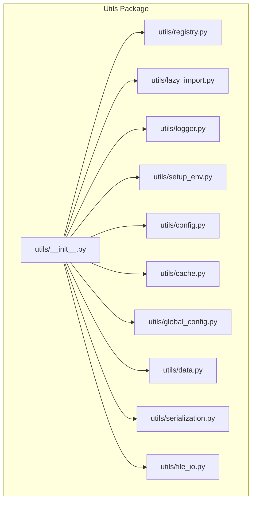

**Diagram sources**
- [__init__.py](file://adalflow/adalflow/utils/__init__.py#L1-L55)
- [registry.py](file://adalflow/adalflow/utils/registry.py#L1-L22)
- [lazy_import.py](file://adalflow/adalflow/utils/lazy_import.py#L1-L227)
- [logger.py](file://adalflow/adalflow/utils/logger.py#L1-L219)
- [setup_env.py](file://adalflow/adalflow/utils/setup_env.py#L1-L19)
- [config.py](file://adalflow/adalflow/utils/config.py#L1-L101)
- [cache.py](file://adalflow/adalflow/utils/cache.py#L1-L48)
- [global_config.py](file://adalflow/adalflow/utils/global_config.py#L1-L13)
- [data.py](file://adalflow/adalflow/utils/data.py#L1-L143)
- [serialization.py](file://adalflow/adalflow/utils/serialization.py#L1-L138)
- [file_io.py](file://adalflow/adalflow/utils/file_io.py#L1-L257)

**Section sources**
- [__init__.py](file://adalflow/adalflow/utils/__init__.py#L1-L55)

## Core Components
- Registry and configuration-driven construction:
  - EntityMapping: a simple registry for component/class/function names
  - new_component/new_components_from_config: build components from configuration dictionaries
- Lazy imports:
  - OptionalPackages: centralized optional dependency metadata
  - LazyImport: proxy that delays import until class usage
  - safe_import: robust import helper for single or multiple modules
- Logging:
  - get_logger: configurable root/named logger with console and file handlers
  - printc: colorized console prints with caller context
- Environment:
  - setup_env: load environment variables from a .env file
- Persistence and serialization:
  - save/load JSON/Pickle helpers
  - serialize/deserialize with registry-aware hooks
- Data utilities:
  - Dataset, Subset, DataLoader analogs for flexible iteration
- Caching:
  - CachedEngine: disk-backed cache keyed by hashed prompts
- Global configuration:
  - get_adalflow_default_root_path: platform-aware default root path

**Section sources**
- [registry.py](file://adalflow/adalflow/utils/registry.py#L1-L22)
- [config.py](file://adalflow/adalflow/utils/config.py#L1-L101)
- [lazy_import.py](file://adalflow/adalflow/utils/lazy_import.py#L1-L227)
- [logger.py](file://adalflow/adalflow/utils/logger.py#L1-L219)
- [setup_env.py](file://adalflow/adalflow/utils/setup_env.py#L1-L19)
- [serialization.py](file://adalflow/adalflow/utils/serialization.py#L1-L138)
- [file_io.py](file://adalflow/adalflow/utils/file_io.py#L1-L257)
- [data.py](file://adalflow/adalflow/utils/data.py#L1-L143)
- [cache.py](file://adalflow/adalflow/utils/cache.py#L1-L48)
- [global_config.py](file://adalflow/adalflow/utils/global_config.py#L1-L13)

## Architecture Overview
The utilities form a cohesive layer enabling:
- Dynamic composition of components via configuration
- Optional dependency loading without hard imports
- Consistent logging and environment setup
- Portable persistence and serialization
- Extensible caching and data iteration

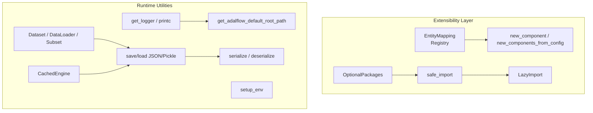

**Diagram sources**
- [registry.py](file://adalflow/adalflow/utils/registry.py#L1-L22)
- [config.py](file://adalflow/adalflow/utils/config.py#L66-L101)
- [lazy_import.py](file://adalflow/adalflow/utils/lazy_import.py#L13-L227)
- [logger.py](file://adalflow/adalflow/utils/logger.py#L100-L169)
- [setup_env.py](file://adalflow/adalflow/utils/setup_env.py#L8-L19)
- [serialization.py](file://adalflow/adalflow/utils/serialization.py#L30-L138)
- [file_io.py](file://adalflow/adalflow/utils/file_io.py#L13-L257)
- [data.py](file://adalflow/adalflow/utils/data.py#L13-L143)
- [cache.py](file://adalflow/adalflow/utils/cache.py#L19-L48)
- [global_config.py](file://adalflow/adalflow/utils/global_config.py#L5-L13)

## Detailed Component Analysis

### Registry System for Dynamic Component Registration
EntityMapping provides a simple registry keyed by string names. Components can be registered once and later retrieved by name to construct instances dynamically from configuration.

Key behaviors:
- register(name, entity_cls): stores a mapping from name to class
- get(name): returns the class or None if not found
- get_all(): returns the entire registry

Usage pattern:
- Register framework or user-defined components during import or app startup
- Use new_component/new_components_from_config to instantiate from config dictionaries

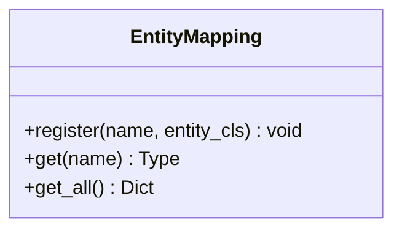

**Diagram sources**
- [registry.py](file://adalflow/adalflow/utils/registry.py#L4-L22)

**Section sources**
- [registry.py](file://adalflow/adalflow/utils/registry.py#L1-L22)
- [config.py](file://adalflow/adalflow/utils/config.py#L66-L101)

### Lazy Import Mechanisms for Optional Dependencies
Two complementary mechanisms enable optional dependencies:
- OptionalPackages: enum of optional packages with package names and friendly error messages
- LazyImport: a proxy class whose import is deferred until accessed
- safe_import: robust import helper for single or multiple modules

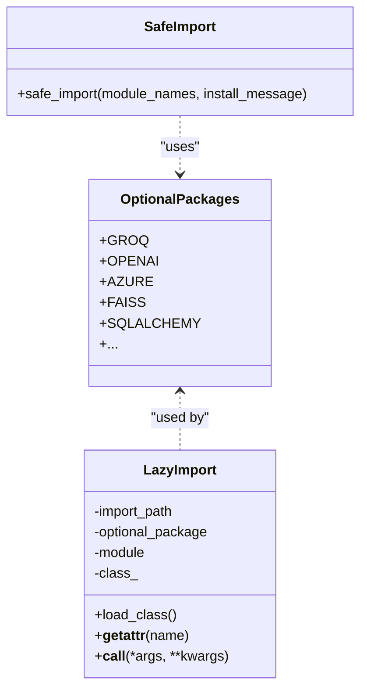

**Diagram sources**
- [lazy_import.py](file://adalflow/adalflow/utils/lazy_import.py#L13-L227)

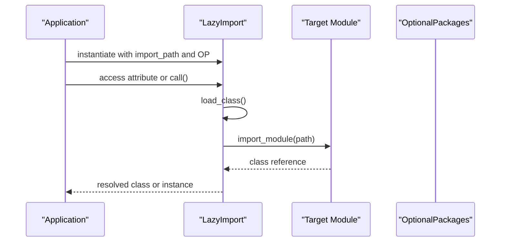

**Diagram sources**
- [lazy_import.py](file://adalflow/adalflow/utils/lazy_import.py#L145-L172)

Best practices:
- Prefer LazyImport for optional integrations to avoid cold-start overhead
- Use OptionalPackages to centralize error messaging and package names
- Use safe_import for internal optional imports with explicit install hints

**Section sources**
- [lazy_import.py](file://adalflow/adalflow/utils/lazy_import.py#L1-L227)
- [test_lazy_import.py](file://adalflow/tests/test_lazy_import.py#L1-L140)

### Logging Configuration Utilities
get_logger creates or configures a logger with:
- Console and/or file handlers
- Standardized format including timestamp, module, level, file:line:function, and message
- Platform-aware default log directory via get_adalflow_default_root_path

printc provides colorized console output with caller context and timestamp.

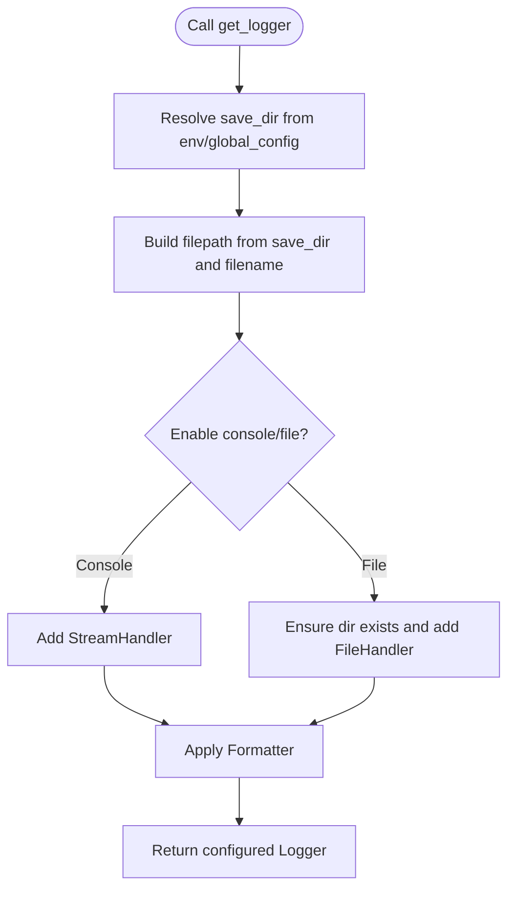

**Diagram sources**
- [logger.py](file://adalflow/adalflow/utils/logger.py#L52-L98)
- [logger.py](file://adalflow/adalflow/utils/logger.py#L100-L169)
- [global_config.py](file://adalflow/adalflow/utils/global_config.py#L5-L13)

**Section sources**
- [logger.py](file://adalflow/adalflow/utils/logger.py#L1-L219)
- [global_config.py](file://adalflow/adalflow/utils/global_config.py#L1-L13)
- [test_logger.py](file://adalflow/tests/test_logger.py#L1-L83)

### Environment Setup Helpers
setup_env loads environment variables from a .env file and validates its existence. It logs errors and propagates exceptions to surface misconfiguration early.

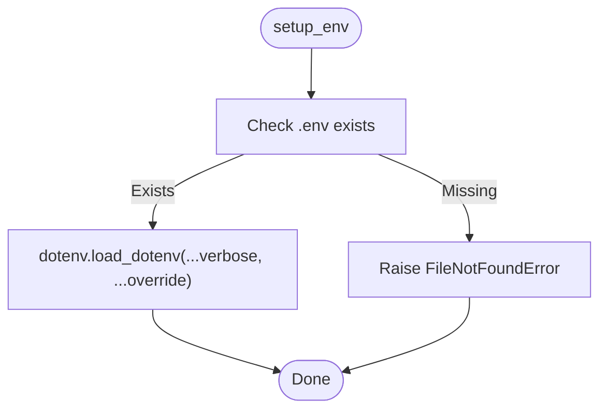

**Diagram sources**
- [setup_env.py](file://adalflow/adalflow/utils/setup_env.py#L8-L19)

**Section sources**
- [setup_env.py](file://adalflow/adalflow/utils/setup_env.py#L1-L19)

### Serialization and Persistence Utilities
Serialization supports framework-specific classes and instances via to_dict/to_dict_class hooks, with fallbacks for external objects. Deserialization leverages EntityMapping to reconstruct classes from type metadata.

File I/O helpers:
- save/save_json/save_pickle: write JSON and/or Pickle
- load/load_json/load_pickle: read JSON and/or Pickle
- load_jsonl/append_to_jsonl/write_list_to_jsonl: JSONL utilities

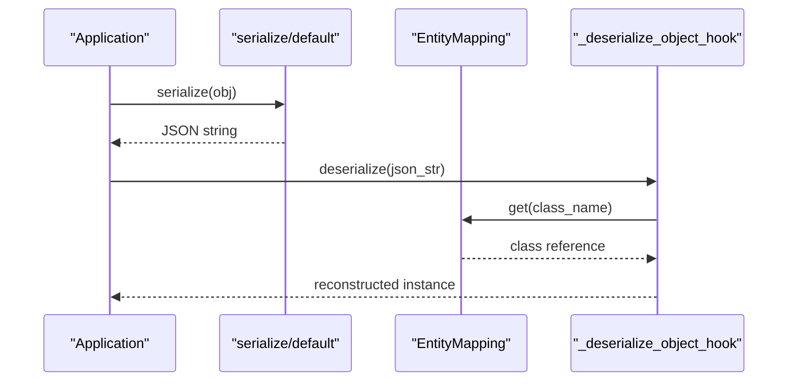

**Diagram sources**
- [serialization.py](file://adalflow/adalflow/utils/serialization.py#L30-L126)
- [registry.py](file://adalflow/adalflow/utils/registry.py#L16-L17)

**Section sources**
- [serialization.py](file://adalflow/adalflow/utils/serialization.py#L1-L138)
- [file_io.py](file://adalflow/adalflow/utils/file_io.py#L13-L257)

### Data Utilities and Iteration Patterns
Dataset, Subset, and DataLoader mirror familiar iteration semantics for flexible batching and shuffling. These are useful for building training loops and evaluation pipelines without requiring external frameworks.

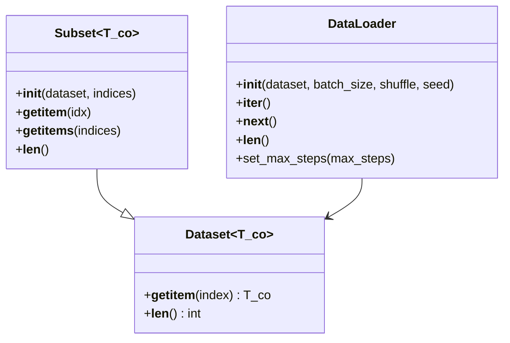

**Diagram sources**
- [data.py](file://adalflow/adalflow/utils/data.py#L13-L143)

**Section sources**
- [data.py](file://adalflow/adalflow/utils/data.py#L1-L143)

### Caching Engine
CachedEngine provides a disk-backed cache keyed by hashed prompts. It supports pickling/unpickling by excluding the cache instance from the pickle state and restoring it post-unpickle.

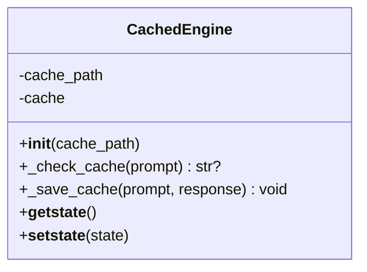

**Diagram sources**
- [cache.py](file://adalflow/adalflow/utils/cache.py#L19-L48)

**Section sources**
- [cache.py](file://adalflow/adalflow/utils/cache.py#L1-L48)

### Configuration-Driven Component Construction
new_component and new_components_from_config recursively build components from configuration dictionaries. They rely on EntityMapping to resolve class names and support nested component instantiation.

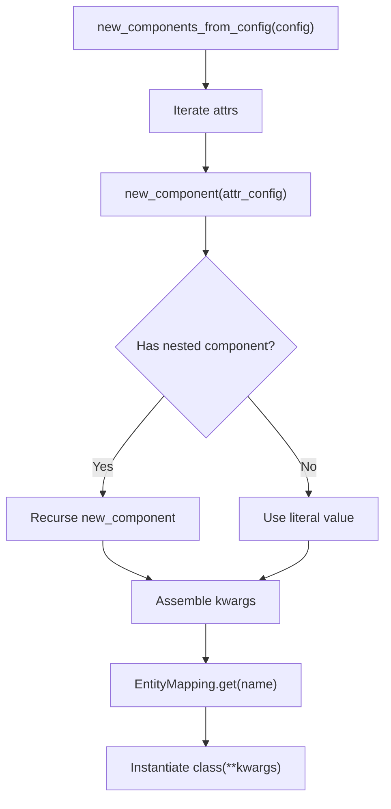

**Diagram sources**
- [config.py](file://adalflow/adalflow/utils/config.py#L95-L101)
- [config.py](file://adalflow/adalflow/utils/config.py#L66-L93)
- [registry.py](file://adalflow/adalflow/utils/registry.py#L16-L17)

**Section sources**
- [config.py](file://adalflow/adalflow/utils/config.py#L1-L101)
- [registry.py](file://adalflow/adalflow/utils/registry.py#L1-L22)

## Dependency Analysis
The utilities are intentionally decoupled and expose a small, stable public API. Internal dependencies are localized to minimize coupling.

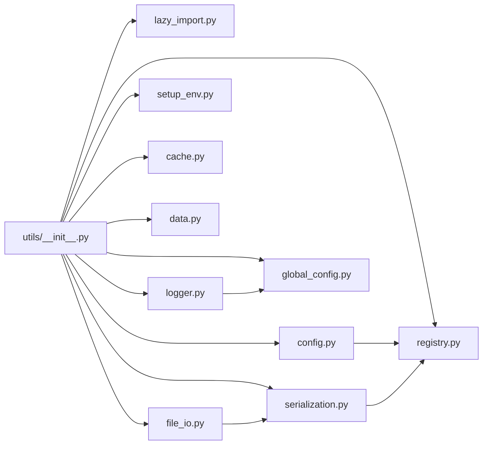

**Diagram sources**
- [__init__.py](file://adalflow/adalflow/utils/__init__.py#L1-L55)
- [config.py](file://adalflow/adalflow/utils/config.py#L63-L63)
- [serialization.py](file://adalflow/adalflow/utils/serialization.py#L8-L8)
- [logger.py](file://adalflow/adalflow/utils/logger.py#L27-L27)
- [file_io.py](file://adalflow/adalflow/utils/file_io.py#L8-L8)

**Section sources**
- [__init__.py](file://adalflow/adalflow/utils/__init__.py#L1-L55)

## Performance Considerations
- LazyImport defers import costs until usage, reducing cold-start latency for optional integrations.
- CachedEngine avoids recomputation by hashing prompts; ensure cache paths are on fast storage for I/O-bound workloads.
- DataLoader uses NumPy for shuffling and batching; tune batch_size and seed for reproducibility and throughput.
- Logging handlers are minimal; prefer file-only logging in production to reduce console overhead.
- Serialization uses JSON with hooks; keep objects lightweight and avoid large in-memory copies when possible.

## Troubleshooting Guide
Common issues and resolutions:
- Optional dependency not installed:
  - Symptom: ImportError mentioning install instructions
  - Resolution: Install per OptionalPackages message; use safe_import to guard imports
- .env file missing:
  - Symptom: FileNotFoundError raised by setup_env
  - Resolution: Create .env or adjust dotenv_path
- JSON decode errors:
  - Symptom: ValueError when loading JSON
  - Resolution: Validate JSON structure; prefer save/load helpers for consistent serialization
- Logger not emitting output:
  - Symptom: No console or file logs
  - Resolution: Ensure enable_console or enable_file is True; verify save_dir permissions

**Section sources**
- [lazy_import.py](file://adalflow/adalflow/utils/lazy_import.py#L158-L161)
- [setup_env.py](file://adalflow/adalflow/utils/setup_env.py#L11-L12)
- [file_io.py](file://adalflow/adalflow/utils/file_io.py#L136-L139)
- [logger.py](file://adalflow/adalflow/utils/logger.py#L161-L168)
- [test_lazy_import.py](file://adalflow/tests/test_lazy_import.py#L19-L30)
- [test_logger.py](file://adalflow/tests/test_logger.py#L54-L61)

## Conclusion
AdalFlow’s utilities provide a robust foundation for extensibility and developer productivity:
- Registry and configuration enable dynamic, declarative composition
- Lazy imports and optional packages keep startup lean and user-friendly
- Logging and environment helpers streamline diagnostics and deployment
- Serialization and persistence utilities support reproducible workflows
- Data and caching utilities accelerate iteration and reduce boilerplate

## Appendices

### Best Practices for Maintaining Clean Utility Code
- Keep public APIs minimal and stable; export via utils/__init__.py
- Centralize optional dependency metadata in OptionalPackages
- Use LazyImport for optional integrations; avoid eager imports in hot paths
- Encapsulate logging configuration behind get_logger to enforce consistency
- Prefer save/load helpers for persistence to maintain serialization compatibility
- Keep caches keyed by deterministic hashes; document cache invalidation policies
- Write unit tests for critical flows (lazy imports, logging handlers, file I/O)

### Example Workflows

- Registering custom components:
  - Register a custom class with a stable name in the registry
  - Build pipelines from configuration using new_components_from_config
  - Reference the registered name in component_name fields

- Implementing lazy loading strategies:
  - Wrap optional integrations with LazyImport and OptionalPackages
  - Use safe_import for internal optional modules with clear error messages

- Extending framework capabilities:
  - Add new serializers in serialization.py with appropriate hooks
  - Introduce new cache backends by extending CachedEngine patterns
  - Provide new dataset types by subclassing Dataset and composing with DataLoader